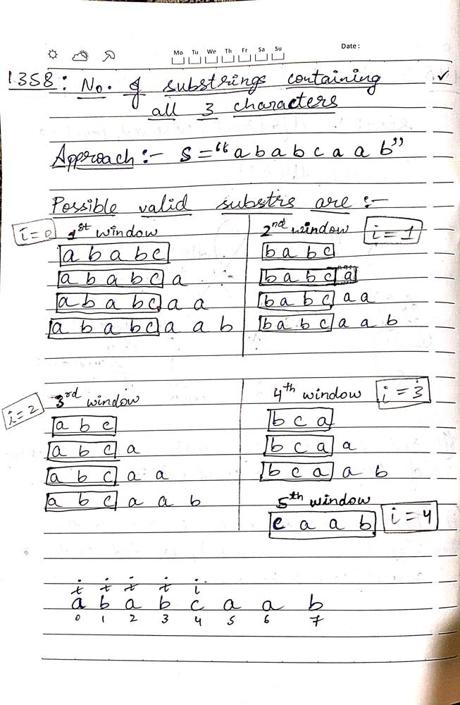
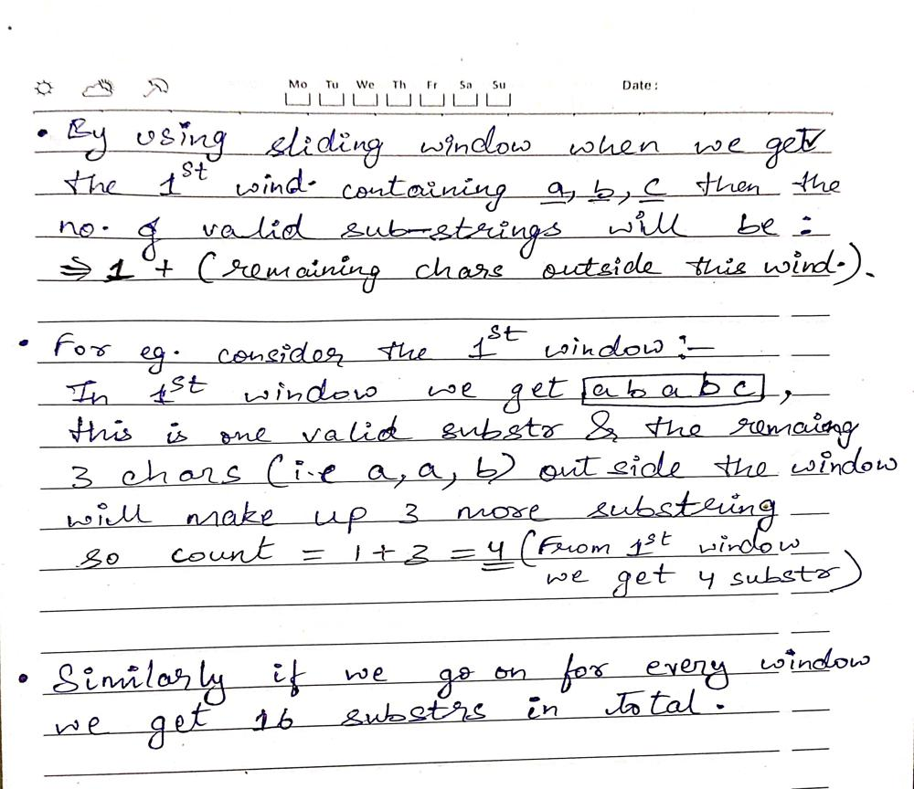

# ✅Explained w/ Images🏆Made Easy🔥C++

**Author:** Manohar_001
**Votes:** 381
**Link:** [https://leetcode.com/problems/number-of-substrings-containing-all-three-characters/solutions/3459766/](https://leetcode.com/problems/number-of-substrings-containing-all-three-characters/solutions/3459766/)

---

# \uD83D\uDE09Don't just watch & move away, also give an Upvote.\uD83D\uDE09

###### I've used acronym ***wind.*** for ***window***.
###### And acronym ***substr.*** for ***substring***.






# Complexity
- Time complexity: $$O(n)$$
<!-- Add your time complexity here, e.g. $$O(n)$$ -->

- Space complexity: $$O(27)$$ `for hash`
<!-- Add your space complexity here, e.g. $$O(n)$$ -->
# \uD83D\uDE09Please upvote it motivates me\uD83D\uDE09
# Code
```
class Solution {
public:
    int numberOfSubstrings(string s) {
        int n = size(s);

        int i=0,j=0,count=0;

        unordered_map<char, int> mp;

        while(j<n)
        {
            mp[s[j]]++;

            while(mp['a']>=1 && mp['b']>=1 && mp['c']>=1)
            {
                count += (n - j);

                //shrinking the window
                mp[s[i]]--;
                i++;
            }
            j++;
        }


<!-- \u2705Well before returning "count" don't forget to UPVOTE.\u2705 -->
        return count;
    }
};
```
### If there's any doubt please feel free to comment.

