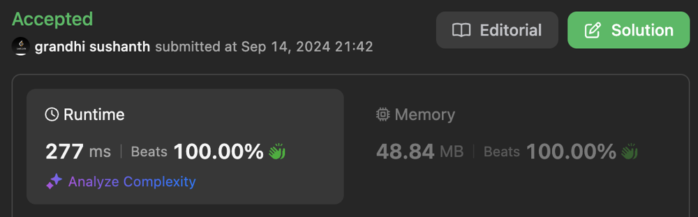

# Detailed Explanation || Clear code with comments || Beats 100% time and space

**Author:** sushanth_grandhi
**Votes:** 3
**Link:** [https://leetcode.com/problems/find-the-longest-substring-containing-vowels-in-even-counts/solutions/5788137/](https://leetcode.com/problems/find-the-longest-substring-containing-vowels-in-even-counts/solutions/5788137/)

---




# Intuition

- **Bruteforce Approach:**
  - We will iterate through all the possible substrings, counting vowels.
  - But, this will result in a TLE.
- Optimized approach:
  - The problem says that we need to find the longest substring which contains even number of each and every vowel.
  - Hence, each and every vowel should be in counts of 0, 2, 4, ....
  - One point to note here is that we only care if the vowel occurrences is odd or even, we don't care about its count.
  - And we don't care about the consonants as well => represented as 0.
  - We can represent whether the counts of these 5 vowels are even or odd, using 5 bits.
  - If the count for each vowel (count mod 2) is even we can represent it as 0, else 1.
  - So we iterate through the string and toggle the respective bit when ever a vowel is found.
  - Since we have 5 bits => range: [0, 32)
  - Now, how we can find whether the count of vowels is even or odd using these 5 bits?
    - If the value of this 5 bit integer is same at 2 points of a string, it means that all vowels between these 2 points has occurred even number of times.

# Approach:

1. We create a vowel hashmap by assigning a bitmask to each vowel (a - 1, e - 2, i - 4, o - 8, u - 16).
2. We start with state (5 bit integer) value of 0.
3. Since the range of this state will be from 0 to 31, we can have an array of size 32 to keep track index where specific state value occurs.
4. We iterate through the string updating the state for each vowel, using vowel hashmap value.
5. At every iteration we update if the array[state value] is -1.
6. We also update the length of longest substring, based on state value.

## Time Complexity:

1. We iterate through the string once, and all other operations are constant time.
2. Total time: `O(n)`

## Space Complexity:

1. We use space for vowel hashmap => O(5)
2. We use space for array => O(32)
3. Since, both are constant.
4. Total Space = O(5) + O(32) ~ `O(1)`


# Code
```kotlin []
class Solution {
    fun findTheLongestSubstring(s: String): Int {
        // assigning bitmask to each vowel
        val vowelMap = hashMapOf<Char, Int> (
            'a' to (1 shl 0), 
            'e' to (1 shl 1), 
            'i' to (1 shl 2), 
            'o' to (1 shl 3), 
            'u' to (1 shl 4)
        )

        // variable to handle 5 bit vowel count encoding
        var state = 0 //00000
        // binary to int conversion of the range
        val range = IntArray(32) {-1}
        var longestSubStr = 0

        // iterate through string
        for (i in s.indices) {
            // if the character is vowel
            if (vowelMap.contains(s[i])) {
                // toggle the corresponding bit of vowel in the state
                state = state xor vowelMap[s[i]]!!

                // update the index in the range array at which state value is seen for the first time
                // One exception is if the state value is 0, then the substring is considered from start till this index
                // Since empty string has state value of 0
                if (range[state] == -1 && state != 0) {
                    range[state] = i
                }
            }

            // Update longest sub string length variable
            longestSubStr = max(longestSubStr, i - range[state])
        }

        return longestSubStr
    }
}
```
```python3 []
class Solution:
    def findTheLongestSubstring(self, s: str) -> int:
        # Assigning bitmask to each vowel
        vowel_map = {'a': 1 << 0, 'e': 1 << 1, 'i': 1 << 2, 'o': 1 << 3, 'u': 1 << 4}

        # Variable to handle 5-bit vowel count encoding
        state = 0  # 00000
        # Binary to int conversion of the range
        range_array = [-1] * 32  # Initialize an array of size 32 with -1
        longest_substr = 0

        for i in range(len(s)):
            # If the character is a vowel
            if s[i] in vowel_map:
                # Toggle the corresponding bit of vowel in the state
                state ^= vowel_map[s[i]]

            # Update the index in the range array at which state value is seen for the first time
            # One exception is if the state value is 0
            if range_array[state] == -1 and state != 0:
                range_array[state] = i

            # Update longest substring length variable
            longest_substr = max(longest_substr, i - range_array[state])

        return longest_substr

        
```

Thanks for reading.

Please Upvote :)
Leave suggestions in comments.