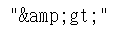
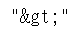

# Python sol by replace and regex. 85%+ [w/ Hint ]

**Author:** brianchiang_tw
**Votes:** 14
**Link:** [https://leetcode.com/problems/html-entity-parser/solutions/575248/](https://leetcode.com/problems/html-entity-parser/solutions/575248/)

---

Python sol by replacement.

---

**Hint**:

Remeber to put the & replacement on the last one, in order to avoid chain reaction replacement.

For example: 
should be , instead of ">"

---

**Implementation** by string replacement:

```
class Solution:
    def entityParser(self, text: str) -> str:
        
        html_symbol = [ '&quot;', '&apos;', '&gt;', '&lt;', '&frasl;', '&amp;']
        formal_symbol = [ '"', "'", '>', '<', '/', '&']
                
        for html_sym, formal_sym in zip(html_symbol, formal_symbol):
            text = text.replace( html_sym , formal_sym )
        
        return text
        
```

---

**Implementation** by regular expression:

```
import re
class Solution:
    def entityParser(self, text: str) -> str:
        
        html_symbol = [ '&quot;', '&apos;', '&gt;', '&lt;', '&frasl;', '&amp;']
        formal_symbol = [ '"', "'", '>', '<', '/', '&']
                
        for html_sym, formal_sym in zip(html_symbol, formal_symbol):
            text = re.sub( html_sym , formal_sym, text )
        
        return text
```

---


Reference:

[1] [Python official docs about str.replace( ... )](https://docs.python.org/3/library/stdtypes.html#str.replace)

[2] [Python official docs about re.sub( ... )](https://docs.python.org/3/library/re.html#re.sub)

---

Related leetcode challenge:

[Leetcode #1108 Defanging an IP Address](https://leetcode.com/problems/defanging-an-ip-address/)