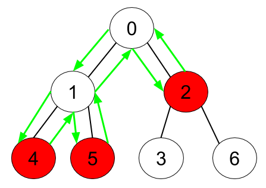
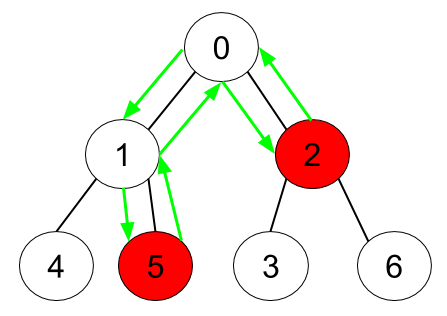

# [1443. Minimum Time to Collect All Apples in a Tree](https://leetcode.com/problems/minimum-time-to-collect-all-apples-in-a-tree/)

| Category | Difficulty | Likes | Dislikes |
| :------: | :--------: | :---: | :------: |
| Algorithms | Medium | 3822 | 333 |

**Tags:** [`hash-table`](https://leetcode.com/tag/hash-table), [`tree`](https://leetcode.com/tag/tree), [`depth-first-search`](https://leetcode.com/tag/depth-first-search), [`breadth-first-search`](https://leetcode.com/tag/breadth-first-search)

**Companies:** `cisco`, `facebook`, `microsoft`, `google`, `myntra`, `amazon`

## Description

Given an undirected tree consisting of `n` vertices numbered from `0` to `n-1`, which has some apples in their vertices. You spend 1 second to walk over one edge of the tree. *Return the minimum time in seconds you have to spend to collect all apples in the tree, starting at **vertex 0** and coming back to this vertex.*

The edges of the undirected tree are given in the array `edges`, where `edges[i] = [a_i, b_i]` means that exists an edge connecting the vertices `a_i` and `b_i`. Additionally, there is a boolean array `hasApple`, where `hasApple[i] = true` means that vertex `i` has an apple; otherwise, it does not have any apple.

 

**Example 1:**


```

Input: n = 7, edges = [[0,1],[0,2],[1,4],[1,5],[2,3],[2,6]], hasApple = [false,false,true,false,true,true,false]
Output: 8 
Explanation: The figure above represents the given tree where red vertices have an apple. One optimal path to collect all apples is shown by the green arrows.  

```

**Example 2:**


```

Input: n = 7, edges = [[0,1],[0,2],[1,4],[1,5],[2,3],[2,6]], hasApple = [false,false,true,false,false,true,false]
Output: 6
Explanation: The figure above represents the given tree where red vertices have an apple. One optimal path to collect all apples is shown by the green arrows.  

```

**Example 3:**

```

Input: n = 7, edges = [[0,1],[0,2],[1,4],[1,5],[2,3],[2,6]], hasApple = [false,false,false,false,false,false,false]
Output: 0

```

 

**Constraints:**

	- `1 <= n <= 10^5`

	- `edges.length == n - 1`

	- `edges[i].length == 2`

	- `0 <= a_i < b_i <= n - 1`

	- `hasApple.length == n`

---

**Links:** [Submissions](https://leetcode.com/problems/minimum-time-to-collect-all-apples-in-a-tree/) | [Solutions](https://leetcode.com/problems/minimum-time-to-collect-all-apples-in-a-tree/)
