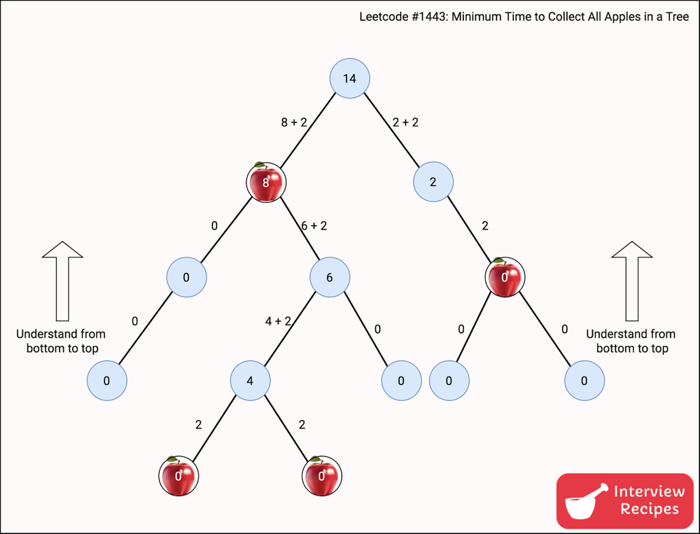

# Concise explanation with a Picture for Visualization

**Author:** interviewrecipes
**Votes:** 453
**Link:** [https://leetcode.com/problems/minimum-time-to-collect-all-apples-in-a-tree/solutions/623673/](https://leetcode.com/problems/minimum-time-to-collect-all-apples-in-a-tree/solutions/623673/)

---


**Key idea**
Whenever you are at a node, say p, you will collect all apples in p\u2019s subtree before returning back to the original root. This will avoid traveling the same path multiple times. 
Say, root is where we start, p is a node in the tree and p has two children - child1, child2 - and both of them have an apple each.
`root -> p -> child1 -> p -> child2 -> p -> root `is always going to be better than
`root-> p -> child1 -> p -> root -> p -> child2 -> p -> root`.

So now it becomes a simple graph traversal problem, particularly DFS where we visit all children of the node first and then go back the other nodes.

**Algorithm**
1. Because you have the list of edges, construct the graph first to have a better representation of the graph.
2. For each node, check if any of its children have apples and find the total cost in terms of time in seconds of collecting those.
3. If there is at least one child with an apple, then we have to collect it. So we will also have to add the cost (time required) of reaching that node.
4. return the total time.

Following image should help in understanding better.

**Please upvote** if you find this helpful, it would be encouraging! 

Let me know if something is unclear and I will fix it. :)
Thanks.





**[EDIT]**
It looks like some cases were failing because I assumed I won't need the bidirectional graph. As correctly pointed out by @hiepit, I was wrong. Fixed the code. :)

**C++**
```
class Solution {
public:
    unordered_map<int, vector<int>> g; // to store the graph
    unordered_map<int, bool> visited; // to stop exploring same nodes again and again.
	
    void createGraph(vector<vector<int>>& edges) {
      for (auto e: edges) {
        g[e[0]].push_back(e[1]); // adjecency list representation
		g[e[1]].push_back(e[0]); // adjecency list representation
      }
    }
  
    int dfs(int node, int myCost, vector<bool>& hasApple) {
	  if (visited[node]) {
		  return 0;
	  }
	  visited[node] = true;
	  
      int childrenCost = 0; // cost of traversing all children. 
      for (auto x: g[node]) { 
        childrenCost += dfs(x, 2, hasApple);  // check recursively for all apples.
      }

      if (childrenCost == 0 && hasApple[node] == false) {
	  // If no child has apples, then we won't traverse the subtree, so cost will be zero.
	  // similarly, if current node also does not have the apple, we won't traverse this branch at all, so cost will be zero.
        return 0;
      }
	  
	  // Children has at least one apple or the current node has an apple, so add those costs.
      return (childrenCost + myCost);
    }
  
    int minTime(int n, vector<vector<int>>& edges, vector<bool>& hasApple) {
      createGraph(edges); // construct the graph first.
      return dfs(0, 0, hasApple); // cost of reaching the root is 0. For all others, its 2.
    }
};

```

**Java**
```
class Solution {
    public int minTime(int n, int[][] edges, List<Boolean> hasApple) {
        
        Map<Integer, List<Integer>> graph = createGraph(edges); // to store the graph
        Map<Integer, Boolean> visited = new HashMap<>();
		
        return dfs(graph, 0, hasApple, 0, visited); // cost of reaching the root is 0. For all others, its 2.
      
    }
    
    private int dfs(Map<Integer, List<Integer>> graph, int node, List<Boolean> hasApple, int myCost, Map<Integer, Boolean> visited) {
        Boolean v = visited.getOrDefault(node, false);
		if (v) {
			return 0;
		}
		visited.put(node, true);
		
        int childrenCost = 0; // cost of traversing all children. 
      
        for(int n : graph.getOrDefault(node, new ArrayList<>())) {
            childrenCost += dfs(graph, n, hasApple, 2, visited); // check recursively for all apples in subtrees.
        }
      
        if (childrenCost == 0 && hasApple.get(node) == false) {
          // If no child has apples, then we won't traverse the subtree, so cost will be zero.
          // similarly, if current node also does not have the apple, we won't traverse this branch at all, so cost will be zero.
          return 0;
        }
      
        return childrenCost + myCost;
    }
    
    private Map<Integer, List<Integer>> createGraph(int[][] edges) {
        Map<Integer, List<Integer>> graph = new HashMap<>();
      
        for(int i = 0; i < edges.length; i++) {
            List<Integer> list = graph.getOrDefault(edges[i][0], new ArrayList<>()); // Adjecency list representation.
            list.add(edges[i][1]);
            graph.put(edges[i][0], list);
			
			list = graph.getOrDefault(edges[i][1], new ArrayList<>()); // Adjecency list representation.
            list.add(edges[i][0]);
            graph.put(edges[i][1], list);
        }
      
        return graph;
    }
}
```

**Python 3** (Thanks to @venetor for this Python 3 solution.)
```
def minTime(self, n: int, edges: List[List[int]], hasApple: List[bool]) -> int:
    adj = [[] for _ in range(n)]
    for u, v in edges:
        adj[u].append(v)
        adj[v].append(u)

    visited = set()
    def dfs(node):
        if node in visited:
            return 0
        visited.add(node)
        secs = 0
        for child in adj[node]:
            secs += dfs(child)
        if secs > 0:
            return secs + 2
        return 2 if hasApple[node] else 0

    return max(dfs(0) - 2, 0)
```
