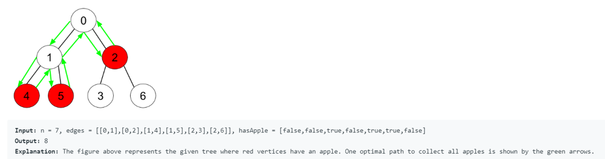

# Python O(n) by DFS [w/ Visualization]

**Author:** brianchiang_tw
**Votes:** 9
**Link:** [https://leetcode.com/problems/minimum-time-to-collect-all-apples-in-a-tree/solutions/772044/](https://leetcode.com/problems/minimum-time-to-collect-all-apples-in-a-tree/solutions/772044/)

---

Python O(n) by DFS

---

**Visualization**:


---

**Implementation** by DFS

```
from collections import defaultdict

class Solution:
    def minTime(self, n: int, edges: List[List[int]], hasApple: List[bool]) -> int:
        
        adjacency_list = defaultdict(list)
        
        # Build adjacency list to represent the tree
        for src_node, dst_node in edges:
            adjacency_list[src_node].append(dst_node)
            adjacency_list[dst_node].append(src_node)
        
        # Record of visited nodes
        visited = set()
        
        #------------------------------------------------------------------------------------
        def collect_in_dfs(cur_node):
            
            visited.add(cur_node)
            
            cost_of_collect = 0
            
            for child_node in adjacency_list[cur_node]:
                
                if child_node in visited:
                    # avoid repeated traversal
                    continue
                
                
                cost_from_child = collect_in_dfs(child_node)
                
                if cost_from_child or hasApple[child_node]:
                    # update cost of collection (i.e., cost of green arrows)
                    # The first +1 is for path from cur_node to child_node, and the second +1 is for going back.
					# Totally, +2

                    cost_of_collect += cost_from_child + 2
            
            return cost_of_collect
        
        #------------------------------------------------------------------------------------
        root_node_idx = 0
        return collect_in_dfs(cur_node=root_node_idx)
        
        
```

---

Reference:

[1] [USFCA: DFS visualization and demo animation](https://www.cs.usfca.edu/~galles/visualization/DFS.html)

[2] [Python official docs about defaultdict](https://docs.python.org/3/library/collections.html#collections.defaultdict)