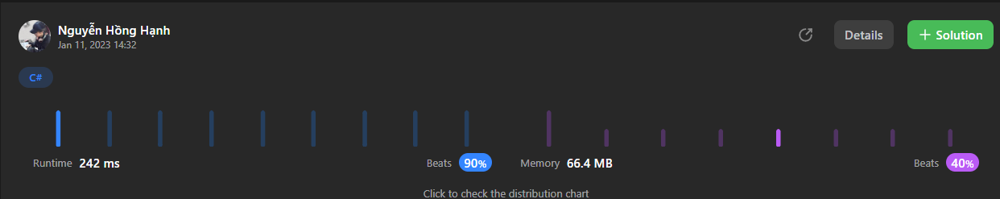

# My TS/C# solution, but Leetcode got error with TS, can someone help me to take a look?

**Author:** HanhNguyenHong1802
**Votes:** 2
**Link:** [https://leetcode.com/problems/minimum-time-to-collect-all-apples-in-a-tree/solutions/3034369/](https://leetcode.com/problems/minimum-time-to-collect-all-apples-in-a-tree/solutions/3034369/)

---

# Intuition
<!-- Describe your first thoughts on how to solve this problem. -->
Simple DFS to reach the apple branch and add by 2 (2 way direction), but Leetcode got error with TS, so I can't run this code, even only return constant. Because of that issue, I changed to C# without change any logic and beat 90% time complexity 


# Code
```C# []
public class Solution {
    private int DFS(int curr, Dictionary<int, List<int>> g, IList<bool> hasApple, IList<bool> visited) {
        int sum = 0;
        visited[curr] = true;
        var path = g[curr];
        foreach(var item in path) {
            if(!visited[item]) {
                int n = DFS(item, g, hasApple, visited);
                if(n>=0) sum+=n+2;
            }
        }
        if(hasApple[curr] || sum>0)
            return sum;
        return -1;
    }
    public int MinTime(int n, int[][] edges, IList<bool> hasApple) {
        int ans = 0;
        var g = new Dictionary<int, List<int>>();
        bool[] visited = Enumerable.Repeat(false, n).ToArray();
        foreach(var item in edges) {
            if(g.ContainsKey(item[0]))
                g[item[0]].Add(item[1]);
            else
                g.Add(item[0], new List<int>{item[1]});

            if(g.ContainsKey(item[1]))
                g[item[1]].Add(item[0]);
            else
                g.Add(item[1], new List<int>{item[0]});
        }
        ans = DFS(0, g, hasApple, visited);
        if(ans == -1)
            return 0;
        return ans;
    }
}
```
```TypeScript []
function dfs(curr: number, g: number[][], hasApple: boolean[], visited: boolean[]): number {
    let sum:number = 0;
    visited[curr] = true;
    let path:number[] = g[curr];
    path.forEach((_, index) => {
        if(!visited[path[index]]) {
            let n = dfs(path[index], g, hasApple, visited);
            if(n>=0) {
                sum+=n+2;
            }
        }
    })
    if(hasApple[curr] || sum > 0 ) 
        return sum;
    return -1;
}
function minTime(n: number, edges: number[][], hasApple: boolean[]): number {
    let ans:number = 0;
    let g: number[][] =[];
    let visited: boolean[] = Array(n).fill(false);
    edges.forEach((_, index)=>{
        let u:number = edges[index][0];
        let v:number = edges[index][1];
        g[u].push(v);
        g[v].push(u);
    })
    ans = dfs(0, g, hasApple, visited);
    if (ans == -1)
        return 0;
    return ans;
};
```

