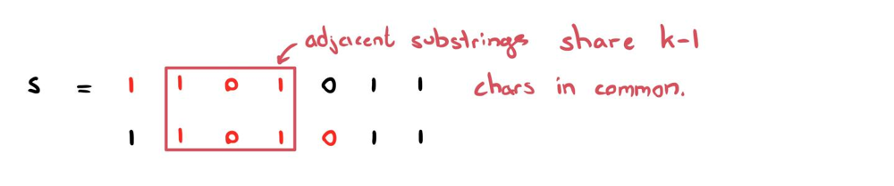

# Explaining the Rolling Hash Method | Guide

**Author:** ciote
**Votes:** 67
**Link:** [https://leetcode.com/problems/check-if-a-string-contains-all-binary-codes-of-size-k/solutions/2092553/](https://leetcode.com/problems/check-if-a-string-contains-all-binary-codes-of-size-k/solutions/2092553/)

---

### Intuition:
This is a neat question in that there exists solutions that optimise for either time complexity or space complexity. However, it isn't necessarily obvious how one might approach this question and come up with these solutions. Hopefully, I'll provide and answer to this query in this guide!

**Approach 1: HashSet**
First, let's make sure we're on the same page regarding the simpler approach. This approach involves adding all susbtrings of length `k` to a hashset and checking if the set has `2^k` elements (if you're confident with this, feel free to skip to approach 2).

_Why does this work?_
When you start thinking about an approach to the question, you may first think of generating all possible binary values of length `k`, putting them in a set and checking the input string if it's missing any of these values. After drawing out a couple short examples, you may then realise that there's exactly `2^k` values. Awesome! The next thing to realise is that we can just add all substrings of our input string into a hashset. If the set's size is equal to `2^k`, we have all possible values.

**Approach 2: Rolling Hash**
The main inefficiency with our previous approach is that at each iteration, we're creating a substring of length `k` which takes `O(k)` time. However, as you're about to realise, there's no need to do this! The main thing to notice here is that each substring is quite simply the previous substring but shifted to the right by 1. Therefore, we can just use the previous substring to create our current one. This can save heaps of time especially for larger `k` values where we still have a lot of the same characters in the middle.

Observe this in the example before for `s = "1101011", k = 4`.


> In an interview, we can come to this observation by thinking about inefficiencies in our code and how we can improve them. 

### How do we Implement This?
It may not be obvious how we can replicate the above behaviour in code. Let's think about this a step at a time. What do we actually need from the previous substring? Well, we need the 3 least significant bits (LSBs). One thing we can do is shift our previous substring by 1 to the left. 
* If our previous substring is `1101`, we now have `11010`.

Great. Now we have the 3/4 of the bits for the substring we're building in the right place (i.e. the `101` in the middle). We just have two more things to do; remove the most significant bit since we don't need it anymore, and set the LSB correctly.
* To remove the MSB, we can just perform `11010 & 1111 = 1010`. That is, we perform a bitwise AND with a `k` digit number of all ones to extract out the `k` LSBs. 
* To set the LSB, we can just perform `1010 | s.charAt(i) = 1010`. That is, we perform a bitwise OR with the new LSB which is the bit we're currently at in our for loop (in this case, our current bit is still 0).

There we go! Now that we have a rolling hash, we can code this up.
To make our lives easier, let's store our substrings as integers so we can actually utilise bit manipulation.

### Couple clarifications about the code:
* `total = 1 << k` : 1 shifted to the left k times is equal to `2^k`.
* `allOnes = total - 1`: A power of 2 substracted by 1 gives the previous value which is a number filled with 1s of length `k`. Try this out for some values.
* `if (i >= k-1 && codes.add(hashCode) && codes.size() == total)`:
	* Return true only if our substring is of length k, and;
	* if the current hashCode doesn't exist in our set yet, and;
	* if our set size has all `2^k` elements.
___
### Code:
If you have any questions, suggestions or improvements, feel free to let me know! Thanks for reading.
> Approach 1: HashSet
> Time complexity: `O(nk)` where `n` is the length of the string and `k` is the size of each substring.
> Space complexity: `O(nk)`
```java
class Solution {
    public boolean hasAllCodes(String s, int k) {
        Set<String> codes = new HashSet<>();
        int total = 1 << k;
        
        for (int i=0; i+k<=s.length(); i++) {
            codes.add(s.substring(i, i+k));
            if (codes.size() == total) return true;
        }
        
        return false;
    }
}
```
> Approach 2: Rolling Hash
> Time complexity: `O(n)`
> Space complexity: `O(2^k)` since we're storing 2^k values. 
```java
class Solution {
    public boolean hasAllCodes(String s, int k) {
        Set<Integer> codes = new HashSet<>();
        int total = 1 << k, allOnes = total - 1, hashCode = 0;
        
        for (int i=0; i<s.length(); i++) {
            hashCode = ((hashCode << 1) & allOnes) | (s.charAt(i) - '0');
            if (i >= k-1 && codes.add(hashCode) && codes.size() == total) return true;
        }
        
        return false;
    }
}
```