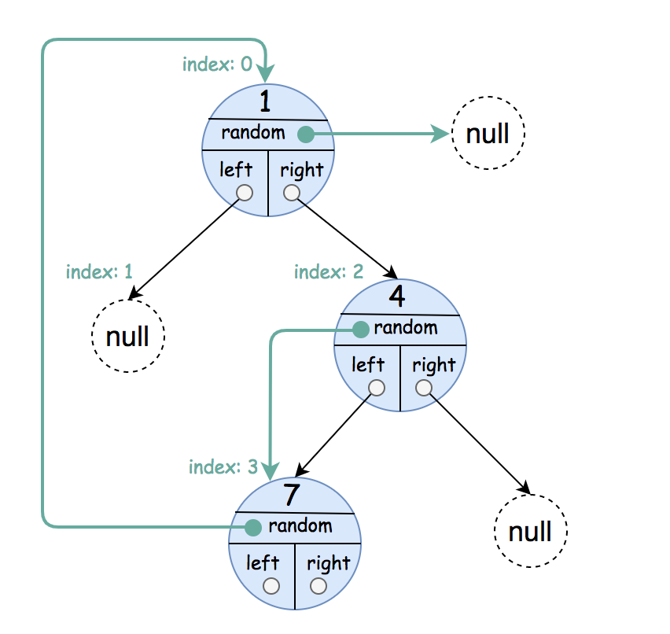
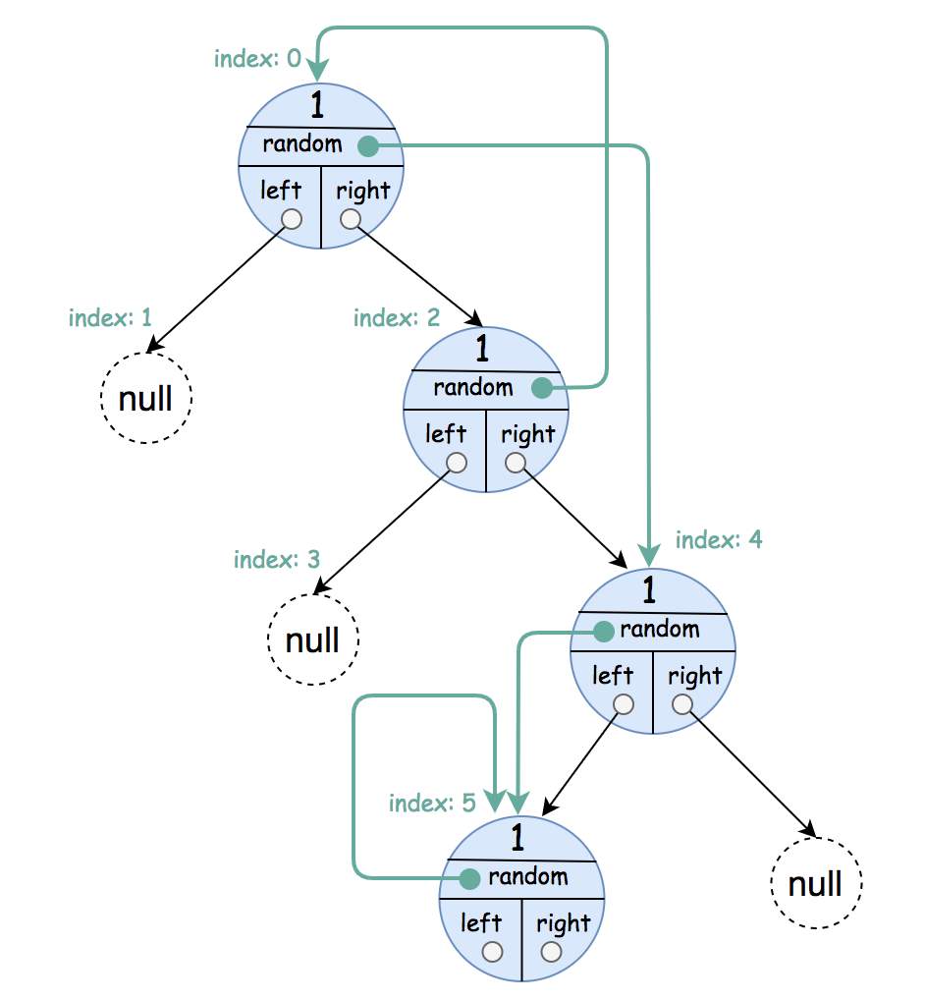
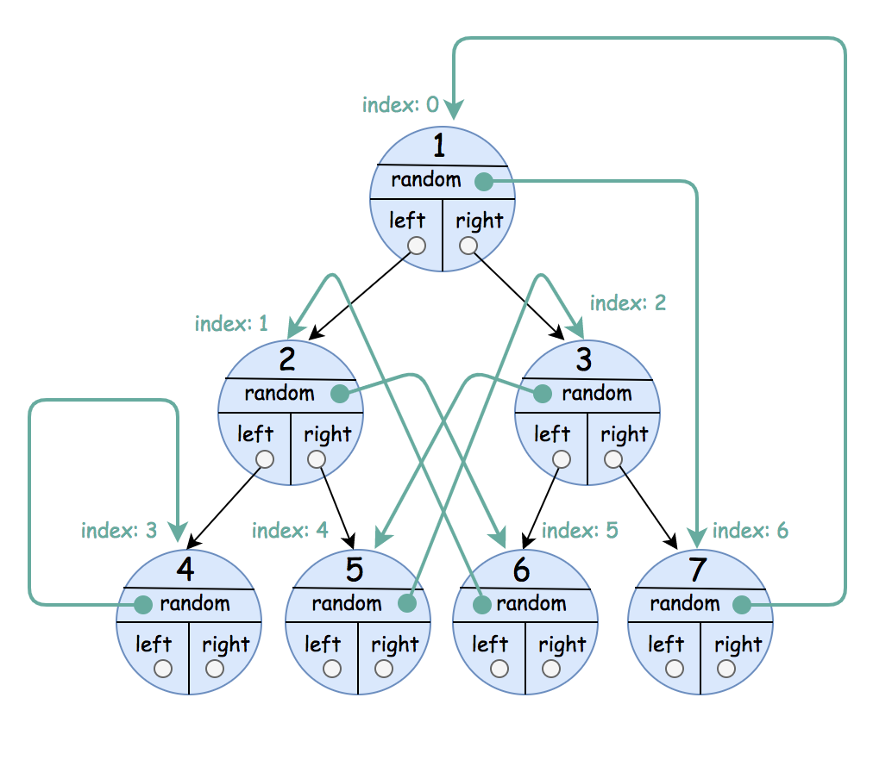

# [1485. Clone Binary Tree With Random Pointer](https://leetcode.com/problems/clone-binary-tree-with-random-pointer/)

| Category | Difficulty | Likes | Dislikes |
| :------: | :--------: | :---: | :------: |
| Algorithms | Medium | 432 | 93 |

**Tags:** [`hash-table`](https://leetcode.com/tag/hash-table), [`tree`](https://leetcode.com/tag/tree), [`depth-first-search`](https://leetcode.com/tag/depth-first-search), [`breadth-first-search`](https://leetcode.com/tag/breadth-first-search), [`binary-tree`](https://leetcode.com/tag/binary-tree)

**Companies:** `amazon`

## Description

A binary tree is given such that each node contains an additional random pointer which could point to any node in the tree or null.

Return a **deep copy** of the tree.

The tree is represented in the same input/output way as normal binary trees where each node is represented as a pair of `[val, random_index]` where:

	- `val`: an integer representing `Node.val`

	- `random_index`: the index of the node (in the input) where the random pointer points to, or `null` if it does not point to any node.

You will be given the tree in class `Node` and you should return the cloned tree in class `NodeCopy`. `NodeCopy` class is just a clone of `Node` class with the same attributes and constructors.

 

**Example 1:**


```

Input: root = [[1,null],null,[4,3],[7,0]]
Output: [[1,null],null,[4,3],[7,0]]
Explanation: The original binary tree is [1,null,4,7].
The random pointer of node one is null, so it is represented as [1, null].
The random pointer of node 4 is node 7, so it is represented as [4, 3] where 3 is the index of node 7 in the array representing the tree.
The random pointer of node 7 is node 1, so it is represented as [7, 0] where 0 is the index of node 1 in the array representing the tree.

```

**Example 2:**


```

Input: root = [[1,4],null,[1,0],null,[1,5],[1,5]]
Output: [[1,4],null,[1,0],null,[1,5],[1,5]]
Explanation: The random pointer of a node can be the node itself.

```

**Example 3:**


```

Input: root = [[1,6],[2,5],[3,4],[4,3],[5,2],[6,1],[7,0]]
Output: [[1,6],[2,5],[3,4],[4,3],[5,2],[6,1],[7,0]]

```

 

**Constraints:**

	- The number of nodes in the `tree` is in the range `[0, 1000].`

	- `1 <= Node.val <= 10^6`

---

**Links:** [Submissions](https://leetcode.com/problems/clone-binary-tree-with-random-pointer/) | [Solutions](https://leetcode.com/problems/clone-binary-tree-with-random-pointer/)
