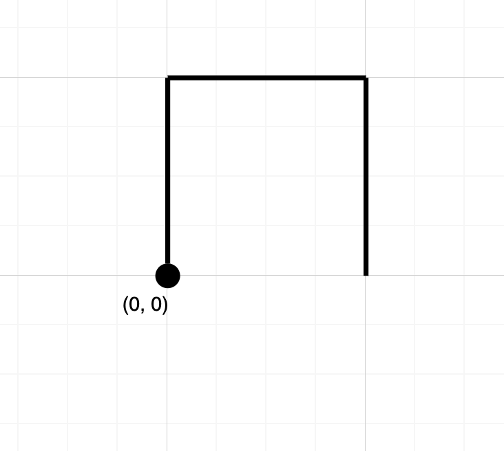
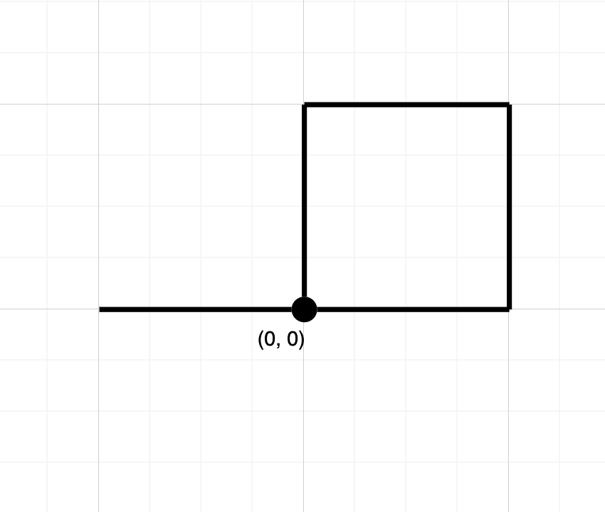

# [1496. Path Crossing](https://leetcode.com/problems/path-crossing/)

| Category | Difficulty | Likes | Dislikes |
| :------: | :--------: | :---: | :------: |
| Algorithms | Easy | 1545 | 49 |

**Tags:** [`hash-table`](https://leetcode.com/tag/hash-table), [`string`](https://leetcode.com/tag/string)

**Companies:** `amazon`, `google`

## Description

Given a string `path`, where `path[i] = 'N'`, `'S'`, `'E'` or `'W'`, each representing moving one unit north, south, east, or west, respectively. You start at the origin `(0, 0)` on a 2D plane and walk on the path specified by `path`.

Return `true` *if the path crosses itself at any point, that is, if at any time you are on a location you have previously visited*. Return `false` otherwise.

 

**Example 1:**


```

Input: path = &quot;NES&quot;
Output: false 
Explanation: Notice that the path doesn&#39;t cross any point more than once.

```

**Example 2:**


```

Input: path = &quot;NESWW&quot;
Output: true
Explanation: Notice that the path visits the origin twice.
```

 

**Constraints:**

	- `1 <= path.length <= 10^4`

	- `path[i]` is either `'N'`, `'S'`, `'E'`, or `'W'`.

---

**Links:** [Submissions](https://leetcode.com/problems/path-crossing/) | [Solutions](https://leetcode.com/problems/path-crossing/)
