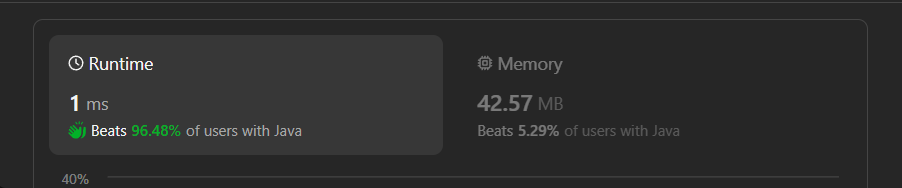

# ✅Beats 100% - Explained with [ Video ] - C++/Java/Python/JS  - Map Single Pass - Visualized

**Author:** lancertech6
**Votes:** 95
**Link:** [https://leetcode.com/problems/path-crossing/solutions/4443651/](https://leetcode.com/problems/path-crossing/solutions/4443651/)

---



# YouTube Video Explanation:

[https://youtu.be/ak1VtSLhibI](https://youtu.be/ak1VtSLhibI)
<!-- **If you want a video for this question please write in the comments** -->

**\uD83D\uDD25 Please like, share, and subscribe to support our channel's mission of making complex concepts easy to understand.**

Subscribe Link: https://www.youtube.com/@leetlogics/?sub_confirmation=1

*Subscribe Goal: 1000 Subscribers*
*Current Subscribers: 941*

---

# Example Explanation
Let's create a step-by-step explanation using a table.

| **Step** | **Current Position (x, y)** | **Visited Locations** | **Move** | **New Position** | **Check Crossing** | **Update Visited** |
|----------|-----------------------------|------------------------|----------|------------------|--------------------|--------------------|
| 1        | (0, 0)                      | {(0, 0)}               | N        | (0, 1)           | No                 | {(0, 0), (0, 1)}   |
| 2        | (0, 1)                      | {(0, 0), (0, 1)}       | E        | (1, 1)           | No                 | {(0, 0), (0, 1), (1, 1)} |
| 3        | (1, 1)                      | {(0, 0), (0, 1), (1, 1)} | S        | (1, 0)           | No                 | {(0, 0), (0, 1), (1, 1), (1, 0)} |
| 4        | (1, 0)                      | {(0, 0), (0, 1), (1, 1), (1, 0)} | W        | (0, 0)           | Yes                | (Crossing found)   |

In this example, the path "NESW" crosses itself when reaching the starting position again. If the traversal completes without finding any crossing, the function returns `false`.

---

# Intuition
<!-- Describe your first thoughts on how to solve this problem. -->
The problem asks us to determine if a path crosses itself at any point. We need to keep track of the visited locations during the traversal of the path and check if we revisit any location.

# Approach
<!-- Describe your approach to solving the problem. -->
1. Create a map `moves` to map the characters 'N', 'S', 'E', 'W' to their respective coordinate changes.
2. Initialize a set `visited` to store the visited locations. Add the starting location (0, 0) to the set.
3. Traverse the path character by character:
   - Update the current position based on the move.
   - Create a pair of the current position.
   - Check if the pair is already in the `visited` set. If yes, return `true` as the path crosses itself.
   - Otherwise, add the pair to the `visited` set.
4. If the traversal completes without finding any crossing, return `false`.

# Complexity
- Time complexity: O(n) - We iterate through the path once.
<!-- Add your time complexity here, e.g. $$O(n)$$ -->

- Space complexity: O(n) - We use a set to store visited locations. In the worst case, all locations are unique.
<!-- Add your space complexity here, e.g. $$O(n)$$ -->

# Code
```java []
class Solution {
    public boolean isPathCrossing(String path) {
        Map<Character, Pair<Integer, Integer>> moves = new HashMap();
        moves.put('N', new Pair(0, 1));
        moves.put('S', new Pair(0, -1));
        moves.put('W', new Pair(-1, 0));
        moves.put('E', new Pair(1, 0));
        
        Set<Pair<Integer, Integer>> visited = new HashSet();
        visited.add(new Pair(0, 0));
        
        int x = 0;
        int y = 0;
        
        for (Character c : path.toCharArray()) {
            Pair<Integer, Integer> curr = moves.get(c);
            int dx = curr.getKey();
            int dy = curr.getValue();
            x += dx;
            y += dy;
            
            Pair<Integer, Integer> pair = new Pair(x, y);
            if (visited.contains(pair)) {
                return true;
            }
            
            visited.add(pair);
        }
        
        return false;
    }
}
```
```C++ []
class Solution {
public:
    bool isPathCrossing(string path) {
        unordered_map<char, pair<int, int>> moves;
        moves['N'] = {0, 1};
        moves['S'] = {0, -1};
        moves['W'] = {-1, 0};
        moves['E'] = {1, 0}; 
        
        unordered_set<string> visited;
        visited.insert("0,0");
        
        int x = 0;
        int y = 0;
        
        for (char c : path) {
            pair<int, int> curr = moves[c];
            int dx = curr.first;
            int dy = curr.second;
            
            x += dx;
            y += dy;
            
            string hash = to_string(x) + "," + to_string(y);
            
            if (visited.find(hash) != visited.end()) {
                return true;
            }
            
            visited.insert(hash);
        }
        
        return false;
    }
};
```
```Python []
class Solution(object):
    def isPathCrossing(self, path):
        moves = {
            "N": (0, 1),
            "S": (0, -1),
            "W": (-1, 0),
            "E": (1, 0)
        }
        
        visited = {(0, 0)}
        x = 0
        y = 0

        for c in path:
            dx, dy = moves[c]
            x += dx
            y += dy
            
            if (x, y) in visited:
                return True

            visited.add((x, y))
        
        return False
```
```JavaScript []
var isPathCrossing = function(path) {
    let moves = {
        'N': [0, 1], 
        'S': [0, -1], 
        'W': [-1, 0],
        'E': [1, 0]
    };

    let visited = new Set();
    visited.add("0,0");
    let x = 0;
    let y = 0;

    for (let c of path) {
        let curr = moves[c];
        let dx = curr[0]; 
        let dy = curr[1];

        x += dx;
        y += dy;

        let hash = `${x},${y}`;

        if (visited.has(hash)) {
            return true;
        }
        visited.add(hash);
    }

    return false;
};

```

