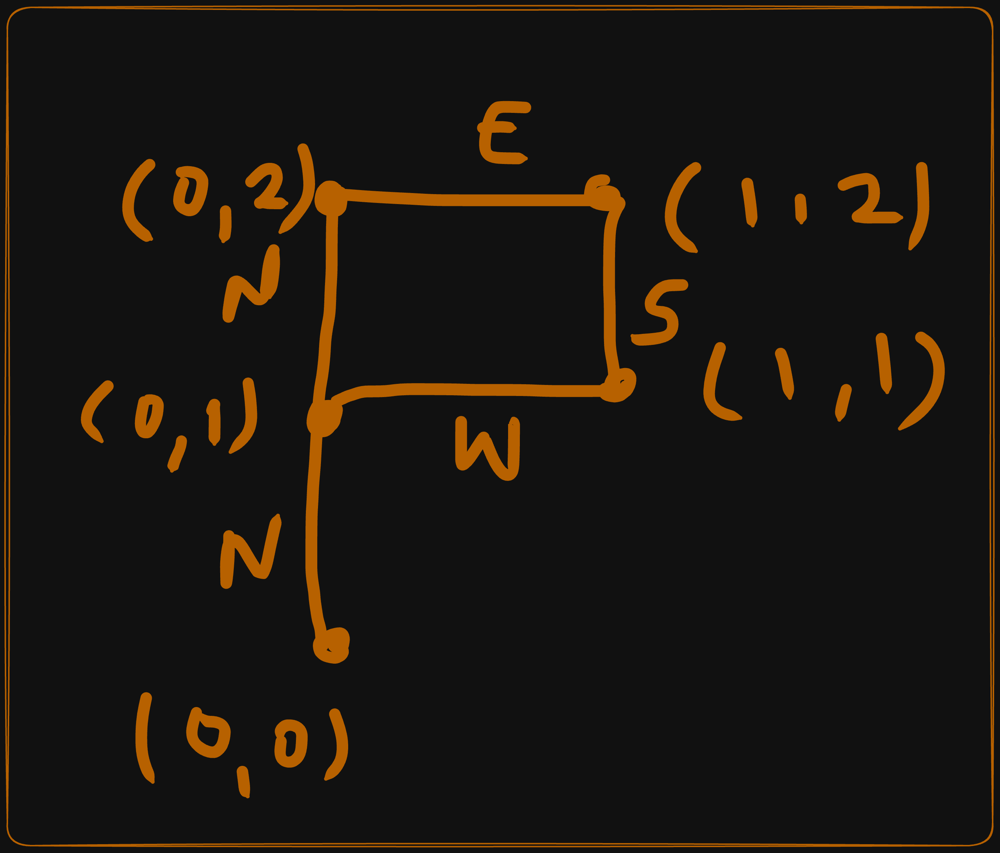
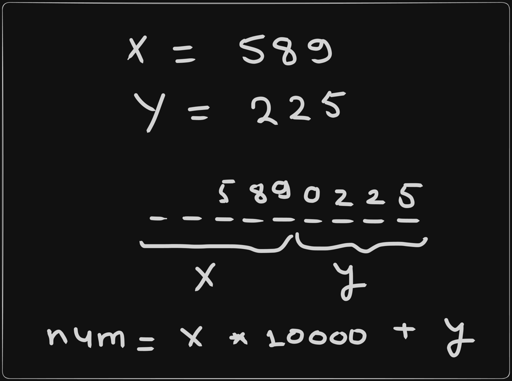

# Interview Approach - Path Crossing Brute Force without Set

**Author:** cs_iitian
**Votes:** 2
**Link:** [https://leetcode.com/problems/path-crossing/solutions/4444177/](https://leetcode.com/problems/path-crossing/solutions/4444177/)

---

# Video Solution
https://youtu.be/PeMd2T7Rv5g

# Brute Force Solution

Don\u2019y you agree that if a path crosses than It will form a loop. ( See the below diagram )

In that loop

Condition1: `No. of Norths = No. of Souths`

Condition2: `No. of Wests = No. of Easts`

Now we should know the entry point of the loop, and which can be any node.

So we pick each node as starting point and keep on checking those above two conditions to check the loop.




### Code

Here tempX and tempY are the starting point for each node, where x and y are the origin of the current point.

```java []
class Solution {
    public boolean isPathCrossing(String path) {
        int n = path.length();
        int x = 0;
        int y = 0;
        for(int i=0;i<n;i++) {
            int tempX = x;
            int tempY = y;
            for(int j=i;j<n;j++) {
                char ch = path.charAt(j);
                if(ch == 'N') y++;
                else if(ch == 'S') y--;
                else if(ch == 'W') x--;
                else x++;
                if(x == tempX && y == tempY) return true;
            }
        }
        return false;
    }
}
```

Time Complexity: O(n^2)

Space Complexity: O(1)


# Approach -2 ( Using List )

Store the Visited Nodes in an array, and then check for each node if it is already stored or not.

if it is already stored means we have already visited it else store the current node and move on.

Time Complexity: O(n^2) for every element checking the element will take O(n) time

Space Complexity: O(n) for array to store nodes.

# Approach-3 ( Using Set )

In the previous approach we were storing visited node in list so while checking if a node is present or not in the list It was taking O(n) time to traverse the array and check.

But in Set we can check this in O(1) time.

```c++ []
#include <iostream>
#include <unordered_set>

struct pair_hash {
    template <class T1, class T2>
    std::size_t operator () (const std::pair<T1, T2>& p) const {
        auto h1 = std::hash<T1>{}(p.first);
        auto h2 = std::hash<T2>{}(p.second);

        // Combine the hash values using a hash function for combining two hash values
        return h1 ^ h2;
    }
};

class Solution {
public:
    bool isPathCrossing(string path) {
        int x = 0;
        int y = 0;
        unordered_set<pair<int, int>, pair_hash> coordinates;
        coordinates.insert({x, y});

        for (char ch : path) {
            if (ch == 'N') y++;
            else if (ch == 'S') y--;
            else if (ch == 'W') x--;
            else x++;

            pair<int, int> currentCoordinate = {x, y};
            if (coordinates.count(currentCoordinate) > 0) {
                return true;
            }
            coordinates.insert(currentCoordinate);
        }

        return false;
    }
};
```
```java []
class Solution {
    public boolean isPathCrossing(String path) {
        int x = 0;
        int y = 0;
        int n = path.length();
        Set<Pair<Integer, Integer>> set = new HashSet<>();
        set.add(new Pair(x, y));
        for(char ch: path.toCharArray()) {
            if(ch == 'N') y++;
            else if(ch == 'S') y--;
            else if(ch == 'W') x--;
            else x++;
            Pair pair = new Pair(x, y);
            if(set.contains(pair)) return true;
            set.add(pair);
        }
        return false;
    }
}
```
```python []
from typing import Set, Tuple

class Solution:
    def isPathCrossing(self, path: str) -> bool:
        x, y = 0, 0
        coordinates: Set[Tuple[int, int]] = {(x, y)}

        for ch in path:
            if ch == 'N':
                y += 1
            elif ch == 'S':
                y -= 1
            elif ch == 'W':
                x -= 1
            elif ch == 'E':
                x += 1

            current_coordinate = (x, y)
            if current_coordinate in coordinates:
                return True
            coordinates.add(current_coordinate)

        return False
```
```rust []
use std::collections::HashSet;

#[derive(Debug, PartialEq, Eq, Hash, Clone, Copy)]
struct Pair(i32, i32);

impl Solution {
    pub fn is_path_crossing(path: String) -> bool {
        let mut x = 0;
        let mut y = 0;
        let mut set = HashSet::new();
        set.insert(Pair(x, y));

        for ch in path.chars() {
            match ch {
                'N' => y += 1,
                'S' => y -= 1,
                'W' => x -= 1,
                'E' => x += 1,
                _ => (),
            }

            let pair = Pair(x, y);
            if set.contains(&pair) {
                return true;
            }
            set.insert(pair);
        }

        false
    }
}
```
```kotlin []
data class Pair(val x: Int, val y: Int)

class Solution {
    fun isPathCrossing(path: String): Boolean {
        var x = 0
        var y = 0
        val set = HashSet<Pair>()
        set.add(Pair(x, y))

        for (ch in path) {
            when (ch) {
                'N' -> y++
                'S' -> y--
                'W' -> x--
                'E' -> x++
            }

            val pair = Pair(x, y)
            if (pair in set) {
                return true
            }
            set.add(pair)
        }

        return false
    }
}
```

Time Complexity: O(n)
Space Complexity: O(n)

# Approach-4 ( Replacing x and y into one variable )

In the previous approach we were using Pair which stores x and y.

Now as we know that path length range is 1 to 10^4.

and the maximum range for integer is around 1 to 10^9 almost.

I will use one integer digit where last four digit will store y and rest will store x.

Let\u2019s see how it works



If you can see at most x and y can have 4 digits. So I will multiply x by 10000 which will add 4 zeros to the end of x and now I can add y.

So in this way for each pair, num would always be unique.

```java []
class Solution {
    public boolean isPathCrossing(String path) {
        int x = 0;
        int y = 0;
        int n = path.length();
        Set<Integer> set = new HashSet<>();
        set.add(x * 10000 + y);
        for(char ch: path.toCharArray()) {
            if(ch == 'N') y++;
            else if(ch == 'S') y--;
            else if(ch == 'W') x--;
            else x++;
            int newLoc = x * 10000 + y;
            if(set.contains(newLoc)) return true;
            set.add(newLoc);
        }
        return false;
    }
}
```

Time Complexity: O(n)
Space Complexity: O(n)

That\u2019s it Guys !!

Thanks !!!