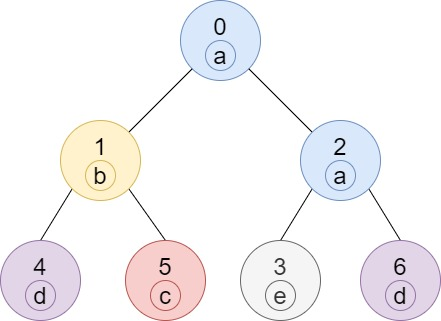
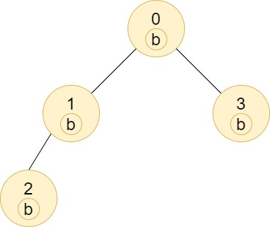
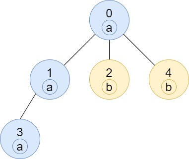

# [1519. Number of Nodes in the Sub-Tree With the Same Label](https://leetcode.com/problems/number-of-nodes-in-the-sub-tree-with-the-same-label/)

| Category | Difficulty | Likes | Dislikes |
| :------: | :--------: | :---: | :------: |
| Algorithms | Medium | 2354 | 810 |

**Tags:** [`hash-table`](https://leetcode.com/tag/hash-table), [`tree`](https://leetcode.com/tag/tree), [`depth-first-search`](https://leetcode.com/tag/depth-first-search), [`breadth-first-search`](https://leetcode.com/tag/breadth-first-search), [`counting`](https://leetcode.com/tag/counting)

**Companies:** `samsung`, `uber`

## Description

You are given a tree (i.e. a connected, undirected graph that has no cycles) consisting of `n` nodes numbered from `0` to `n - 1` and exactly `n - 1` `edges`. The **root** of the tree is the node `0`, and each node of the tree has **a label** which is a lower-case character given in the string `labels` (i.e. The node with the number `i` has the label `labels[i]`).

The `edges` array is given on the form `edges[i] = [a_i, b_i]`, which means there is an edge between nodes `a_i` and `b_i` in the tree.

Return *an array of size `n`* where `ans[i]` is the number of nodes in the subtree of the `i^th` node which have the same label as node `i`.

A subtree of a tree `T` is the tree consisting of a node in `T` and all of its descendant nodes.

 

**Example 1:**


```

Input: n = 7, edges = [[0,1],[0,2],[1,4],[1,5],[2,3],[2,6]], labels = &quot;abaedcd&quot;
Output: [2,1,1,1,1,1,1]
Explanation: Node 0 has label &#39;a&#39; and its sub-tree has node 2 with label &#39;a&#39; as well, thus the answer is 2. Notice that any node is part of its sub-tree.
Node 1 has a label &#39;b&#39;. The sub-tree of node 1 contains nodes 1,4 and 5, as nodes 4 and 5 have different labels than node 1, the answer is just 1 (the node itself).

```

**Example 2:**


```

Input: n = 4, edges = [[0,1],[1,2],[0,3]], labels = &quot;bbbb&quot;
Output: [4,2,1,1]
Explanation: The sub-tree of node 2 contains only node 2, so the answer is 1.
The sub-tree of node 3 contains only node 3, so the answer is 1.
The sub-tree of node 1 contains nodes 1 and 2, both have label &#39;b&#39;, thus the answer is 2.
The sub-tree of node 0 contains nodes 0, 1, 2 and 3, all with label &#39;b&#39;, thus the answer is 4.

```

**Example 3:**


```

Input: n = 5, edges = [[0,1],[0,2],[1,3],[0,4]], labels = &quot;aabab&quot;
Output: [3,2,1,1,1]

```

 

**Constraints:**

	- `1 <= n <= 10^5`

	- `edges.length == n - 1`

	- `edges[i].length == 2`

	- `0 <= a_i, b_i < n`

	- `a_i != b_i`

	- `labels.length == n`

	- `labels` is consisting of only of lowercase English letters.

---

**Links:** [Submissions](https://leetcode.com/problems/number-of-nodes-in-the-sub-tree-with-the-same-label/) | [Solutions](https://leetcode.com/problems/number-of-nodes-in-the-sub-tree-with-the-same-label/)
