# Ruby solution (T: 549 ms Beats 100%, M: 281.7 MB Beats 100%)

**Author:** ozovalihasan
**Votes:** 3
**Link:** [https://leetcode.com/problems/number-of-nodes-in-the-sub-tree-with-the-same-label/solutions/3039733/](https://leetcode.com/problems/number-of-nodes-in-the-sub-tree-with-the-same-label/solutions/3039733/)

---

# Approach

Let me explain my approach with an example;

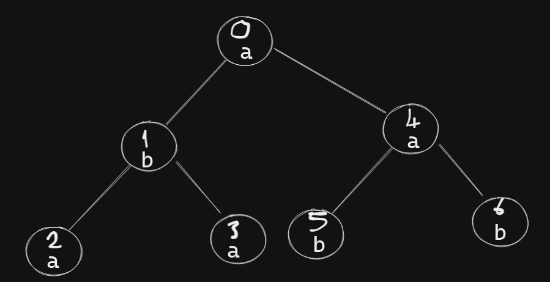

Firstly, an empty hash `label_values` is defined. Also, `label_val` is found by using the label of a node from the hash `label_values`.

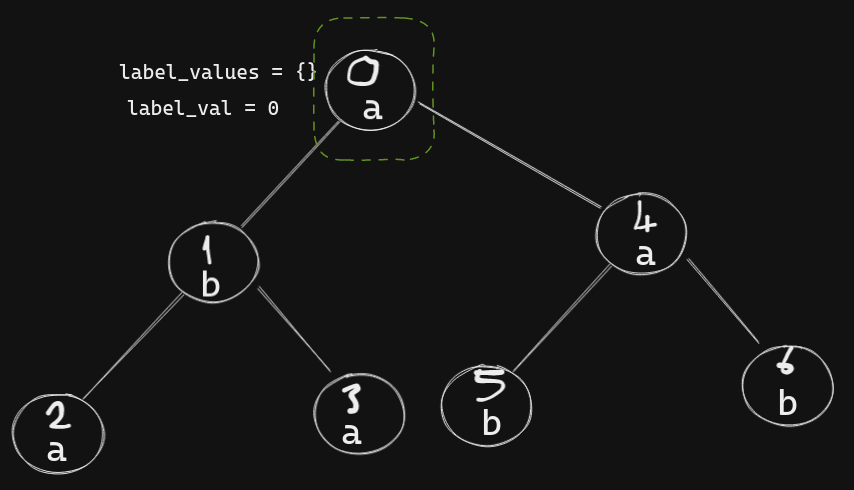

Then, the value of the `label` key of `label_values` is increased by 1.

Then, we are repeating same procedure for next nodes.

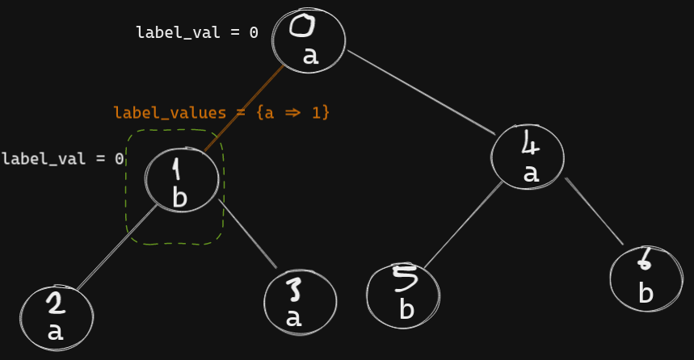

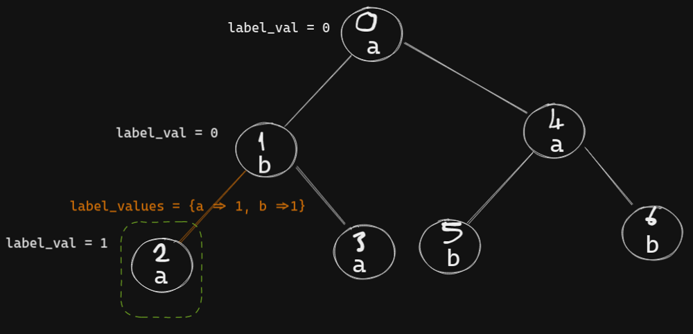

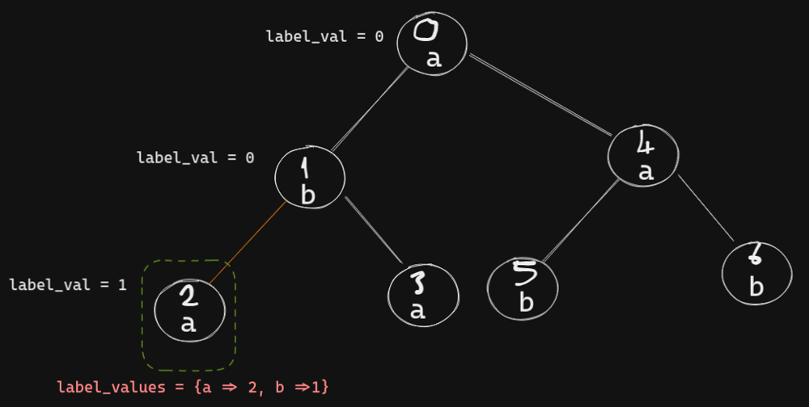


Now, node `2` doesn't have a next node. So, it's result value can be found by calculating the difference of the value of the key `label` of `label_values` and `label_val`; `2 - 1 => 1`

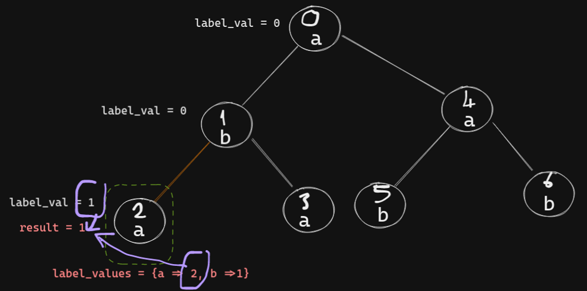

Let's continue the next node of node `1`.

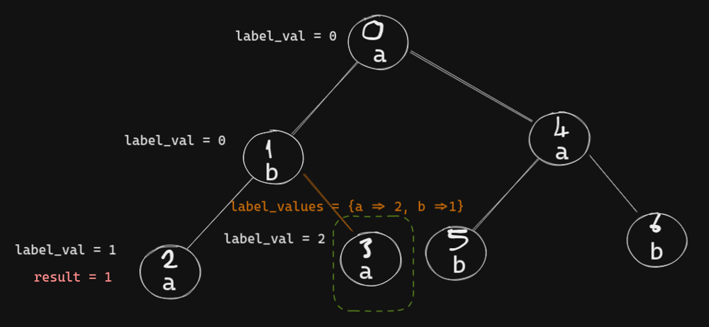

Again, node `3` doesn't have a next node. So, its result value can be found; `3 - 2 => 1`. 

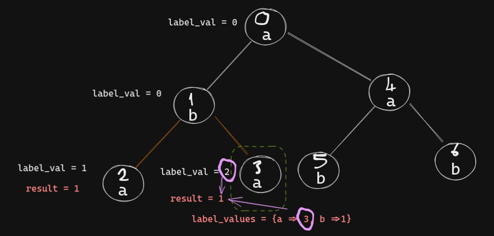


Now, all nodes of node `1` is checked, so the result of node `1` can be found; `1 - 0 => 1`.

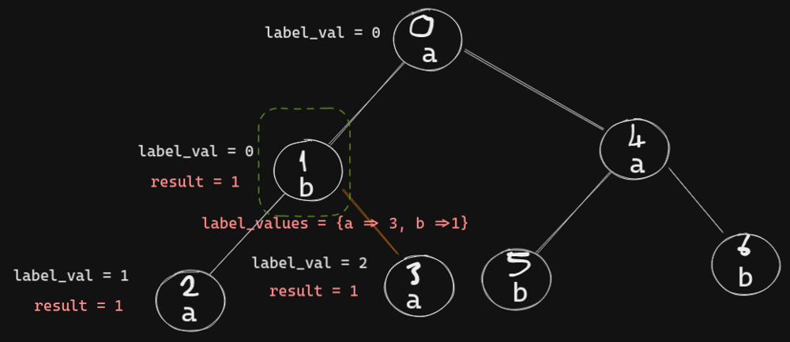


Let me skip nodes `4`, `5` and `6` quickly. Basically, the previous procedure is followed for these nodes.

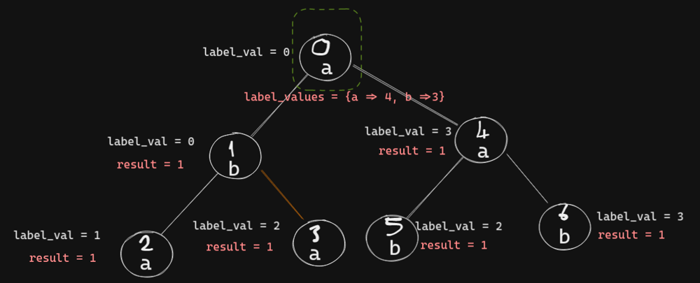


Now, let's find the result of node `0`; `4 - 0 => 4`

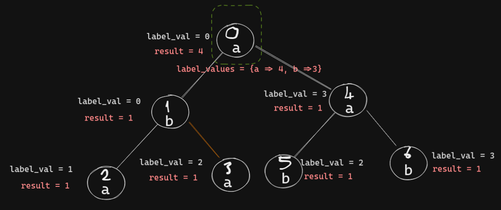

Credit: I have used [excalidraw](https://excalidraw.com/) to draw.

# Code
```ruby []
# @param {Integer} n
# @param {Integer[][]} edges
# @param {String} labels
# @return {Integer[]}
def count_sub_trees(n, edges, labels)
  @tree = build_tree(edges)  

  count_labels(labels)  
end

def build_tree(edges)
  tree = { 0 => []}
  
  edges.each do |start_node, end_node|
    if tree[start_node]
      tree[start_node] << end_node
      tree[end_node] = []
    else
      tree[end_node] << start_node
      tree[start_node] = []
    end
  end

  tree
end

def count_labels(labels)
  @result = []
  @labels = labels.split("")
  @label_values = Hash.new(0)

  starting_node = 0
  check_node(starting_node, @labels[starting_node])
  @result
end

def check_node(node_val, label)
  label_val = @label_values[ label ]
  @label_values[ label ] += 1
  @tree[node_val].each { |node| check_node(node, @labels[node]) }
  @result[node_val] = @label_values[label] - label_val
end
```