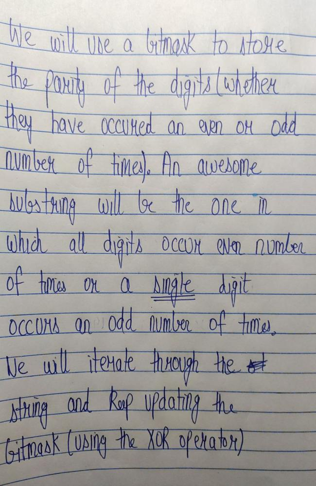
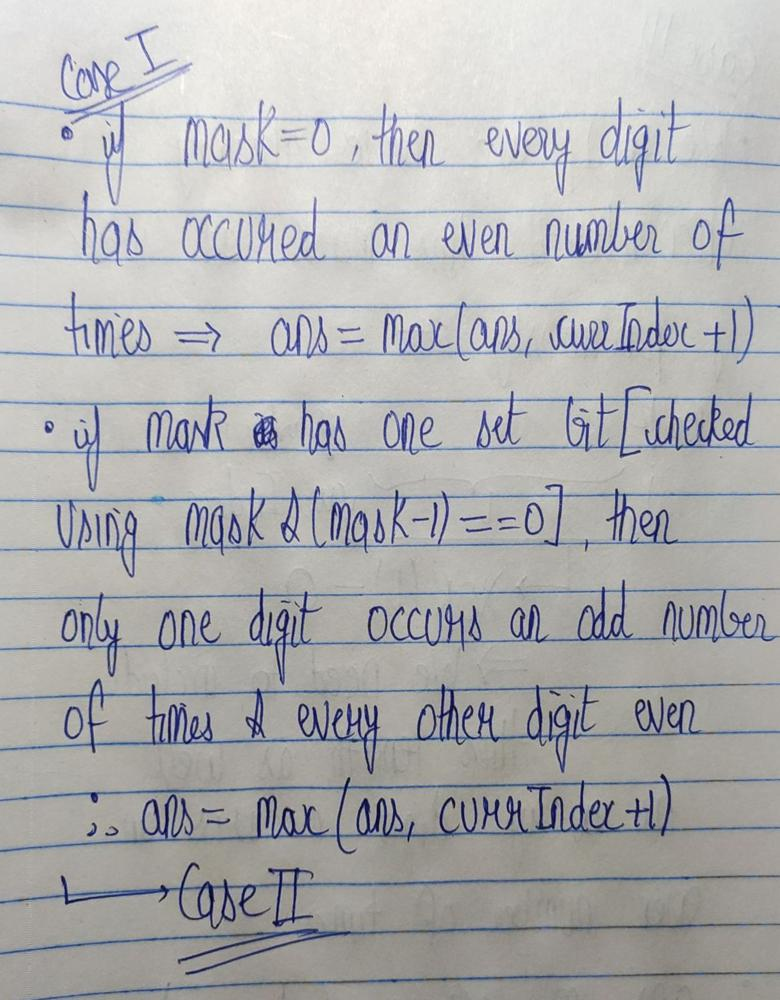
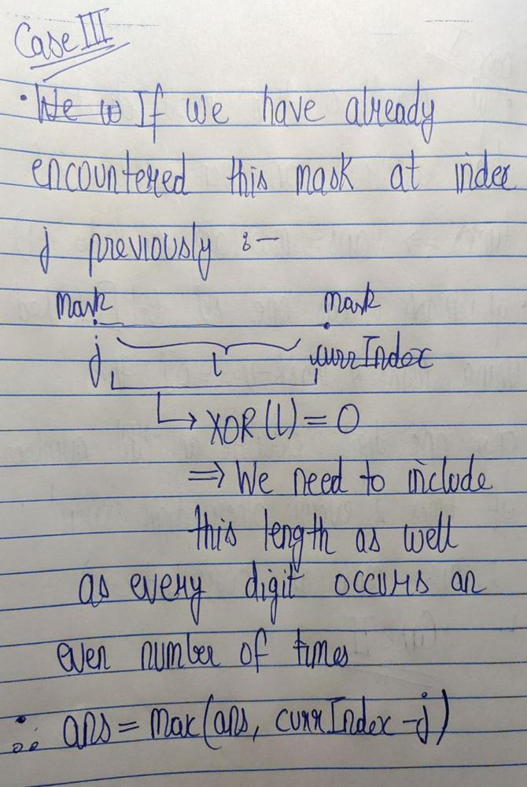
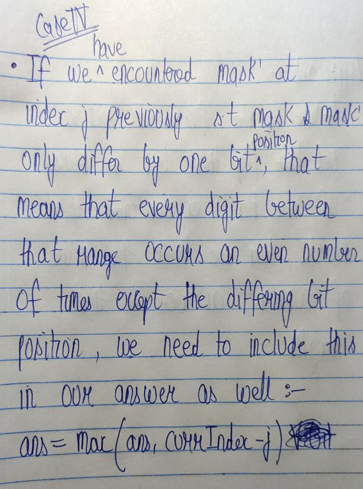
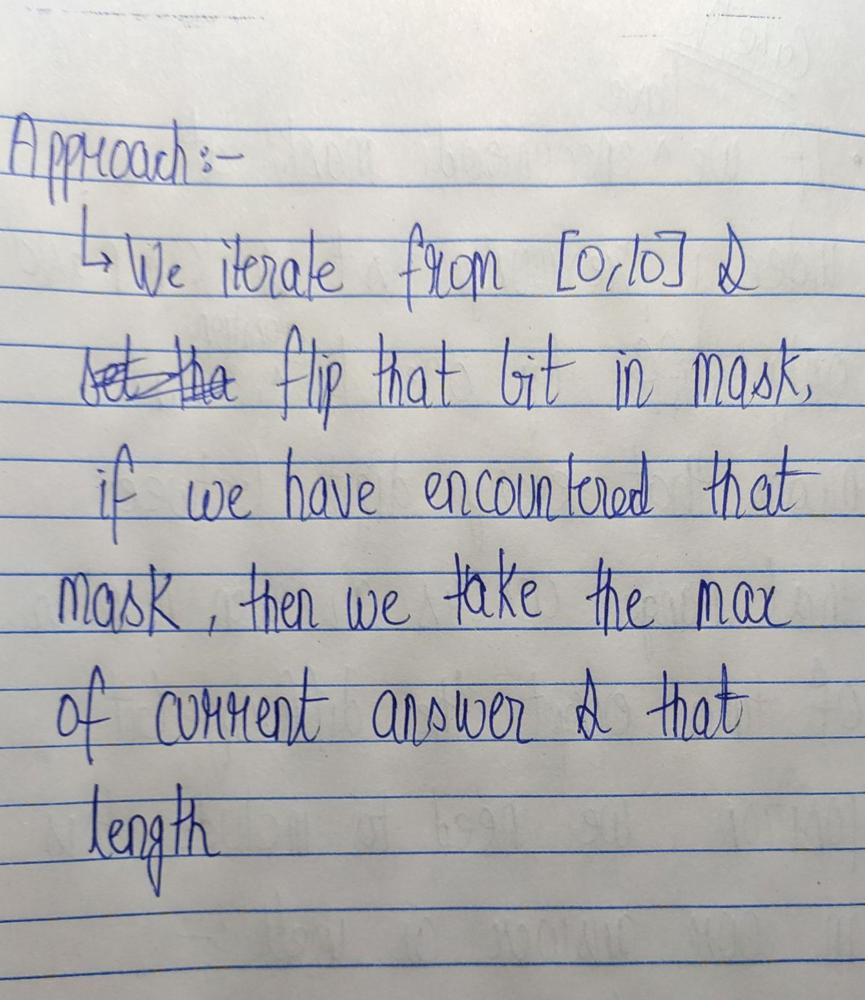

# C++ solution | Bit manipulation and Hashmaps | Explanation

**Author:** Diavolos
**Votes:** 14
**Link:** [https://leetcode.com/problems/find-longest-awesome-substring/solutions/2217420/](https://leetcode.com/problems/find-longest-awesome-substring/solutions/2217420/)

---






```
class Solution {
public:
    int longestAwesome(string s) {
        unordered_map<int,int>maskTable;
        maskTable[0]=-1;
        int ans=0;
        int mask=0;
        for(int i=0;i<s.size();i++){
            int digit=s[i]-'0';
            mask^=(1<<digit);
            if(!maskTable.count(mask)){
                maskTable[mask]=i;
            } else {
                //case III
                ans=max(ans,i-maskTable[mask]);
            }
            //caseI and case II
            if(mask==0 or (mask&(mask-1))==0){
                ans=max(ans,i+1);
            }
            //case IV
            for(int pos=0;pos<=10;pos++){
                int nwmask=mask^(1<<pos);
                if(maskTable.count(nwmask)){
                    ans=max(ans,i-maskTable[nwmask]);
                }
            }
        }
        return ans;
    }
};