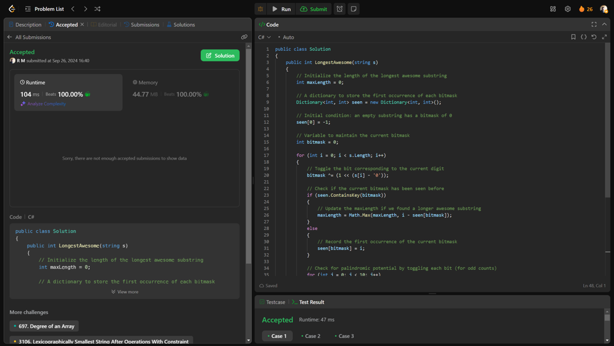

# 💥💥Beats 100% on runtime and memory [EXPLAINED]

**Author:** r9n
**Votes:** 0
**Link:** [https://leetcode.com/problems/find-longest-awesome-substring/solutions/5837835/](https://leetcode.com/problems/find-longest-awesome-substring/solutions/5837835/)

---




# Intuition
The solution uses a bitmask to represent the frequency of digits in the substring, allowing us to efficiently determine if a substring can form a palindrome. By toggling bits for each digit, we can track which digits have odd counts. As we traverse the string, we keep track of the first occurrence of each bitmask in a dictionary. If we encounter the same bitmask again, it means we can form a palindrome from the substring between these two indices. Additionally, we check for palindromes that can have one odd-count digit by toggling each bit. This approach ensures we efficiently find the longest awesome substring in linear time.

# Approach
Bitmasking: Each digit (0-9) is represented by a bit in an integer. This allows us to efficiently track the counts of each digit. A digit contributes to the palindromic structure if it appears an even number of times, except for one digit which can appear an odd number of times (the middle digit in a palindrome).

Tracking First Occurrences: We maintain a dictionary to store the first occurrence of each bitmask. This helps in calculating the length of the substring quickly.

Finding Maximum Length: For each character in the string, we check if the current bitmask has been seen before. If it has, it means we can form a palindrome up to that index. We also check for all possible single-digit toggles to account for palindromes that can have one odd-count digit.

# Complexity
- Time complexity:
O(n), where n is the length of the string, because we iterate through the string once and perform constant-time operations for each character.

- Space complexity:
O(1), since the bitmask only uses a fixed number of integers (for 10 digits) and the dictionary will not grow beyond the number of distinct bitmask configurations.

# Code
```csharp []
public class Solution
{
    public int LongestAwesome(string s)
    {
        // Initialize the length of the longest awesome substring
        int maxLength = 0;
        
        // A dictionary to store the first occurrence of each bitmask
        Dictionary<int, int> seen = new Dictionary<int, int>();
        
        // Initial condition: an empty substring has a bitmask of 0
        seen[0] = -1;
        
        // Variable to maintain the current bitmask
        int bitmask = 0;
        
        for (int i = 0; i < s.Length; i++)
        {
            // Toggle the bit corresponding to the current digit
            bitmask ^= (1 << (s[i] - '0'));
            
            // Check if the current bitmask has been seen before
            if (seen.ContainsKey(bitmask))
            {
                // Update the maxLength if we found a longer awesome substring
                maxLength = Math.Max(maxLength, i - seen[bitmask]);
            }
            else
            {
                // Record the first occurrence of the current bitmask
                seen[bitmask] = i;
            }
            
            // Check for palindromic potential by toggling each bit (for odd counts)
            for (int j = 0; j < 10; j++)
            {
                int toggleMask = bitmask ^ (1 << j);
                if (seen.ContainsKey(toggleMask))
                {
                    maxLength = Math.Max(maxLength, i - seen[toggleMask]);
                }
            }
        }
        
        return maxLength;
    }
}

```