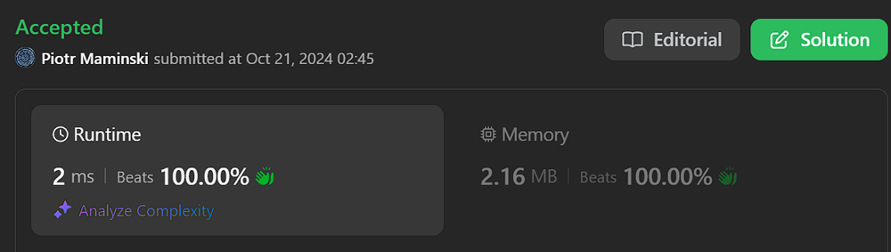
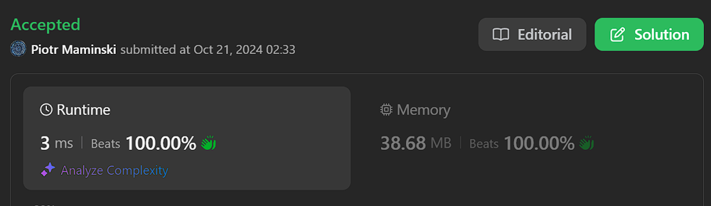

# ✅ Explained step by step | Beats 100% |  ✅ Working 21.10.2024

**Author:** Piotr_Maminski
**Votes:** 24
**Link:** [https://leetcode.com/problems/split-a-string-into-the-max-number-of-unique-substrings/solutions/5944993/](https://leetcode.com/problems/split-a-string-into-the-max-number-of-unique-substrings/solutions/5944993/)

---

```python3 []
class Solution:
    def maxUniqueSplit(self, s: str) -> int:
        seen = set()  # Set to store unique substrings
        max_count = [0]  # List to store the maximum count of unique substrings (using list for mutable reference)
        
        # Call the backtracking function to find the maximum count
        self.backtrack(s, 0, seen, 0, max_count)
        
        return max_count[0]  # Return the final result

    def backtrack(self, s: str, start: int, seen: set, count: int, max_count: list) -> None:
        # Pruning: If the remaining characters plus current count can't exceed max_count, return
        if count + (len(s) - start) <= max_count[0]:
            return

        # Base case: If we've reached the end of the string
        if start == len(s):
            max_count[0] = max(max_count[0], count)  # Update max_count if necessary
            return

        # Try all possible substrings starting from 'start'
        for end in range(start + 1, len(s) + 1):
            substring = s[start:end]  # Extract substring
            
            # If the substring is not in the set (i.e., it's unique)
            if substring not in seen:
                seen.add(substring)  # Add the substring to the set
                
                # Recursively call backtrack with updated parameters
                self.backtrack(s, end, seen, count + 1, max_count)
                
                seen.remove(substring)  # Remove the substring from the set (backtracking)
```
```cpp []
class Solution {
public:
    // Main function to find the maximum number of unique substrings
    int maxUniqueSplit(string s) {
        unordered_set<string> seen;  // Set to store unique substrings
        int maxCount = 0;  // Variable to store the maximum count of unique substrings
        
        // Call the backtracking function to find the maximum count
        backtrack(s, 0, seen, 0, maxCount);
        
        return maxCount;  // Return the final result
    }

private:
    // Backtracking function to explore all possible splits
    void backtrack(const string& s, int start, unordered_set<string>& seen,
                   int count, int& maxCount) {
        // Pruning: If the remaining characters plus current count can't exceed maxCount, return
        if (count + (s.size() - start) <= maxCount) return;

        // Base case: If we've reached the end of the string
        if (start == s.size()) {
            maxCount = max(maxCount, count);  // Update maxCount if necessary
            return;
        }

        // Try all possible substrings starting from 'start'
        for (int end = start + 1; end <= s.size(); ++end) {
            string substring = s.substr(start, end - start);  // Extract substring
            
            // If the substring is not in the set (i.e., it's unique)
            if (seen.find(substring) == seen.end()) {
                seen.insert(substring);  // Add the substring to the set
                
                // Recursively call backtrack with updated parameters
                backtrack(s, end, seen, count + 1, maxCount);
                
                seen.erase(substring);  // Remove the substring from the set (backtracking)
            }
        }
    }
};
```
```java []
import java.util.HashSet;
import java.util.Set;

class Solution {
    // Main function to find the maximum number of unique substrings
    public int maxUniqueSplit(String s) {
        Set<String> seen = new HashSet<>();  // Set to store unique substrings
        int[] maxCount = {0};  // Array to store the maximum count of unique substrings
        
        // Call the backtracking function to find the maximum count
        backtrack(s, 0, seen, 0, maxCount);
        
        return maxCount[0];  // Return the final result
    }

    // Backtracking function to explore all possible splits
    private void backtrack(String s, int start, Set<String> seen,
                           int count, int[] maxCount) {
        // Pruning: If the remaining characters plus current count can't exceed maxCount, return
        if (count + (s.length() - start) <= maxCount[0]) return;

        // Base case: If we've reached the end of the string
        if (start == s.length()) {
            maxCount[0] = Math.max(maxCount[0], count);  // Update maxCount if necessary
            return;
        }

        // Try all possible substrings starting from 'start'
        for (int end = start + 1; end <= s.length(); ++end) {
            String substring = s.substring(start, end);  // Extract substring
            
            // If the substring is not in the set (i.e., it's unique)
            if (!seen.contains(substring)) {
                seen.add(substring);  // Add the substring to the set
                
                // Recursively call backtrack with updated parameters
                backtrack(s, end, seen, count + 1, maxCount);
                
                seen.remove(substring);  // Remove the substring from the set (backtracking)
            }
        }
    }
}
```
```csharp []
using System;
using System.Collections.Generic;

public class Solution {
    // Main function to find the maximum number of unique substrings
    public int MaxUniqueSplit(string s) {
        HashSet<string> seen = new HashSet<string>();  // Set to store unique substrings
        int maxCount = 0;  // Variable to store the maximum count of unique substrings
        
        // Call the backtracking function to find the maximum count
        Backtrack(s, 0, seen, 0, ref maxCount);
        
        return maxCount;  // Return the final result
    }

    // Backtracking function to explore all possible splits
    private void Backtrack(string s, int start, HashSet<string> seen,
                           int count, ref int maxCount) {
        // Pruning: If the remaining characters plus current count can't exceed maxCount, return
        if (count + (s.Length - start) <= maxCount) return;

        // Base case: If we've reached the end of the string
        if (start == s.Length) {
            maxCount = Math.Max(maxCount, count);  // Update maxCount if necessary
            return;
        }

        // Try all possible substrings starting from 'start'
        for (int end = start + 1; end <= s.Length; ++end) {
            string substring = s.Substring(start, end - start);  // Extract substring
            
            // If the substring is not in the set (i.e., it's unique)
            if (!seen.Contains(substring)) {
                seen.Add(substring);  // Add the substring to the set
                
                // Recursively call Backtrack with updated parameters
                Backtrack(s, end, seen, count + 1, ref maxCount);
                
                seen.Remove(substring);  // Remove the substring from the set (backtracking)
            }
        }
    }
}
```
```rust []
use std::collections::HashSet;

impl Solution {
    // Main function to find the maximum number of unique substrings
    pub fn max_unique_split(s: String) -> i32 {
        let mut seen: HashSet<String> = HashSet::new();  // Set to store unique substrings
        let mut max_count = 0;  // Variable to store the maximum count of unique substrings
        
        // Call the backtracking function to find the maximum count
        Self::backtrack(&s, 0, &mut seen, 0, &mut max_count);
        
        max_count  // Return the final result
    }

    // Backtracking function to explore all possible splits
    fn backtrack(s: &str, start: usize, seen: &mut HashSet<String>, 
                 count: i32, max_count: &mut i32) {
        // Pruning: If the remaining characters plus current count can't exceed max_count, return
        if count + (s.len() - start) as i32 <= *max_count {
            return;
        }

        // Base case: If we've reached the end of the string
        if start == s.len() {
            *max_count = (*max_count).max(count);  // Update max_count if necessary
            return;
        }

        // Try all possible substrings starting from 'start'
        for end in start + 1..=s.len() {
            let substring = s[start..end].to_string();  // Extract substring
            
            // If the substring is not in the set (i.e., it's unique)
            if !seen.contains(&substring) {
                seen.insert(substring.clone());  // Add the substring to the set
                
                // Recursively call backtrack with updated parameters
                Self::backtrack(s, end, seen, count + 1, max_count);
                
                seen.remove(&substring);  // Remove the substring from the set (backtracking)
            }
        }
    }
}
```
```swift []
class Solution {
    // Main function to find the maximum number of unique substrings
    func maxUniqueSplit(_ s: String) -> Int {
        var seen = Set<String>()  // Set to store unique substrings
        var maxCount = 0  // Variable to store the maximum count of unique substrings
        
        // Call the backtracking function to find the maximum count
        backtrack(s, start: 0, seen: &seen, count: 0, maxCount: &maxCount)
        
        return maxCount  // Return the final result
    }

    // Backtracking function to explore all possible splits
    private func backtrack(_ s: String, start: Int, seen: inout Set<String>,
                           count: Int, maxCount: inout Int) {
        // Pruning: If the remaining characters plus current count can't exceed maxCount, return
        if count + (s.count - start) <= maxCount { return }

        // Base case: If we've reached the end of the string
        if start == s.count {
            maxCount = max(maxCount, count)  // Update maxCount if necessary
            return
        }

        // Try all possible substrings starting from 'start'
        for end in (start + 1)...s.count {
            let startIndex = s.index(s.startIndex, offsetBy: start)
            let endIndex = s.index(s.startIndex, offsetBy: end)
            let substring = String(s[startIndex..<endIndex])  // Extract substring
            
            // If the substring is not in the set (i.e., it's unique)
            if !seen.contains(substring) {
                seen.insert(substring)  // Add the substring to the set
                
                // Recursively call backtrack with updated parameters
                backtrack(s, start: end, seen: &seen, count: count + 1, maxCount: &maxCount)
                
                seen.remove(substring)  // Remove the substring from the set (backtracking)
            }
        }
    }
}
```
```php []
class Solution {
    // Main function to find the maximum number of unique substrings
    public function maxUniqueSplit($s) {
        $seen = [];  // Array to store unique substrings
        $maxCount = 0;  // Variable to store the maximum count of unique substrings
        
        // Call the backtracking function to find the maximum count
        $this->backtrack($s, 0, $seen, 0, $maxCount);
        
        return $maxCount;  // Return the final result
    }

    // Backtracking function to explore all possible splits
    private function backtrack($s, $start, &$seen, $count, &$maxCount) {
        // Pruning: If the remaining characters plus current count can't exceed maxCount, return
        if ($count + (strlen($s) - $start) <= $maxCount) return;

        // Base case: If we've reached the end of the string
        if ($start == strlen($s)) {
            $maxCount = max($maxCount, $count);  // Update maxCount if necessary
            return;
        }

        // Try all possible substrings starting from 'start'
        for ($end = $start + 1; $end <= strlen($s); ++$end) {
            $substring = substr($s, $start, $end - $start);  // Extract substring
            
            // If the substring is not in the array (i.e., it's unique)
            if (!isset($seen[$substring])) {
                $seen[$substring] = true;  // Add the substring to the array
                
                // Recursively call backtrack with updated parameters
                $this->backtrack($s, $end, $seen, $count + 1, $maxCount);
                
                unset($seen[$substring]);  // Remove the substring from the array (backtracking)
            }
        }
    }
}
```
```golang []
func maxUniqueSplit(s string) int {
    // Initialize the answer to 1 (minimum possible split)
    ans := 1
    // Create a map to keep track of visited substrings
    vis := map[string]bool{}

    // Declare a recursive function dfs
    var dfs func(i, t int)
    dfs = func(i, t int) {
        // Base case: if we've reached the end of the string
        if i >= len(s) {
            // Update the answer with the maximum of current answer and current split count
            ans = max(ans, t)
            return
        }
        
        // Try all possible substrings starting from index i
        for j := i + 1; j <= len(s); j++ {
            // Extract the substring
            x := s[i:j]
            // If this substring hasn't been used before
            if !vis[x] {
                // Mark it as visited
                vis[x] = true
                // Recursively call dfs with the next starting index and incremented split count
                dfs(j, t+1)
                // Backtrack: mark the substring as unvisited for other possibilities
                vis[x] = false
            }
        }
    }

    // Start the DFS from index 0 with initial split count 0
    dfs(0, 0)
    
    // Return the maximum number of unique splits found
    return ans
}
```

```javascript [JS]
  // JavaScript

function maxUniqueSplit(s) {
  // Initialize the result to 1 (minimum possible split)
  let res = 1;
  // Create a Set to store unique substrings
  let strings = new Set();

  // Define a recursive search function
  function search(s) {
    // If the current string is not in the Set
    if (!strings.has(s)) {
      // Add it to the Set
      strings.add(s);
      // Update the result with the maximum of current result and Set size
      res = Math.max(res, strings.size);
      // Remove the string from the Set (backtracking)
      strings.delete(s);
    }

    // Iterate through all possible split positions
    for (let i = 1; i < s.length; i++) {
      // Get the substring from start to current position
      const sub = s.substring(0, i);
      // If this substring is already in the Set, skip this iteration
      if (strings.has(sub)) continue;
      // Add the substring to the Set
      strings.add(sub);
      // Recursively search the remaining part of the string
      search(s.substring(i));
      // Remove the substring from the Set (backtracking)
      strings.delete(sub);
    }
  }

  // Start the search with the entire input string
  search(s);
  // Return the maximum number of unique substrings found
  return res;
}
```
```typescript [TS]
  // TypeScript

function maxUniqueSplit(s: string): number {
  // Initialize the result to 1 (minimum possible split)
  let res = 1
  // Create a Set to store unique substrings
  let strings = new Set()

  // Define a recursive search function
  function search(s: string) {
    // If the current string is not in the Set
    if (!strings.has(s)) {
      // Add it to the Set
      strings.add(s)
      // Update the result with the maximum of current result and Set size
      res = Math.max(res, strings.size)
      // Remove the string from the Set (backtracking)
      strings.delete(s)
    }

    // Iterate through all possible split positions
    for (let i = 1; i < s.length; i++) {
      // Get the substring from start to current position
      const sub = s.substring(0, i)
      // If this substring is already in the Set, skip this iteration
      if (strings.has(sub)) continue
      // Add the substring to the Set
      strings.add(sub)
      // Recursively search the remaining part of the string
      search(s.substring(i))
      // Remove the substring from the Set (backtracking)
      strings.delete(sub)
    }
  }

  // Start the search with the entire input string
  search(s)
  // Return the maximum number of unique substrings found
  return res
};
```


### Complexity 
- Time complexity: O(2^n)

- Space complexity: O(2^n)

## Explain step by step

---


1. Initialization:

- seen: A set to store the unique substrings encountered during the process.

- max_count: A list with one element (initially set to 0) to store the maximum number of unique substrings found (using a list for mutability).

2. Calling Backtrack: Start the process by calling the backtrack function with initial parameters: the string s, starting index 0, the seen set, current count 0, and the max_count list.

3. Backtrack Function:

- Pruning: Check if the sum of the current count and the remaining characters can't exceed the maximum count found so far. If so, return early to avoid unnecessary work.

- Base Case: If the start index reaches the end of the string, update max_count if the current count is higher than the recorded maximum.

- Exploring Substrings: Iterate over possible substring ending positions from start + 1 to len(s) + 1:

    - Extract the substring s[start:end].

    - If the substring is not in the seen set (meaning it's unique):

        - Add it to the seen set.

        - Recursively call backtrack with updated parameters: new start index end, updated seen set, incremented count, and max_count.

        - Remove the substring from the seen set after backtracking to allow for other combinations.

4. Return Result: The maxUniqueSplit function returns the maximum count of unique substrings found, stored in max_count[0].

---






