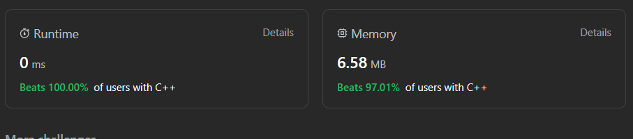

# ✅☑Beats 100% Users || [C++/Java/Python/JavaScript] || 3 Approaches || EXPLAINED🔥

**Author:** MarkSPhilip31
**Votes:** 108
**Link:** [https://leetcode.com/problems/largest-substring-between-two-equal-characters/solutions/4480466/](https://leetcode.com/problems/largest-substring-between-two-equal-characters/solutions/4480466/)

---

# PLEASE UPVOTE IF IT HELPED

---





---
# Approaches
(Also explained in the code)

#### ***Approach 1(Brute Force)***
1. The function initializes a variable `ans` to `-1`. This variable will store the maximum distance found between two equal characters in the string.
1. It uses two nested loops to iterate through the string characters. The outer loop starts from the first character and moves to the end of the string.
1. For each character in the string (`s[left]`), the inner loop checks subsequent characters (`s[right]`) to see if any of them match the character at `s[left]`.
1. If a matching character is found at position `right`, it calculates the distance between the matching characters using (`right - left - 1`) and updates the `ans` variable to store the maximum distance found so far.
1. The function continues to explore all possible pairs of equal characters, updating `ans` whenever it finds a pair with a greater distance.

# Complexity
- Time complexity:
   $$O(n^2)$$
    

- Space complexity:
   $$O(1)$$
    


# Code
```C++ []
class Solution {
public:
    int maxLengthBetweenEqualCharacters(string s) {
        int ans = -1;
        for (int left = 0; left < s.size(); left++) {
            for (int right = left + 1; right < s.size(); right++) {
                if (s[left] == s[right]) {
                    ans = max(ans, right - left - 1);
                }
            }
        }
        
        return ans;
    }
};


```
```Java []
class Solution {
    public int maxLengthBetweenEqualCharacters(String s) {
        int ans = -1;
        for (int left = 0; left < s.length(); left++) {
            for (int right = left + 1; right < s.length(); right++) {
                if (s.charAt(left) == s.charAt(right)) {
                    ans = Math.max(ans, right - left - 1);
                }
            }
        }
        
        return ans;
    }
}


```
```python3 []

class Solution:
    def maxLengthBetweenEqualCharacters(self, s: str) -> int:
        ans = -1
        
        for left in range(len(s)):
            for right in range(left + 1, len(s)):
                if s[left] == s[right]:
                    ans = max(ans, right - left - 1)
        
        return ans

```
```javascript []
function maxLengthBetweenEqualCharacters(s) {
    let ans = -1;

    for (let left = 0; left < s.length; left++) {
        for (let right = left + 1; right < s.length; right++) {
            if (s[left] === s[right]) {
                ans = Math.max(ans, right - left - 1);
            }
        }
    }

    return ans;
}


```
---
#### ***Approach 2(With Maps)***


1. The function initializes an unordered map `firstIndex`, where the keys are characters from the string `s`, and the values are the indices (positions) of their first occurrences.
1. It also initializes `ans` as `-1`, which will store the maximum distance between equal characters found in the string.
1. The function iterates through each character in the string using a loop.
1. For each character `s[i]`, it checks if `s[i]` exists in the firstIndex map. If it does:
    - It calculates the distance between the current index `i` and the index of the first occurrence of `s[i]` stored in `firstIndex[s[i]]`.
    - It updates `ans` with the maximum of its current value and the calculated distance (`i - firstIndex[s[i]] - 1`).
1. If the character `s[i]` is not found in the `firstIndex` map, it means it's encountered for the first time, so it adds it to the map with its index `i`.
1. Finally, the function returns the maximum distance (`ans`) found between two equal characters in the input string. If no equal characters are found or there's only one occurrence of a character, the function returns `-1`.

# Complexity
- Time complexity:
   $$O(n)$$
    

- Space complexity:
   $$O(1)$$
    


# Code
```C++ []

class Solution {
public:
    int maxLengthBetweenEqualCharacters(string s) {
        unordered_map<char, int> firstIndex;
        int ans = -1;
        
        for (int i = 0; i < s.size(); i++) {
            if (firstIndex.find(s[i]) != firstIndex.end()) {
                ans = max(ans, i - firstIndex[s[i]] - 1);
            } else {
                firstIndex[s[i]] = i;
            }
        }

        return ans;
    }
};


```
```Java []
class Solution {
    public int maxLengthBetweenEqualCharacters(String s) {
        Map<Character, Integer> firstIndex = new HashMap();
        int ans = -1;
        
        for (int i = 0; i < s.length(); i++) {
            if (firstIndex.containsKey(s.charAt(i))) {
                ans = Math.max(ans, i - firstIndex.get(s.charAt(i)) - 1);
            } else {
                firstIndex.put(s.charAt(i), i);
            }
        }
        
        return ans;
    }
}


```
```python3 []
class Solution:
    def maxLengthBetweenEqualCharacters(self, s: str) -> int:
        first_index = {}
        ans = -1
        
        for i in range(len(s)):
            if s[i] in first_index:
                ans = max(ans, i - first_index[s[i]] - 1)
            else:
                first_index[s[i]] = i

        return ans


```
```javascript []
function maxLengthBetweenEqualCharacters(s) {
    const firstIndex = new Map();
    let ans = -1;

    for (let i = 0; i < s.length; i++) {
        if (firstIndex.has(s[i])) {
            ans = Math.max(ans, i - firstIndex.get(s[i]) - 1);
        } else {
            firstIndex.set(s[i], i);
        }
    }

    return ans;
}


```
---

#### ***Approach 3(Using Array)***
 
1. It  initializes ans as `-1`, which will store the maximum distance between equal characters found in the string.
1. The function iterates through each character in the string using a loop.
1. For each character `s[i]`, it converts the character to an index in the range 0-25 by subtracting `a` from it (`s[i] - 'a'`). This index is used to access positions in `v1` and `v2` for that specific character.
1. If the first occurrence of the character is encountered (`v1[temp] == -1`), it records its index `i` in `v1[temp]`.
1. If a subsequent occurrence of the same character is encountered, it records its index `i` in `v2[temp]` and calculates the distance between the current occurrence and the first occurrence of the character (`v2[temp] - v1[temp] - 1`). It updates `ans` with the maximum of its current value and the calculated distance.
1. The function continues to iterate through the string, updating the indices in `v1` and `v2` for each character encountered and updating `ans` whenever it finds a pair of equal characters with a greater distance between them.

# Complexity
- Time complexity:
   $$O(n)$$
    

- Space complexity:
   $$O(1)$$
    


# Code
```C++ []
class Solution {
public:
    int maxLengthBetweenEqualCharacters(string s) {
        vector<int> v1(26, -1);
        vector<int> v2(26, -1);
        int ans = -1;

        for (int i = 0; i < s.size(); ++i) {
            int temp = s[i] - 'a';

            if (v1[temp] == -1) {
                v1[temp] = i;
            } else {
                v2[temp] = i;
                ans = max(ans, v2[temp] - v1[temp] - 1);
            }
        }

        return ans;
    }
};


```
```Java []
class Solution {
    public int maxLengthBetweenEqualCharacters(String s) {
        int[] v1 = new int[26];
        int[] v2 = new int[26];
        Arrays.fill(v1, -1);
        Arrays.fill(v2, -1);
        int ans = -1;

        for (int i = 0; i < s.length(); ++i) {
            int temp = s.charAt(i) - 'a';

            if (v1[temp] == -1) {
                v1[temp] = i;
            } else {
                v2[temp] = i;
                ans = Math.max(ans, v2[temp] - v1[temp] - 1);
            }
        }

        return ans;
    }
}


```
```python3 []
class Solution:
    def maxLengthBetweenEqualCharacters(self, s: str) -> int:
        v1 = [-1] * 26
        v2 = [-1] * 26
        ans = -1

        for i in range(len(s)):
            temp = ord(s[i]) - ord('a')

            if v1[temp] == -1:
                v1[temp] = i
            else:
                v2[temp] = i
                ans = max(ans, v2[temp] - v1[temp] - 1)

        return ans


```
```javascript []
function maxLengthBetweenEqualCharacters(s) {
    const v1 = Array(26).fill(-1);
    const v2 = Array(26).fill(-1);
    let ans = -1;

    for (let i = 0; i < s.length; ++i) {
        const temp = s.charCodeAt(i) - 'a'.charCodeAt(0);

        if (v1[temp] === -1) {
            v1[temp] = i;
        } else {
            v2[temp] = i;
            ans = Math.max(ans, v2[temp] - v1[temp] - 1);
        }
    }

    return ans;
}


```
---


# PLEASE UPVOTE IF IT HELPED

---
---


---