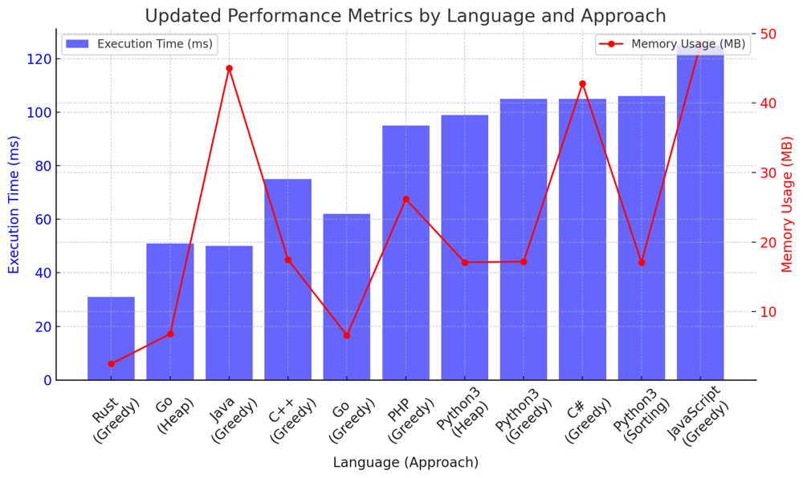

# ✅ 98.18% Greedy & Heap & Sorting

**Author:** vanAmsen
**Votes:** 108
**Link:** [https://leetcode.com/problems/minimum-deletions-to-make-character-frequencies-unique/solutions/4033205/](https://leetcode.com/problems/minimum-deletions-to-make-character-frequencies-unique/solutions/4033205/)

---

# Comprehensive Guide to Solving "Minimum Deletions to Make Character Frequencies Unique"

## Introduction & Problem Statement

Welcome, code enthusiasts! Today, we're tackling an intriguing problem: **Minimum Deletions to Make Character Frequencies Unique**. Given a string  `s` , the goal is to delete the minimum number of characters so that no two characters have the same frequency.

For instance, if the input string is "aaabbbcc", you can delete two 'b's to make the string "aaabcc", ensuring that each character has a unique frequency.

## Key Concepts and Constraints

### What Makes this Problem Unique?

1. **Character Frequency**: 
   Each character in the string  `s`  has a frequency, and we need to make sure no two characters share the same frequency after deletions.

2. **Minimum Deletions**:
   The goal is to achieve this with the fewest number of deletions.

3. **Constraints**: 
   - The length of the string `s` ,  `n` , is between `1` and  `10^5` .
   - The string  `s` contains only lowercase English letters.

---

# Strategies to Tackle the Problem:

## Live Coding & Explain Greedy
https://youtu.be/QkCo8HhiwYU?si=zPPAMxrpL0a0c4Ns

## Greedy Algorithm 1/3: Minimizing Deletions Step by Step

### What is a Greedy Algorithm?
A Greedy Algorithm makes choices that seem the best at the moment. In the context of this problem, we'll try to make each character frequency unique by making the fewest number of changes to the existing frequencies.

### Detailed Steps

1. **Step 1: Count Frequencies**  
   - **Why Count Frequencies?**:  
     Before we can decide which characters to delete, we need to know how often each character appears. This is done using a frequency counter, stored in a dictionary `cnt`.
  
2. **Step 2: Iterate and Minimize**
   - **Why Iterate Through Frequencies?**:  
     We need to ensure that all character frequencies are unique. To do this, we iterate through the `cnt` dictionary. If a frequency is already used, we decrement it by 1 until it becomes unique, keeping track of these decrements in a variable `deletions`.

3. **Step 3: Return Deletions**
   - **What is the Output?**:  
     The function returns the total number of deletions (`deletions`) required to make all character frequencies unique.

#### Time and Space Complexity
- **Time Complexity**: $$O(n)$$, as you only iterate through the list once.
- **Space Complexity**: $$O(n)$$, to store the frequencies in `cnt` and the used frequencies in `used_frequencies`.

## Code Greedy
``` Python []
# Greedy Approach
class Solution:
    def minDeletions(self, s: str) -> int:
        cnt = Counter(s)
        deletions = 0
        used_frequencies = set()
        
        for char, freq in cnt.items():
            while freq > 0 and freq in used_frequencies:
                freq -= 1
                deletions += 1
            used_frequencies.add(freq)
            
        return deletions
```
``` Go []
func minDeletions(s string) int {
    cnt := make(map[rune]int)
    deletions := 0
    used_frequencies := make(map[int]bool)
    
    for _, c := range s {
        cnt[c]++
    }
    
    for _, freq := range cnt {
        for freq > 0 && used_frequencies[freq] {
            freq--
            deletions++
        }
        used_frequencies[freq] = true
    }
    
    return deletions
}
```
``` Rust []
use std::collections::HashMap;
use std::collections::HashSet;

impl Solution {
    pub fn min_deletions(s: String) -> i32 {
        let mut cnt = HashMap::new();
        let mut deletions = 0;
        let mut used_frequencies = HashSet::new();
        
        for c in s.chars() {
            *cnt.entry(c).or_insert(0) += 1;
        }
        
        for freq in cnt.values() {
            let mut f = *freq;
            while f > 0 && used_frequencies.contains(&f) {
                f -= 1;
                deletions += 1;
            }
            used_frequencies.insert(f);
        }
        
        deletions
    }
}
```
``` C++ []
class Solution {
public:
    int minDeletions(std::string s) {
        std::unordered_map<char, int> cnt;
        int deletions = 0;
        std::unordered_set<int> used_frequencies;
        
        for (char c : s) {
            cnt[c]++;
        }
        
        for (auto& kv : cnt) {
            int freq = kv.second;
            while (freq > 0 && used_frequencies.find(freq) != used_frequencies.end()) {
                freq--;
                deletions++;
            }
            used_frequencies.insert(freq);
        }
        
        return deletions;
    }
};
```
``` Java []
public class Solution {
    public int minDeletions(String s) {
        HashMap<Character, Integer> cnt = new HashMap<>();
        int deletions = 0;
        HashSet<Integer> used_frequencies = new HashSet<>();
        
        for (char c : s.toCharArray()) {
            cnt.put(c, cnt.getOrDefault(c, 0) + 1);
        }
        
        for (int freq : cnt.values()) {
            while (freq > 0 && used_frequencies.contains(freq)) {
                freq--;
                deletions++;
            }
            used_frequencies.add(freq);
        }
        
        return deletions;
    }
}
```
``` JavaScript []
/**
 * @param {string} s
 * @return {number}
 */
var minDeletions = function(s) {
    const cnt = {};
    let deletions = 0;
    const used_frequencies = new Set();
    
    for (const c of s) {
        cnt[c] = (cnt[c] || 0) + 1;
    }
    
    for (const freq of Object.values(cnt)) {
        let f = freq;
        while (f > 0 && used_frequencies.has(f)) {
            f--;
            deletions++;
        }
        used_frequencies.add(f);
    }
    
    return deletions;
}
```
``` PHP []
class Solution {

    /**
     * @param String $s
     * @return Integer
     */
    function minDeletions($s) {
    $cnt = [];
    $deletions = 0;
    $used_frequencies = [];
    
    foreach (str_split($s) as $c) {
        $cnt[$c] = ($cnt[$c] ?? 0) + 1;
    }
    
    foreach ($cnt as $freq) {
        while ($freq > 0 && in_array($freq, $used_frequencies)) {
            $freq--;
            $deletions++;
        }
        $used_frequencies[] = $freq;
    }
    
    return $deletions;
}
}
```
``` C# []
using System;
using System.Collections.Generic;

public class Solution {
    public int MinDeletions(string s) {
        Dictionary<char, int> cnt = new Dictionary<char, int>();
        int deletions = 0;
        HashSet<int> used_frequencies = new HashSet<int>();
        
        foreach (char c in s) {
            if (cnt.ContainsKey(c)) cnt[c]++;
            else cnt[c] = 1;
        }
        
        foreach (int freqReadOnly in cnt.Values) {
            int freq = freqReadOnly;
            while (freq > 0 && used_frequencies.Contains(freq)) {
                freq--;
                deletions++;
            }
            used_frequencies.Add(freq);
        }
        
        return deletions;
    }
}
```

---

## Sorting Algorithm 2/3: Sort and Minimize

### Detailed Steps

#### Step 1: Count and Sort Frequencies

- **Why Sort?**:  
  Sorting brings an order to the chaos. When you sort the frequencies in descending order, you can start adjusting from the highest frequency downwards. This is beneficial because higher frequencies have a greater range of potential unique lower frequencies they can be adjusted to. For example, a frequency of 10 can be decreased to any of 9, 8, 7, ... until it becomes unique, giving us more "room" to make adjustments.

#### Step 2: Iterate and Minimize

- **Why Iterate Through Sorted Frequencies?**:  
  After sorting, the frequencies are now in an ordered list, `sorted_freqs`. We iterate through this list, and for each frequency, we decrease it until it becomes unique. The advantage of working with sorted frequencies is that we can minimize the number of operations by taking advantage of the "room" lower frequencies offer for adjustment.

#### Step 3: Early Exit Optimization

- **Why Early Exit?**:  
  An important optimization is to exit the loop early when you find a frequency that is already unique. In a sorted list, if you encounter a frequency that is unique, then all frequencies that come after it in the list will also be unique. This is because they will all be smaller and we have already confirmed that larger frequencies are unique.

#### Step 4: Return Deletions

- **What is the output?**:  
  After iterating through `sorted_freqs` and making the necessary adjustments, we return the total number of deletions required to make the frequencies unique.

### Time and Space Complexity

- **Time Complexity**: $$ O(n \\log n) $$ due to sorting. Sorting the frequencies is the most time-consuming part here.
- **Space Complexity**: $$ O(n) $$ for storing frequencies and used frequencies.

## Code Sorting
``` Python []
# Sorting Approach
class Solution:
    def minDeletions(self, s: str) -> int:
        cnt = Counter(s)
        deletions = 0
        used_frequencies = set()
        
        sorted_freqs = sorted(cnt.values(), reverse=True)
        
        for freq in sorted_freqs:
            if freq not in used_frequencies:  # Early exit condition
                used_frequencies.add(freq)
                continue  

            while freq > 0 and freq in used_frequencies:
                freq -= 1
                deletions += 1

            used_frequencies.add(freq)
            
        return deletions
```
``` Go []
func minDeletions(s string) int {
	cnt := make(map[rune]int)
	deletions := 0
	used_frequencies := make(map[int]bool)

	for _, c := range s {
		cnt[c]++
	}

	sortedFreqs := make([]int, 0, len(cnt))
	for _, freq := range cnt {
		sortedFreqs = append(sortedFreqs, freq)
	}
	sort.Sort(sort.Reverse(sort.IntSlice(sortedFreqs)))

	for _, freq := range sortedFreqs {
		for freq > 0 && used_frequencies[freq] {
			freq--
			deletions++
		}
		used_frequencies[freq] = true
	}

	return deletions
}
```

---

## Heap / Priority Queue 3/3: Prioritize Frequencies to Adjust

### Detailed Steps

#### Step 1: Count Frequencies and Build Heap

- **Why Use a Heap?**:  
  A min-heap is a specialized tree-based data structure that keeps the smallest element at the top. In the context of this problem, the smallest frequency will always be at the top of the heap. This allows us to focus on making the smallest frequencies unique first, which is generally easier and requires fewer adjustments.

#### Step 2: Iterate and Minimize Using Heap

- **Why Heap?**:  
  The heap automatically "tells" us which frequency should be adjusted next (it will be the smallest one). We pop this smallest frequency and make it unique by decrementing it until it no longer matches any other frequency. The advantage here is that the heap dynamically updates, so after each adjustment, the next smallest frequency is ready for us to examine.

### Time and Space Complexity

- **Time Complexity**: $$ O(n \\log n) $$ due to heap operations. Each insertion and removal from the heap takes $$ \\log n $$ time, and we may need to do this $$ n $$ times.
- **Space Complexity**: $$ O(n) $$ for storing the frequencies in `cnt` and the used frequencies in `used_frequencies`.


## Code Heap
``` Python []
# Heap / Priority Queue Approach
class Solution:
    def minDeletions(self, s: str) -> int:
        cnt = Counter(s)
        deletions = 0
        used_frequencies = set()
        
        heap = list(cnt.values())
        heapq.heapify(heap)
        
        while heap:
            freq = heapq.heappop(heap)
            while freq > 0 and freq in used_frequencies:
                freq -= 1
                deletions += 1
            used_frequencies.add(freq)
            
        return deletions
```
``` Go []
import (
	"container/heap"
	"fmt"
)

type IntHeap []int

func (h IntHeap) Len() int           { return len(h) }
func (h IntHeap) Less(i, j int) bool { return h[i] < h[j] }
func (h IntHeap) Swap(i, j int)      { h[i], h[j] = h[j], h[i] }

func (h *IntHeap) Push(x interface{}) {
	*h = append(*h, x.(int))
}

func (h *IntHeap) Pop() interface{} {
	old := *h
	n := len(old)
	x := old[n-1]
	*h = old[0 : n-1]
	return x
}

func minDeletions(s string) int {
	cnt := make(map[rune]int)
	deletions := 0
	used_frequencies := make(map[int]bool)

	for _, c := range s {
		cnt[c]++
	}

	h := &IntHeap{}
	heap.Init(h)

	for _, freq := range cnt {
		heap.Push(h, freq)
	}

	for h.Len() > 0 {
		freq := heap.Pop(h).(int)
		for freq > 0 && used_frequencies[freq] {
			freq--
			deletions++
		}
		used_frequencies[freq] = true
	}

	return deletions
}
```

---

## Performance

| Language   | Approach  | Execution Time (ms) | Memory Usage (MB) |
|------------|-----------|---------------------|-------------------|
| Rust       | Greedy    | 31                  | 2.5               |
| Go         | Heap      | 51                  | 6.8               |
| Java       | Greedy    | 50                  | 45                |
| C++        | Greedy    | 75                  | 17.5              |
| Go         | Greedy    | 62                  | 6.6               |
| PHP        | Greedy    | 95                  | 26.2              |
| Python3    | Heap      | 99                  | 17.1              |
| Python3    | Greedy    | 105                 | 17.2              |
| C#         | Greedy    | 105                 | 42.8              |
| Python3    | Sorting   | 106                 | 17.1              |
| JavaScript | Greedy    | 125                 | 48.4              |




## Live Coding & Explain Heap & Sort
https://youtu.be/myQ6RGLyaDM?si=5nfp8jnnsp_srtCz

## Code Highlights and Best Practices

- The Greedy Algorithm is simple and efficient, making it a go-to approach for this problem.
- The Sorting Algorithm provides another effective way to tackle this problem but with a slight overhead due to sorting.
- The Heap / Priority Queue approach adds a layer of optimization by prioritizing which frequencies to adjust first.

By mastering these approaches, you'll be well-equipped to tackle other frequency-based or deletion-minimizing problems, which are common in coding interviews and competitive programming. So, are you ready to make some string frequencies unique? Let's get coding!


