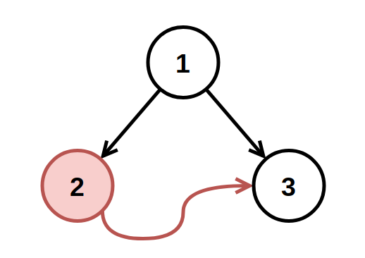
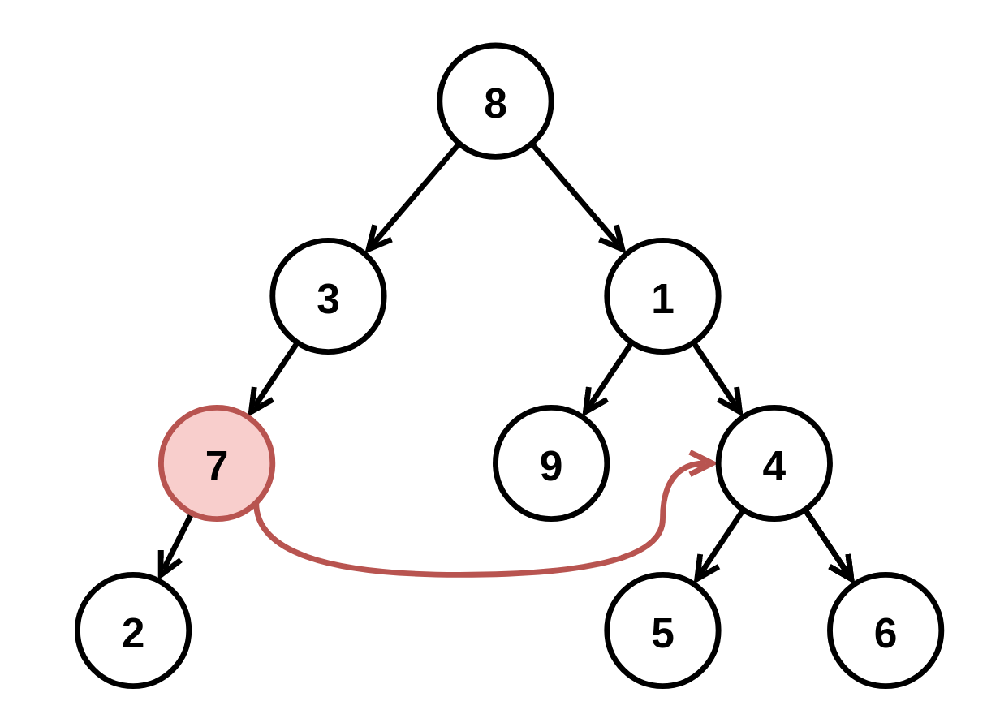

# [1660. Correct a Binary Tree](https://leetcode.com/problems/correct-a-binary-tree/)

| Category | Difficulty | Likes | Dislikes |
| :------: | :--------: | :---: | :------: |
| Algorithms | Medium | 277 | 47 |

**Tags:** [`hash-table`](https://leetcode.com/tag/hash-table), [`tree`](https://leetcode.com/tag/tree), [`depth-first-search`](https://leetcode.com/tag/depth-first-search), [`breadth-first-search`](https://leetcode.com/tag/breadth-first-search), [`binary-tree`](https://leetcode.com/tag/binary-tree)

**Companies:** `google`

## Description

You have a binary tree with a small defect. There is **exactly one** invalid node where its right child incorrectly points to another node at the **same depth** but to the invalid node's right.


Given the root of the binary tree with this defect, `root`, return *the root of the binary tree after **removing** this invalid node **and every node underneath it** (minus the node it incorrectly points to).*


**Custom testing:**


The test input is read as 3 lines:


	- `TreeNode root`

	- `int fromNode` (**not available to **`correctBinaryTree`)

	- `int toNode` (**not available to **`correctBinaryTree`)


After the binary tree rooted at `root` is parsed, the `TreeNode` with value of `fromNode` will have its right child pointer pointing to the `TreeNode` with a value of `toNode`. Then, `root` is passed to `correctBinaryTree`.


 


**Example 1:**


****


```

Input: root = [1,2,3], fromNode = 2, toNode = 3
Output: [1,null,3]
Explanation: The node with value 2 is invalid, so remove it.

```


**Example 2:**


****


```

Input: root = [8,3,1,7,null,9,4,2,null,null,null,5,6], fromNode = 7, toNode = 4
Output: [8,3,1,null,null,9,4,null,null,5,6]
Explanation: The node with value 7 is invalid, so remove it and the node underneath it, node 2.

```


 


**Constraints:**


	- The number of nodes in the tree is in the range `[3, 10^4]`.

	- `-10^9 <= Node.val <= 10^9`

	- All `Node.val` are **unique**.

	- `fromNode != toNode`

	- `fromNode` and `toNode` will exist in the tree and will be on the same depth.

	- `toNode` is to the **right** of `fromNode`.

	- `fromNode.right` is `null` in the initial tree from the test data.

---

**Links:** [Submissions](https://leetcode.com/problems/correct-a-binary-tree/) | [Solutions](https://leetcode.com/problems/correct-a-binary-tree/)
