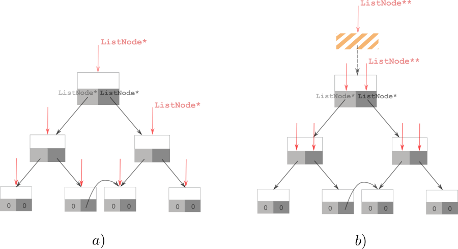
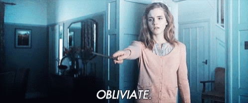

# - 𝕆𝖇𝖑𝖎𝖛𝖎𝖆𝖙𝖊! ^^

**Author:** andrii_khlevniuk
**Votes:** 1
**Link:** [https://leetcode.com/problems/correct-a-binary-tree/solutions/956148/](https://leetcode.com/problems/correct-a-binary-tree/solutions/956148/)

---

This is the default solution
```
class Solution
{
    unordered_set<int> s;
public:           
    TreeNode* correctBinaryTree(TreeNode* r) 
    {      
        if(!r or (r->right and s.count(r->right->val))) return nullptr;
        s.insert(r->val);
        r->right = correctBinaryTree(r->right);
        r->left  = correctBinaryTree(r->left);
        return r;
    }
};
```
but I want to talk about the other one.

The algo is also based on reversed postorder (`root -> right subtree -> left subtree`) traversal and one `unordered_set ` datastructure. 
```
class Solution
{
    unordered_set<int> s;
public:    
    TreeNode* f(TreeNode** r) 
    {
        if(!(*r) or s.count((*r)->val)) return nullptr;       
        s.insert((*r)->val);
        auto isInvalid = f(&(*r)->right) != (*r)->right;
        f(&(*r)->left);
        return isInvalid ? *r = nullptr : *r;
    }
        
    TreeNode* correctBinaryTree(TreeNode* r) 
    {        
        return f(&r);
    }
};
```
The solution is based on the `TreeNode**` trick (https://github.com/mkirchner/linked-list-good-taste).
In this algo instead of traversing the tree like this (a) I traverse it like this (b)




As you can see I address the nodes indirectly via parent's pointers to them. This allows me to have access to the node **and** its parent from the same recursive function call. It's handy as I can instantly make the parent "forget" about its sibling if it happens to be **invalid**. 

It's like the child that has realized that he had failed casts *Obliviate* spell on his parents.

<br>


