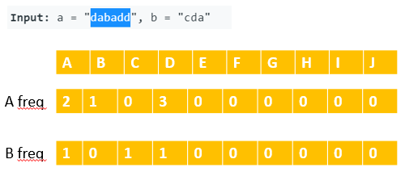
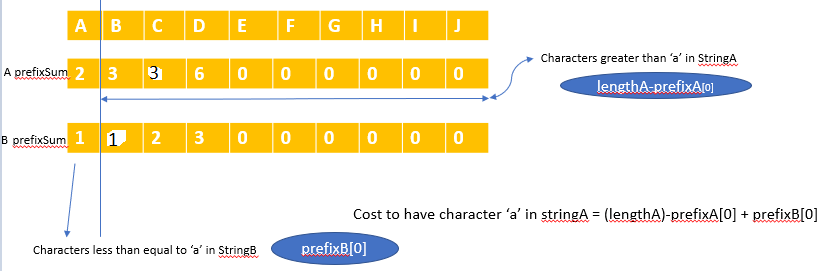
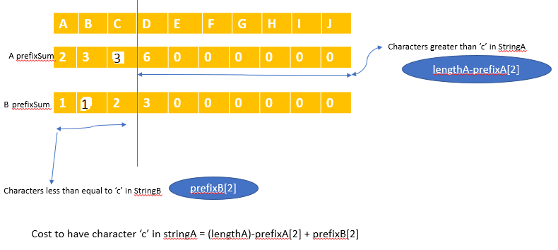

# Java | Explained with Images

**Author:** prashul
**Votes:** 7
**Link:** [https://leetcode.com/problems/change-minimum-characters-to-satisfy-one-of-three-conditions/solutions/1037117/](https://leetcode.com/problems/change-minimum-characters-to-satisfy-one-of-three-conditions/solutions/1037117/)

---

we first calcuate the Afreq and Bfreq , then calculate the prefix sum of these two arrays.
then do manipultations. 
Why ? Below images help to understand what are those manipulations and why we are doing it.


Then we calculate the prefix sum array.
Suppose we decide to have character \u2018a\u2019 in stringA i.e StringA ="aaaaaa", then we need change characters which are greater than \u2018a\u2019 in StringA and change characters less than equal to \u2018a\u2019 in String B , for example b ="cdb" , by doing this StringA will contain only characters less than equal to A and B will contain characters greater than \u2018a\u2019 which satisfies the **Every\xA0letter in\xA0a\xA0is\xA0strictly less\xA0than\xA0every\xA0letter in\xA0b\xA0in the alphabet**

How we can calculate the cost , prefix array help us to determine this.
Note in the image AprefixSum at C is 3 not zero.



Lets take another example 

Suppose we decide to have character less than equal to \u2018c\u2019 in stringA i.e StringA = "**c**aba**cc**" ( we need change characters which are greater than \u2018c\u2019 in StringA, in our case we changed character 'd' to 'c' marked in bold) and at the same time we need to change characters less than equal to \u2018c\u2019 in String B, for example StringB = "**d**d**d**" , 
TransformedString A = "**c**aba**cc**" inputStringA = "dabadd"
TransformedString B = "**d**d**d**"     inputStringB  = "cda"
Again it satisfies  **Every\xA0letter in\xA0a\xA0is\xA0strictly less\xA0than\xA0every\xA0letter in\xA0b\xA0in the alphabet**



We can do the other way round to get the second condition **Every\xA0letter in\xA0b\xA0is\xA0strictly less\xA0than\xA0every\xA0letter in\xA0a\xA0in the alphabet**

Cost to have character \u2018c\u2019 in stringB = (lengthb)-prefixB[2] + prefixA[2]

```
class Solution {
    public int minCharacters(String a, String b) {
        
         int lengthA = a.length();
         int lengthB = b.length();
         int[] afreq = new int[26];
         int[] bfreq = new int[26];
     
        
         int maxFreqA = 0;
         int maxFreqB = 0;

         int res = Integer.MAX_VALUE;
        
         for( int i = 0 ; i < a.length(); i++ )
         {
            int index = a.charAt(i) -'a';
            afreq[ index ]++;    
            maxFreqA = Math.max( maxFreqA,afreq[ index ]); 
         }
        
      
          for( int i = 0 ; i < b.length(); i++ )
          {
              int index = b.charAt(i) -'a';
              bfreq[ index ]++;    
              maxFreqB = Math.max( maxFreqB,bfreq[ index ]); 
          }
        
        res = Math.min( res, lengthA + lengthB - maxFreqA - maxFreqB ); // Both a and b consist of only one distinct letter.
        
        for( int i = 1; i < 26; i++ )
        {
             afreq[i] = afreq[i] + afreq[i-1]; // A prefixSum 
             bfreq[i] = bfreq[i] + bfreq[i-1];// B prefixSum
        }   
        
		//Loop only goes till 'y' character because there is no character greater than z. 
        for( int i =0 ; i < 25; i++ )
        {
            res = Math.min( lengthA - afreq[i] + bfreq[i],res  );
            res = Math.min( lengthB - bfreq[i] + afreq[i],res  );
        }
    return res;
    }
}


