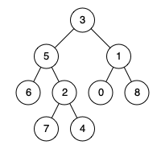

# [1740. Find Distance in a Binary Tree](https://leetcode.com/problems/find-distance-in-a-binary-tree/)

| Category | Difficulty | Likes | Dislikes |
| :------: | :--------: | :---: | :------: |
| Algorithms | Medium | 482 | 19 |

**Tags:** [`hash-table`](https://leetcode.com/tag/hash-table), [`tree`](https://leetcode.com/tag/tree), [`depth-first-search`](https://leetcode.com/tag/depth-first-search), [`breadth-first-search`](https://leetcode.com/tag/breadth-first-search), [`binary-tree`](https://leetcode.com/tag/binary-tree)

**Companies:** `weride`, `amazon`

## Description

Given the root of a binary tree and two integers `p` and `q`, return *the **distance** between the nodes of value *`p`* and value *`q`* in the tree*.

The **distance** between two nodes is the number of edges on the path from one to the other.

 

**Example 1:**


```

Input: root = [3,5,1,6,2,0,8,null,null,7,4], p = 5, q = 0
Output: 3
Explanation: There are 3 edges between 5 and 0: 5-3-1-0.
```

**Example 2:**


```

Input: root = [3,5,1,6,2,0,8,null,null,7,4], p = 5, q = 7
Output: 2
Explanation: There are 2 edges between 5 and 7: 5-2-7.
```

**Example 3:**


```

Input: root = [3,5,1,6,2,0,8,null,null,7,4], p = 5, q = 5
Output: 0
Explanation: The distance between a node and itself is 0.
```

 

**Constraints:**

	- The number of nodes in the tree is in the range `[1, 10^4]`.

	- `0 <= Node.val <= 10^9`

	- All `Node.val` are **unique**.

	- `p` and `q` are values in the tree.

---

**Links:** [Submissions](https://leetcode.com/problems/find-distance-in-a-binary-tree/) | [Solutions](https://leetcode.com/problems/find-distance-in-a-binary-tree/)
