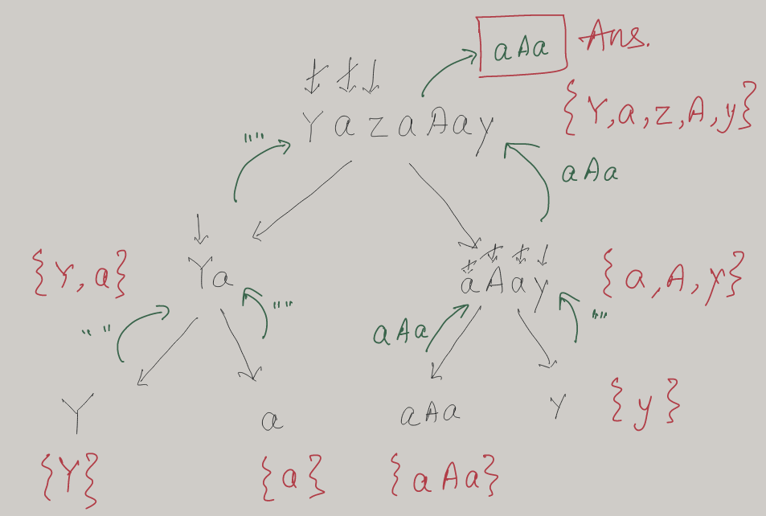

# Java | Why Divide & Conquer | Explained

**Author:** prashant404
**Votes:** 122
**Link:** [https://leetcode.com/problems/longest-nice-substring/solutions/1645774/](https://leetcode.com/problems/longest-nice-substring/solutions/1645774/)

---

**Idea:** 
* Why this is a Divide & Conquer problem?
	* If you've solved a good variety of problems, your initial approach might be Sliding window technique, which won't work, at least not in its template form
	* However when you go down that route, you'll see that a string can possbily become nice later but then some character gets into the string which will make it impossible for that sub-string to become nice because that char doesn't exist in the entire string. So we know there's no point in continuing any further.
	* In fact this character (say z in the given example) will not let any substring become nice in the entire string, so the only way to find a nice substring is to exlude this char, which means you split the string at z, something like `[start...]z[...end]`
	* Now you have two sub-problems with the left and right partitions which ask you to find the original LNS problem, which you can do recursively. This is the very definition of [Divide-and-Conquer technique](https://en.wikipedia.org/wiki/Divide-and-conquer_algorithm) - *A divide-and-conquer algorithm recursively breaks down a problem into two or more sub-problems of the same or related type, until these become simple enough to be solved directly. The solutions to the sub-problems are then combined to give a solution to the original problem.* 
* As long as both upper and lower case chars exists in the string, keep moving, else take the erroneous character as a partition and check for its left and right parts to be nice strings.
* s is not a nice string if size(s) < 2
* Return the longer nice sub-string from the recursive method
* If you'll use `>` instead of `>=` then you'll get the nice substring which occurs last, but the question says that in case of a tie, return the earliest one, thus `prefix >= suffix`
* Space complexity: 
    * Size of the set can at max be 52 because allowed characters in s are a-z and A-Z, so the space of set will be O(1)
    * Space is O(n) because the recursive call stack can be n levels deep




>**T/S:** O(n\xB2)/O(n), where n = size(s)
```
public String longestNiceSubstring(String s) {
	var sub = longestNiceSubstring(s, 0, s.length());
	return s.substring(sub[0], sub[1]);
}

private int[] longestNiceSubstring(String s, int left, int right) {
	var charSet = getCharSet(s, left, right);

	for (var i = left; i < right; i++)
		if (!charSet.contains(Character.toLowerCase(s.charAt(i))) 
		 || !charSet.contains(Character.toUpperCase(s.charAt(i)))) {
		 
			var prefix = longestNiceSubstring(s, left, i);
			var suffix = longestNiceSubstring(s, i + 1, right);
			return prefix[1] - prefix[0] >= suffix[1] - suffix[0] 
				 ? prefix 
				 : suffix;
		}
		
	return new int[]{left, right};
}

private Set<Character> getCharSet(String s, int left, int right) {
	var charSet = new HashSet<Character>();
	
	for (var i = left; i < right; i++)
		charSet.add(s.charAt(i));
		
	return charSet;
}
```

`getCharSet` method can be replaced with this 1 liner
```
IntStream.range(left, right)
	     .mapToObj(s::charAt)
		 .collect(Collectors.toCollection(HashSet::new));
```
***Please upvote if this helps***