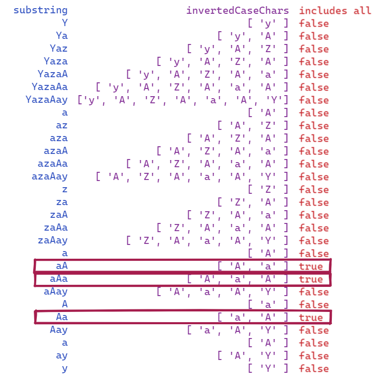
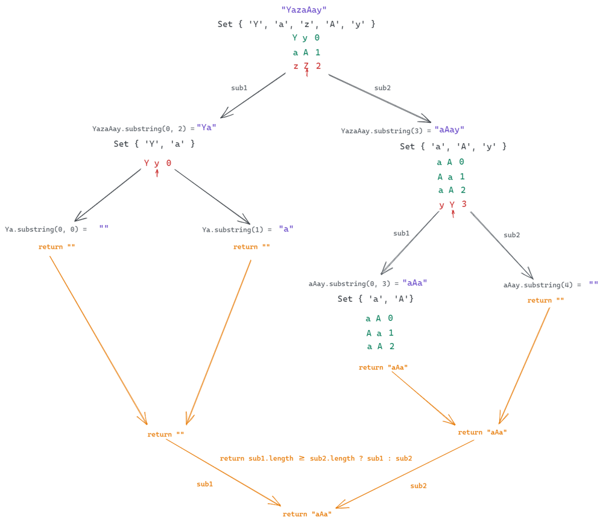

# JavaScript: Brute-force and Divide and Conquer (With illustrations)

**Author:** RinatRezyapov
**Votes:** 35
**Link:** [https://leetcode.com/problems/longest-nice-substring/solutions/2237699/](https://leetcode.com/problems/longest-nice-substring/solutions/2237699/)

---

# 1. Brute-force (not an optimal solution).
We just make an assumption that if we invert case of chars in a nice string then we will have at least one char in the inverted string for each char in the original string. For example, `aA` -> inverting case -> `Aa` - each char from original string is present in inverted string but in different order. That what we do in the code.
**Example: s = "YazaAay"**


```
const swapCase = (str) => str.split('').map((c) => c === c.toUpperCase() ? c.toLowerCase() : c.toUpperCase()).join('');

var longestNiceSubstring = function(s) {
    let ans = "";
        for (let i = 0; i < s.length; i++) {
            for (let ii = i + 1; ii < s.length + 1; ii++) {
                let substring = s.slice(i, ii); // we take a substring

                let invertedCaseChars = [...substring].map(swapCase); // we create an array of chars from the substring and invert case of this chars
                
                if (invertedCaseChars.every(char => substring.includes(char))) { // we check that substring includes every case inverted char (see the illustration above)
                    ans = substring.length > ans.length ? substring : ans; // we select the longest substring which satisfies our condition
                }
            } 
        }
        return ans 
};
```

# 2. Divide and Conquer (an optimal solution).
This method is pretty similar to the brute-force. We check that the lowerCase and upperCase versions of a char are present in the Set, if not we divide the string by this char and solve similar problem but with smaller substring in the next recursions. It's usually pretty hard to imagine the process of solving a problem with recursion that's why I created the illustration:



```
const longestNiceSubstring = (s) => {
    if (s.length < 2) return "";
    let arr = [...s];
    let set = new Set(arr);
    for (let i = 0; i < arr.length; i++) {
        const c = arr[i];
        if (set.has(c.toUpperCase()) && set.has(c.toLowerCase())) continue;
        const sub1 = longestNiceSubstring(s.substring(0, i));
        const sub2 = longestNiceSubstring(s.substring(i + 1));
        return sub1.length >= sub2.length ? sub1 : sub2;
    }
    return s; 
}
```


Also, it's not an easy problem.