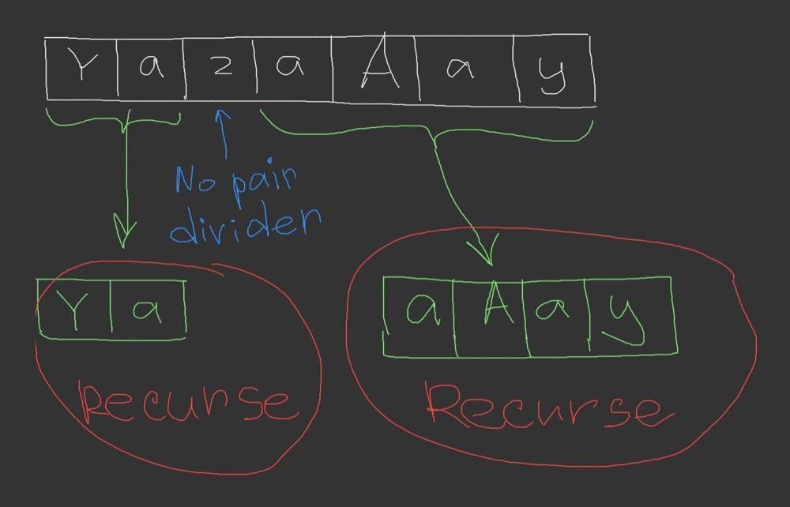

# Divide&Conquer + BitManipulation + Sliding-Window, beats 100%

**Author:** rrrrrr111
**Votes:** 0
**Link:** [https://leetcode.com/problems/longest-nice-substring/solutions/5581331/](https://leetcode.com/problems/longest-nice-substring/solutions/5581331/)

---

# Intuition

1. We can check the string, if it contains only characters with corresponding pairs then we can return this string as a result. 
2. If the string contains any character without a pair, these characters cannot be in a result string in any possible way. 
3. Characters without a pair act like dividers for candidate sub-strings, so we can recurse at this point.




# Complexity time: $$O(2^n)$$, space: $$O(2^n)$$ 
# Code
```
class Solution {
    var result = ""
    fun longestNiceSubstring(s: String): String {
        recurse(s)
        return result
    }

    fun recurse(str: String, fromIndex: Int = 0, toIndex: Int = str.length) {
        // Use Integer as a bit-set to collect upper and lower characters.
        // First 26 bits of 32-length Integer used for every distinct upper character,
        // and the same goes for lower characters.
        var uppersSet = 0
        var lowersSet = 0
        var index = fromIndex - 1
        while (++index < toIndex) {
            val char = str[index]
            if (char.isUpperCase())
                uppersSet = uppersSet or (1 shl (char.code - 'A'.code))
            else lowersSet = lowersSet or (1 shl (char.code - 'a'.code))
        }
        // XOR leaves only characters without a corresponding pair (dividers)
        val dividers = uppersSet xor lowersSet
        val isNiceString = dividers == 0
        if (isNiceString) {
            result = str.substring(fromIndex, toIndex)
            return
        }
        // with Sliding-Window check sub-strings between dividers
        var subStrFrom = fromIndex
        var subStrTo = fromIndex - 1
        while (++subStrTo <= toIndex) {
            val isNiceChar = subStrTo < toIndex && str.isNiceChar(subStrTo, dividers)
            if (!isNiceChar) {
                while (subStrFrom < subStrTo && !str.isNiceChar(subStrFrom, dividers))
                    subStrFrom++
                if (subStrTo - subStrFrom > result.length)
                    recurse(str, subStrFrom, subStrTo)
                subStrFrom = subStrTo + 1
            }
        }
    }

    inline fun String.isNiceChar(index: Int, dividers: Int): Boolean {
        val char = this[index]
        val setIndex = char.code - (if (char.isUpperCase()) 'A' else 'a').code
        return ((1 shl setIndex) and dividers) == 0
    }
}
```