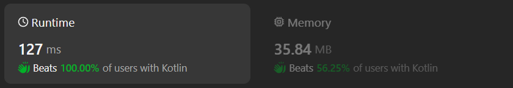

# Kotlin solution with O(n) time and O(1) space

**Author:** chayangkoon
**Votes:** 0
**Link:** [https://leetcode.com/problems/second-largest-digit-in-a-string/solutions/4977063/](https://leetcode.com/problems/second-largest-digit-in-a-string/solutions/4977063/)

---



# Complexity
- Time complexity:
O(n)

- Space complexity:
O(1)

# Code
```
class Solution {
    fun secondHighest(s: String): Int {
        var maxDigit = Char.MIN_VALUE
        var secondMaxDigit = Char.MIN_VALUE

        for(char in s) {
            if(!char.isDigit()) continue
            if(char > maxDigit) {
                secondMaxDigit = maxDigit
                maxDigit = char
            } else if(char < maxDigit && char > secondMaxDigit) {
                secondMaxDigit = char
            }
        }

        return if(secondMaxDigit == Char.MIN_VALUE) {
            -1
        } else {
            secondMaxDigit.digitToInt()
        }
    }
}
```