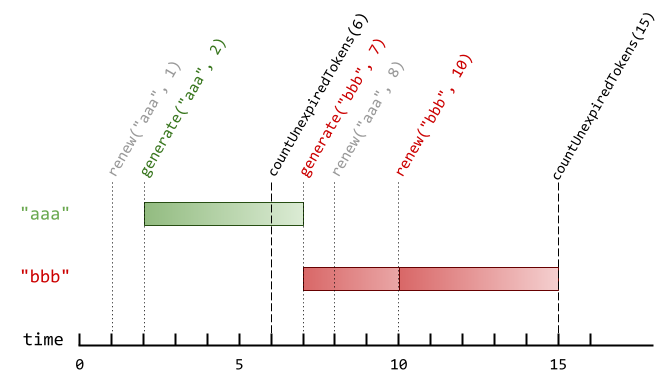

# [1797. Design Authentication Manager](https://leetcode.com/problems/design-authentication-manager/)

| Category | Difficulty | Likes | Dislikes |
| :------: | :--------: | :---: | :------: |
| Algorithms | Medium | 417 | 56 |

**Tags:** [`hash-table`](https://leetcode.com/tag/hash-table), [`linked-list`](https://leetcode.com/tag/linked-list), [`design`](https://leetcode.com/tag/design), [`doubly-linked-list`](https://leetcode.com/tag/doubly-linked-list)

**Companies:** `microsoft`, `deliveroo`, `ncr`, `atlassian`, `oracle`, `confluent`, `docusign`, `twitter`

## Description

There is an authentication system that works with authentication tokens. For each session, the user will receive a new authentication token that will expire `timeToLive` seconds after the `currentTime`. If the token is renewed, the expiry time will be extended to expire `timeToLive` seconds after the (potentially different) `currentTime`.

Implement the `AuthenticationManager` class:

	- `AuthenticationManager(int timeToLive)` constructs the `AuthenticationManager` and sets the `timeToLive`.

	- `generate(string tokenId, int currentTime)` generates a new token with the given `tokenId` at the given `currentTime` in seconds.

	- `renew(string tokenId, int currentTime)` renews the **unexpired** token with the given `tokenId` at the given `currentTime` in seconds. If there are no unexpired tokens with the given `tokenId`, the request is ignored, and nothing happens.

	- `countUnexpiredTokens(int currentTime)` returns the number of **unexpired** tokens at the given currentTime.

Note that if a token expires at time `t`, and another action happens on time `t` (`renew` or `countUnexpiredTokens`), the expiration takes place **before** the other actions.

 

**Example 1:**


```

Input
[&quot;AuthenticationManager&quot;, &quot;renew&quot;, &quot;generate&quot;, &quot;countUnexpiredTokens&quot;, &quot;generate&quot;, &quot;renew&quot;, &quot;renew&quot;, &quot;countUnexpiredTokens&quot;]
[[5], [&quot;aaa&quot;, 1], [&quot;aaa&quot;, 2], [6], [&quot;bbb&quot;, 7], [&quot;aaa&quot;, 8], [&quot;bbb&quot;, 10], [15]]
Output
[null, null, null, 1, null, null, null, 0]

Explanation
AuthenticationManager authenticationManager = new AuthenticationManager(5); // Constructs the AuthenticationManager with timeToLive = 5 seconds.
authenticationManager.renew(&quot;aaa&quot;, 1); // No token exists with tokenId &quot;aaa&quot; at time 1, so nothing happens.
authenticationManager.generate(&quot;aaa&quot;, 2); // Generates a new token with tokenId &quot;aaa&quot; at time 2.
authenticationManager.countUnexpiredTokens(6); // The token with tokenId &quot;aaa&quot; is the only unexpired one at time 6, so return 1.
authenticationManager.generate(&quot;bbb&quot;, 7); // Generates a new token with tokenId &quot;bbb&quot; at time 7.
authenticationManager.renew(&quot;aaa&quot;, 8); // The token with tokenId &quot;aaa&quot; expired at time 7, and 8 &gt;= 7, so at time 8 the renew request is ignored, and nothing happens.
authenticationManager.renew(&quot;bbb&quot;, 10); // The token with tokenId &quot;bbb&quot; is unexpired at time 10, so the renew request is fulfilled and now the token will expire at time 15.
authenticationManager.countUnexpiredTokens(15); // The token with tokenId &quot;bbb&quot; expires at time 15, and the token with tokenId &quot;aaa&quot; expired at time 7, so currently no token is unexpired, so return 0.

```

 

**Constraints:**

	- `1 <= timeToLive <= 10^8`

	- `1 <= currentTime <= 10^8`

	- `1 <= tokenId.length <= 5`

	- `tokenId` consists only of lowercase letters.

	- All calls to `generate` will contain unique values of `tokenId`.

	- The values of `currentTime` across all the function calls will be **strictly increasing**.

	- At most `2000` calls will be made to all functions combined.

---

**Links:** [Submissions](https://leetcode.com/problems/design-authentication-manager/) | [Solutions](https://leetcode.com/problems/design-authentication-manager/)
