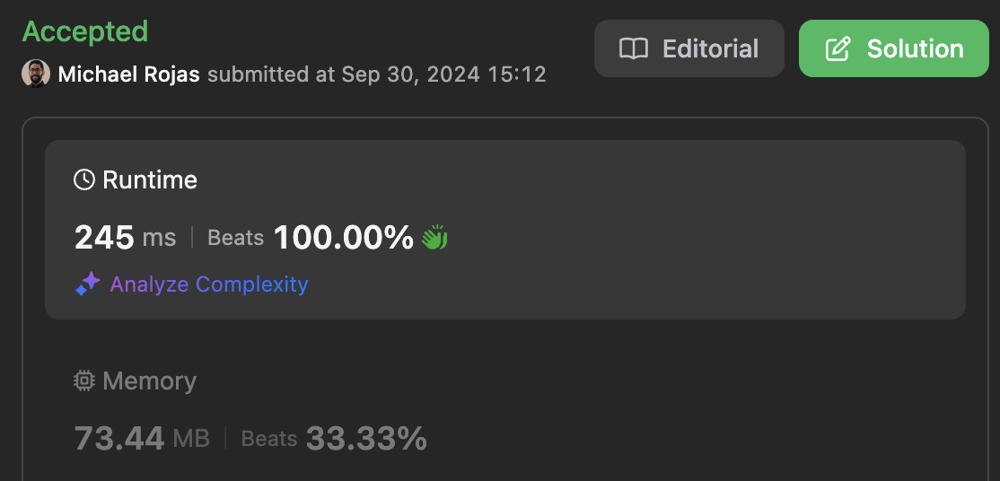

# Trie | Time: O(N) | Space: O(NM)

**Author:** rojas
**Votes:** 0
**Link:** [https://leetcode.com/problems/implement-trie-ii-prefix-tree/solutions/5853590/](https://leetcode.com/problems/implement-trie-ii-prefix-tree/solutions/5853590/)

---

# Complexity

- Time complexity: $$O(N)$$

- Space complexity: $$O(NM)$$

# Performance

[Javascript Submission](https://leetcode.com/problems/implement-trie-ii-prefix-tree/submissions/1407462807/)



# Code

```typescript []
const LOWER_A = "a".charCodeAt(0);

class TrieNode {
    children: TrieNode[];
    count: number;
    prefixCount: number;

    constructor() {
        this.children = new Array(26);
        this.count = 0;
        this.prefixCount = 0;
    }
}

class Trie {
    private root: TrieNode;

    constructor() {
        this.root = new TrieNode();
    }

    insert(s: string): void {
        let node = this.root;
        for (let i = 0; i < s.length; ++i) {
            const code = s.charCodeAt(i) - LOWER_A;
            let next = node.children[code];
            if (next == null) {
                next = new TrieNode();
                node.children[code] = next;
            }
            node = next;
            ++node.prefixCount;
        }
        ++node.count;
    }

    countWordsEqualTo(s: string): number {
        let node = this.root;
        for (let i = 0; node != null && i < s.length; ++i) {
            node = node.children[s.charCodeAt(i) - LOWER_A];
        }
        return node?.count ?? 0;
    }

    countWordsStartingWith(prefix: string): number {
        let node = this.root;
        for (let i = 0; node != null && i < prefix.length; ++i) {
            node = node.children[prefix.charCodeAt(i) - LOWER_A];
        }
        return node?.prefixCount ?? 0;
    }

    erase(s: string): void {
        // Assumes word exists in trie
        let node = this.root;
        for (let i = 0; i < s.length; ++i) {
            const code = s.charCodeAt(i) - LOWER_A;
            if (--node.children[code].prefixCount < 1) {
                node.children[code] = undefined;
                return;
            }
            node = node.children[code];
        }
        --node.count;
    }
}
```

```javascript []
const LOWER_A = "a".charCodeAt(0);

class TrieNode {

    constructor() {
        this.children = new Array(26);
        this.count = 0;
        this.prefixCount = 0;
    }
}

class Trie {

    constructor() {
        this.root = new TrieNode();
    }

    insert(s) {
        let node = this.root;
        for (let i = 0; i < s.length; ++i) {
            const code = s.charCodeAt(i) - LOWER_A;
            let next = node.children[code];
            if (next == null) {
                next = new TrieNode();
                node.children[code] = next;
            }
            node = next;
            ++node.prefixCount;
        }
        ++node.count;
    }

    countWordsEqualTo(s) {
        let node = this.root;
        for (let i = 0; node != null && i < s.length; ++i) {
            node = node.children[s.charCodeAt(i) - LOWER_A];
        }
        return node?.count ?? 0;
    }

    countWordsStartingWith(prefix) {
        let node = this.root;
        for (let i = 0; node != null && i < prefix.length; ++i) {
            node = node.children[prefix.charCodeAt(i) - LOWER_A];
        }
        return node?.prefixCount ?? 0;
    }

    erase(s) {
        // Assumes word exists in trie
        let node = this.root;
        for (let i = 0; i < s.length; ++i) {
            const code = s.charCodeAt(i) - LOWER_A;
            if (--node.children[code].prefixCount < 1) {
                node.children[code] = undefined;
                return;
            }
            node = node.children[code];
        }
        --node.count;
    }
}
```