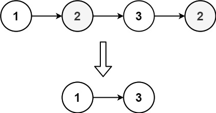
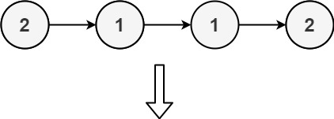
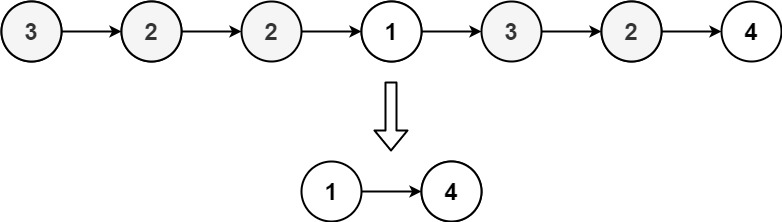

# [1836. Remove Duplicates From an Unsorted Linked List](https://leetcode.com/problems/remove-duplicates-from-an-unsorted-linked-list/)

| Category | Difficulty | Likes | Dislikes |
| :------: | :--------: | :---: | :------: |
| Algorithms | Medium | 408 | 12 |

**Tags:** [`hash-table`](https://leetcode.com/tag/hash-table), [`linked-list`](https://leetcode.com/tag/linked-list)

**Companies:** `amazon`, `microsoft`

## Description

Given the `head` of a linked list, find all the values that appear **more than once** in the list and delete the nodes that have any of those values.


Return *the linked list after the deletions.*


 


**Example 1:**


```

Input: head = [1,2,3,2]
Output: [1,3]
Explanation: 2 appears twice in the linked list, so all 2&#39;s should be deleted. After deleting all 2&#39;s, we are left with [1,3].

```


**Example 2:**


```

Input: head = [2,1,1,2]
Output: []
Explanation: 2 and 1 both appear twice. All the elements should be deleted.

```


**Example 3:**


```

Input: head = [3,2,2,1,3,2,4]
Output: [1,4]
Explanation: 3 appears twice and 2 appears three times. After deleting all 3&#39;s and 2&#39;s, we are left with [1,4].

```


 


**Constraints:**


	- The number of nodes in the list is in the range `[1, 10^5]`

	- `1 <= Node.val <= 10^5`

---

**Links:** [Submissions](https://leetcode.com/problems/remove-duplicates-from-an-unsorted-linked-list/) | [Solutions](https://leetcode.com/problems/remove-duplicates-from-an-unsorted-linked-list/)
