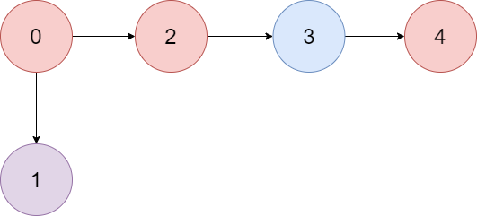
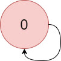

# [1857. Largest Color Value in a Directed Graph](https://leetcode.com/problems/largest-color-value-in-a-directed-graph/)

| Category | Difficulty | Likes | Dislikes |
| :------: | :--------: | :---: | :------: |
| Algorithms | Hard | 2597 | 87 |

**Tags:** [`hash-table`](https://leetcode.com/tag/hash-table), [`dynamic-programming`](https://leetcode.com/tag/dynamic-programming), [`graph`](https://leetcode.com/tag/graph), [`topological-sort`](https://leetcode.com/tag/topological-sort), [`memoization`](https://leetcode.com/tag/memoization), [`counting`](https://leetcode.com/tag/counting)

**Companies:** `juspay`, `facebook`, `google`

## Description

There is a **directed graph** of `n` colored nodes and `m` edges. The nodes are numbered from `0` to `n - 1`.

You are given a string `colors` where `colors[i]` is a lowercase English letter representing the **color** of the `i^th` node in this graph (**0-indexed**). You are also given a 2D array `edges` where `edges[j] = [a_j, b_j]` indicates that there is a **directed edge** from node `a_j` to node `b_j`.

A valid **path** in the graph is a sequence of nodes `x_1 -> x_2 -> x_3 -> ... -> x_k` such that there is a directed edge from `x_i` to `x_i+1` for every `1 <= i < k`. The **color value** of the path is the number of nodes that are colored the **most frequently** occurring color along that path.

Return *the **largest color value** of any valid path in the given graph, or *`-1`* if the graph contains a cycle*.

 

**Example 1:**



```

Input: colors = &quot;abaca&quot;, edges = [[0,1],[0,2],[2,3],[3,4]]
Output: 3
Explanation: The path 0 -&gt; 2 -&gt; 3 -&gt; 4 contains 3 nodes that are colored &quot;a&quot; (red in the above image).

```

**Example 2:**



```

Input: colors = &quot;a&quot;, edges = [[0,0]]
Output: -1
Explanation: There is a cycle from 0 to 0.

```

 

**Constraints:**

	- `n == colors.length`

	- `m == edges.length`

	- `1 <= n <= 10^5`

	- `0 <= m <= 10^5`

	- `colors` consists of lowercase English letters.

	- `0 <= a_j, b_j < n`

---

**Links:** [Submissions](https://leetcode.com/problems/largest-color-value-in-a-directed-graph/) | [Solutions](https://leetcode.com/problems/largest-color-value-in-a-directed-graph/)
