# Image Explanation🏆- [Simple BFS - "COMPLETE" Intuition] - C++/Java/Python

**Author:** aryan_0077
**Votes:** 110
**Link:** [https://leetcode.com/problems/largest-color-value-in-a-directed-graph/solutions/3396205/](https://leetcode.com/problems/largest-color-value-in-a-directed-graph/solutions/3396205/)

---

# Video Solution (`Aryan Mittal`) - Link in LeetCode Profile\r
`Largest Color Value in a Directed Graph` by `Aryan Mittal`\r
\r
\r
\r
\r
# Approach & Intution\r
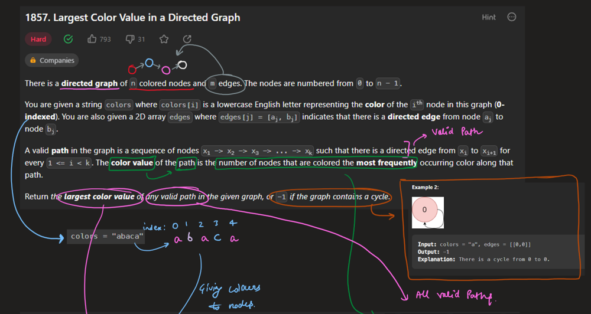\r
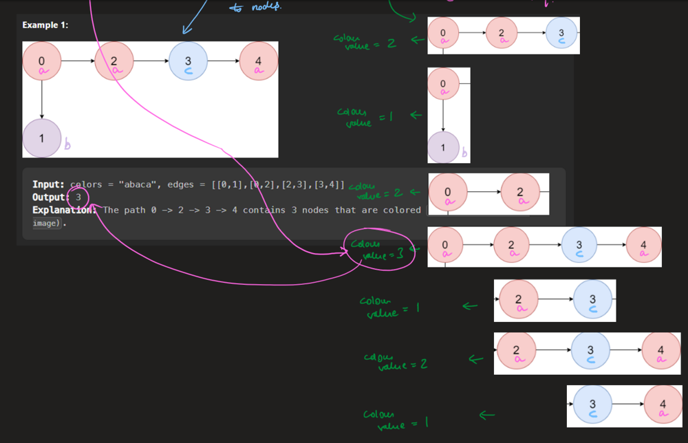\r
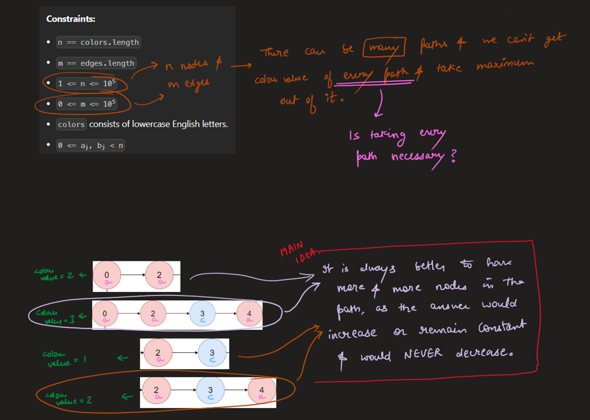\r
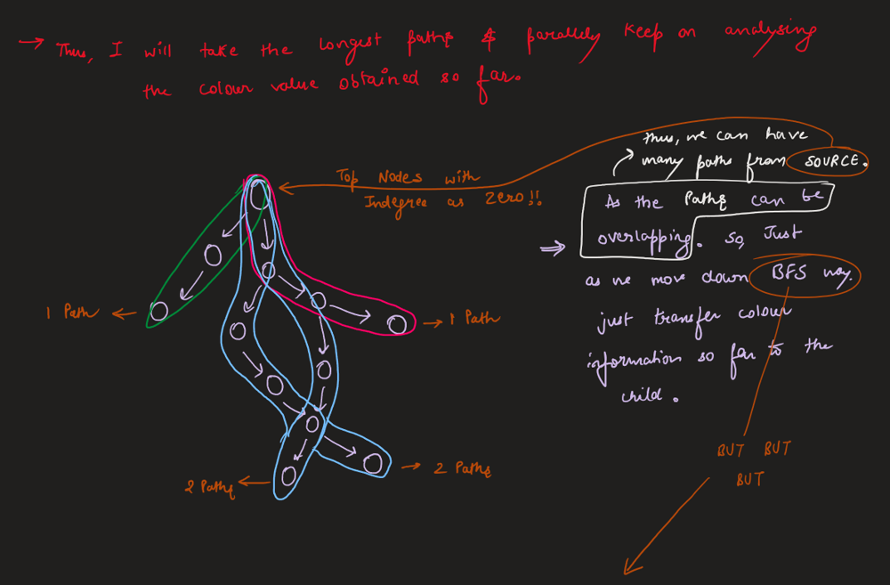\r
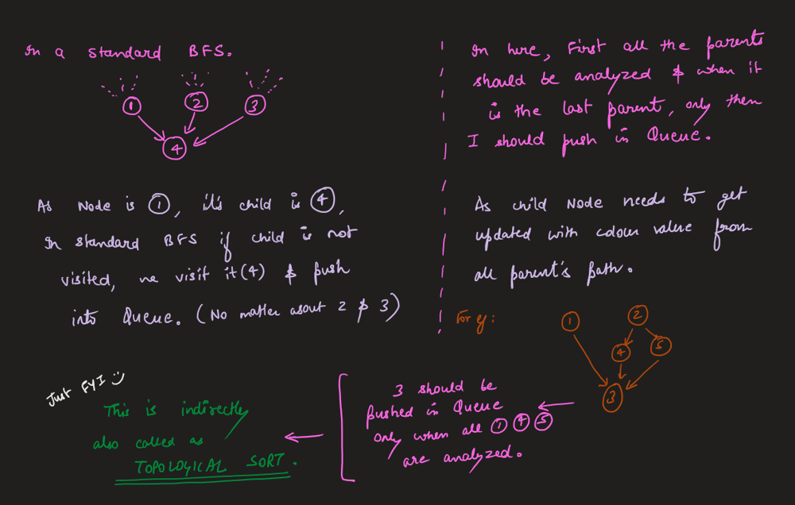\r
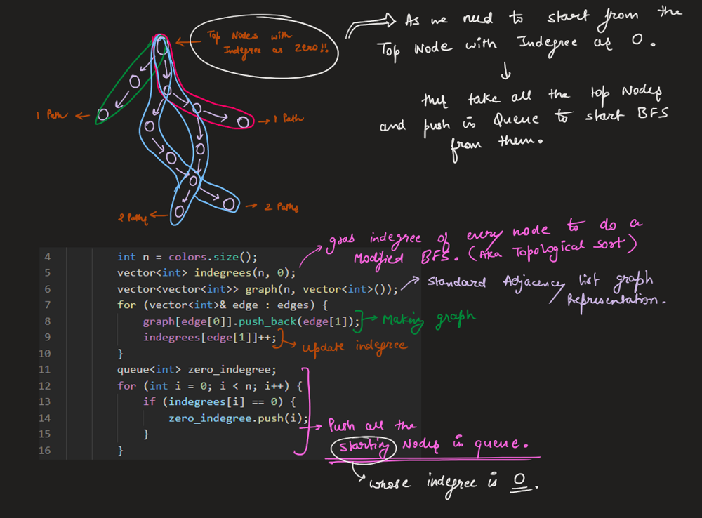\r
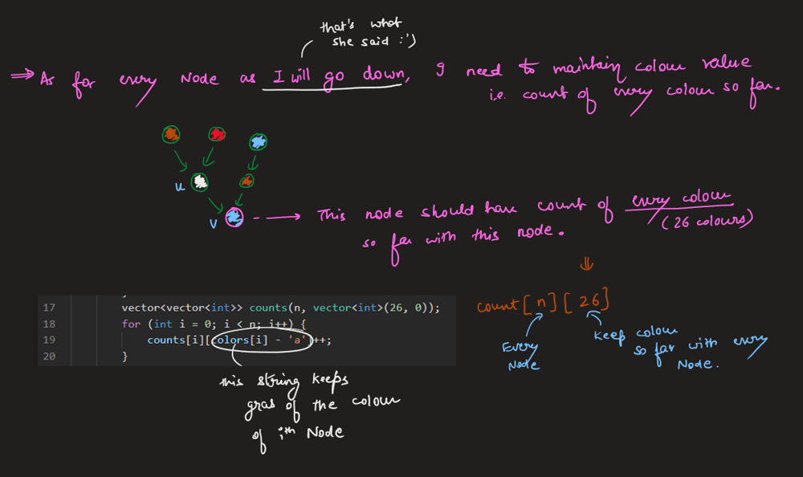\r
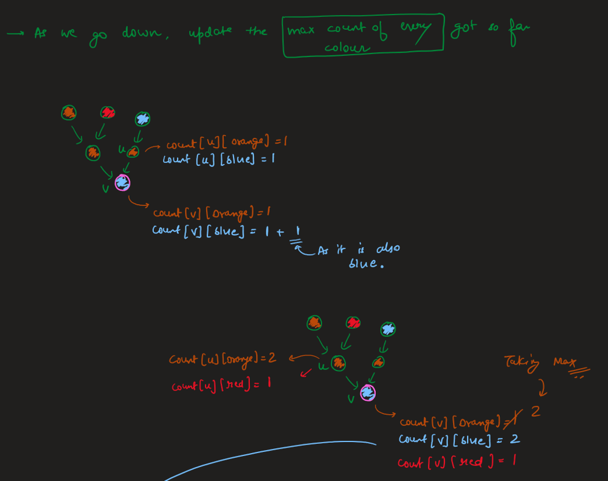\r
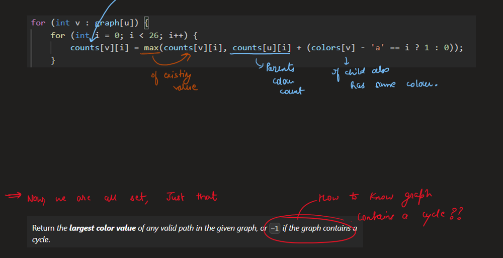\r
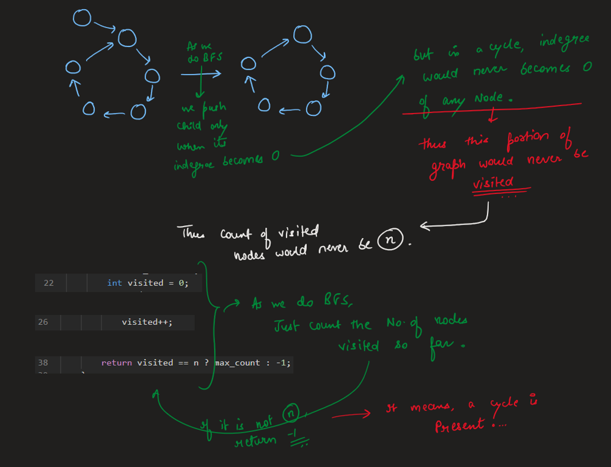\r
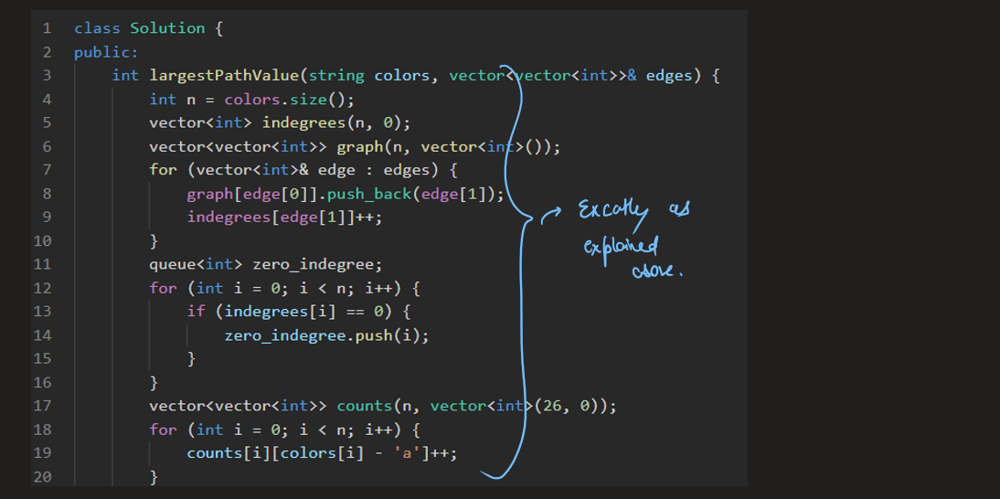\r
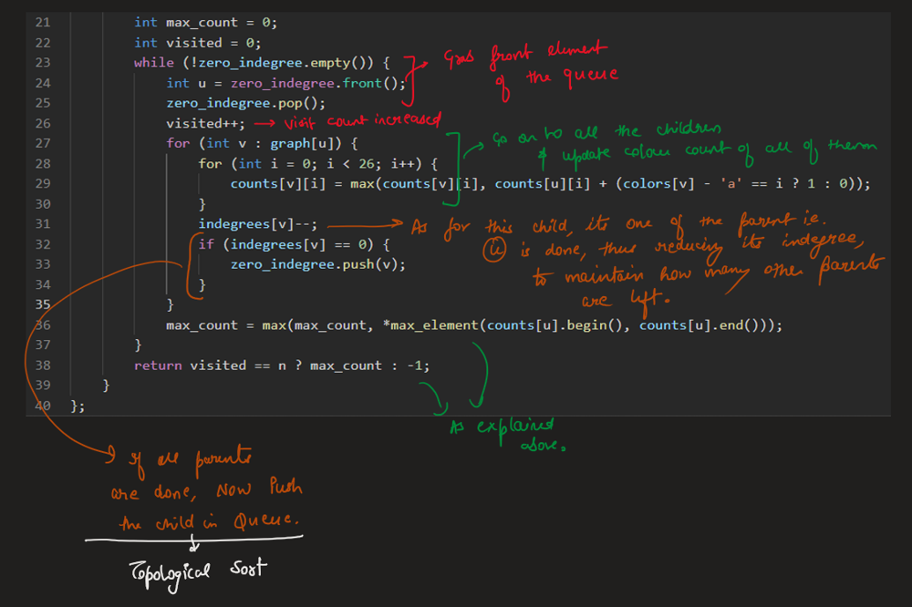\r
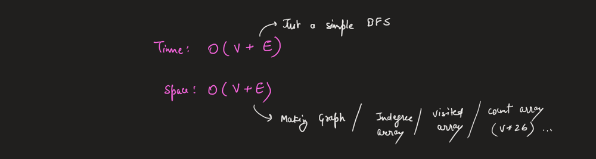\r
\r
\r
# Code\r
```C++ []\r
class Solution {\r
public:\r
    int largestPathValue(string colors, vector<vector<int>>& edges) {\r
        int n = colors.size();\r
        vector<int> indegrees(n, 0);\r
        vector<vector<int>> graph(n, vector<int>());\r
        for (vector<int>& edge : edges) {\r
            graph[edge[0]].push_back(edge[1]);\r
            indegrees[edge[1]]++;\r
        }\r
        queue<int> zero_indegree;\r
        for (int i = 0; i < n; i++) {\r
            if (indegrees[i] == 0) {\r
                zero_indegree.push(i);\r
            }\r
        }\r
        vector<vector<int>> counts(n, vector<int>(26, 0));\r
        for (int i = 0; i < n; i++) {\r
            counts[i][colors[i] - 'a']++;\r
        }\r
        int max_count = 0;\r
        int visited = 0;\r
        while (!zero_indegree.empty()) {\r
            int u = zero_indegree.front();\r
            zero_indegree.pop();\r
            visited++;\r
            for (int v : graph[u]) {\r
                for (int i = 0; i < 26; i++) {\r
                    counts[v][i] = max(counts[v][i], counts[u][i] + (colors[v] - 'a' == i ? 1 : 0));\r
                }\r
                indegrees[v]--;\r
                if (indegrees[v] == 0) {\r
                    zero_indegree.push(v);\r
                }\r
            }\r
            max_count = max(max_count, *max_element(counts[u].begin(), counts[u].end()));\r
        }\r
        return visited == n ? max_count : -1;\r
    }\r
};\r
```\r
```Java []\r
class Solution {\r
    public int largestPathValue(String colors, int[][] edges) {\r
        int n = colors.length();\r
        int[] indegrees = new int[n];\r
        List<List<Integer>> graph = new ArrayList<>();\r
        for (int i = 0; i < n; i++) {\r
            graph.add(new ArrayList<Integer>());\r
        }\r
        for (int[] edge : edges) {\r
            graph.get(edge[0]).add(edge[1]);\r
            indegrees[edge[1]]++;\r
        }\r
        Queue<Integer> zeroIndegree = new LinkedList<>();\r
        for (int i = 0; i < n; i++) {\r
            if (indegrees[i] == 0) {\r
                zeroIndegree.offer(i);\r
            }\r
        }\r
        int[][] counts = new int[n][26];\r
        for (int i = 0; i < n; i++) {\r
            counts[i][colors.charAt(i) - 'a']++;\r
        }\r
        int maxCount = 0;\r
        int visited = 0;\r
        while (!zeroIndegree.isEmpty()) {\r
            int u = zeroIndegree.poll();\r
            visited++;\r
            for (int v : graph.get(u)) {\r
                for (int i = 0; i < 26; i++) {\r
                    counts[v][i] = Math.max(counts[v][i], counts[u][i] + (colors.charAt(v) - 'a' == i ? 1 : 0));\r
                }\r
                indegrees[v]--;\r
                if (indegrees[v] == 0) {\r
                    zeroIndegree.offer(v);\r
                }\r
            }\r
            maxCount = Math.max(maxCount, Arrays.stream(counts[u]).max().getAsInt());\r
        }\r
        return visited == n ? maxCount : -1;\r
    }\r
}\r
```\r
```Python []\r
from typing import List\r
from collections import deque\r
\r
class Solution:\r
    def largestPathValue(self, colors: str, edges: List[List[int]]) -> int:\r
        n = len(colors)\r
        indegrees = [0] * n\r
        graph = [[] for _ in range(n)]\r
        for edge in edges:\r
            graph[edge[0]].append(edge[1])\r
            indegrees[edge[1]] += 1\r
        zero_indegree = deque()\r
        for i in range(n):\r
            if indegrees[i] == 0:\r
                zero_indegree.append(i)\r
        counts = [[0]*26 for _ in range(n)]\r
        for i in range(n):\r
            counts[i][ord(colors[i]) - ord('a')] += 1\r
        max_count = 0\r
        visited = 0\r
        while zero_indegree:\r
            u = zero_indegree.popleft()\r
            visited += 1\r
            for v in graph[u]:\r
                for i in range(26):\r
                    counts[v][i] = max(counts[v][i], counts[u][i] + (ord(colors[v]) - ord('a') == i))\r
                indegrees[v] -= 1\r
                if indegrees[v] == 0:\r
                    zero_indegree.append(v)\r
            max_count = max(max_count, max(counts[u]))\r
        return max_count if visited == n else -1\r
```\r
