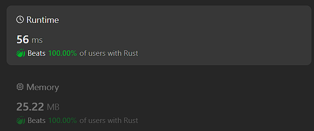

# rust 100% beats answer

**Author:** sovlynn
**Votes:** 0
**Link:** [https://leetcode.com/problems/largest-color-value-in-a-directed-graph/solutions/4975492/](https://leetcode.com/problems/largest-color-value-in-a-directed-graph/solutions/4975492/)

---

\r
\r
# Intuition\r
if we have a node with multiple nodes as perants, we would go next until all edges to this node is considered.\r
\r
\r
# Approach\r
Try avoid using match and complex collections. When you are sure about the length of an array, use Vec, if this length is fixed, use array. Avoid using HashMap or HashSet, though they may seems cool.\r
\r
Iteration, on the other hand, seems that it doesn't affect performance much.\r
\r
Those only work on leetcode environment.\r
\r
# Complexity\r
- Time complexity:\r
$$O(V+E)$$\r
\r
- Space complexity:\r
$$O(V+E)$$\r
\r
# Code\r
```\r
use std::collections::VecDeque;\r
use std::cmp::max;\r
impl Solution {\r
    pub fn largest_path_value(colors: String, edges: Vec<Vec<i32>>) -> i32 {\r
        let mut map=vec![Vec::new(); colors.len()];\r
        let mut indegree=vec![0; colors.len()];\r
        let colors=colors.as_bytes();\r
        for v in &edges{\r
            let (f, t)=(v[0] as usize, v[1] as usize);\r
            if f==t{return -1;}\r
            map[f].push(t);\r
            indegree[t]+=1;\r
        }\r
        let mut q=(0..colors.len()).filter(|x|indegree[*x]==0).collect::<VecDeque<usize>>();\r
        if q.len()==0{\r
            return -1;\r
        }\r
        let mut res=0;\r
        let mut rec=vec![[0; 26]; colors.len()];\r
        let mut visited=0;\r
        for i in &q{rec[*i][(colors[*i]-b'a') as usize]+=1;}\r
        while q.len()>0{\r
            let cur=q.pop_front().unwrap();\r
            visited+=1;\r
            if map[cur].len()==0{\r
                res=max(res, *rec[cur].iter().max().unwrap());\r
            }else{\r
                for nxt in &map[cur]{\r
                    let nxt=*nxt;\r
                    for i in 0..26{if rec[cur][i]>rec[nxt][i]{rec[nxt][i]=rec[cur][i];}}\r
                    indegree[nxt]-=1;\r
                    if indegree[nxt]==0{\r
                        rec[nxt][(colors[nxt]-b'a') as usize]+=1;\r
                        q.push_back(nxt);\r
                    }\r
                }\r
            }\r
        }\r
        if visited==colors.len(){res}else{-1}\r
    }\r
    \r
}\r
```