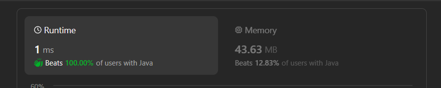

# ✅Beats 100% - Explained with [ Video ] - Hash Table - Interview Solution

**Author:** lancertech6
**Votes:** 96
**Link:** [https://leetcode.com/problems/redistribute-characters-to-make-all-strings-equal/solutions/4476317/](https://leetcode.com/problems/redistribute-characters-to-make-all-strings-equal/solutions/4476317/)

---



# YouTube Video Explanation:

[https://youtu.be/mLlal5Ujrl0](https://youtu.be/mLlal5Ujrl0)
<!-- **If you want a video for this question please write in the comments** -->

**\uD83D\uDD25 Please like, share, and subscribe to support our channel's mission of making complex concepts easy to understand.**

Subscribe Link: https://www.youtube.com/@leetlogics/?sub_confirmation=1

*Subscribe Goal: 1100 Subscribers*
*Current Subscribers: 1040*

---
# Intuition
<!-- Describe your first thoughts on how to solve this problem. -->
The problem is asking whether it is possible to make all strings in the given array equal by performing specific operations. The operations allow moving characters from one string to another.

# Approach
<!-- Describe your approach to solving the problem. -->
- First, we check if the length of the array is 1. If it is, all strings are already equal, so we return true.
- Calculate the total character count across all strings.
- If the total character count is not divisible by the number of strings, it is impossible to make them equal, so return false.
- Initialize an array `myMap` to count the occurrences of each character.
- Traverse all strings and update the character count in `myMap`.
- Check if each character count is divisible evenly by the number of strings. If any character count is not divisible, return false.
- If all checks pass, return true.

# Complexity
- Time complexity: The time complexity is O(N * M), where N is the number of strings and M is the average length of the strings. This is because we traverse each character in each string.
<!-- Add your time complexity here, e.g. $$O(n)$$ -->

- Space complexity: The space complexity is O(1) since the character count array has a constant size of 26 (assuming lowercase English letters).
<!-- Add your space complexity here, e.g. $$O(n)$$ -->

# Code
```java []
class Solution {
    public boolean makeEqual(String[] words) {
      if (words.length == 1) {
			return true;
		}
		int totalCharCount = 0;
		for (String s : words) {
			totalCharCount += s.length();
		}
		if (totalCharCount % words.length != 0) {
			return false;
		}

		int[] myMap = new int[26];
		for (String s : words) {
			for (char c : s.toCharArray()) {
				myMap[c - 'a']++;
			}
		}
		for (int i : myMap) {
			if (i % words.length != 0) {
				return false;
			}
		}
		return true; 
    }
}
```
```C++ []
class Solution {
public:
    bool makeEqual(vector<string>& words) {
        if (words.size() == 1) {
            return true;
        }

        int totalCharCount = 0;
        for (const string& s : words) {
            totalCharCount += s.length();
        }

        if (totalCharCount % words.size() != 0) {
            return false;
        }

        vector<int> myMap(26, 0);
        for (const string& s : words) {
            for (char c : s) {
                myMap[c - 'a']++;
            }
        }

        for (int i : myMap) {
            if (i % words.size() != 0) {
                return false;
            }
        }

        return true;
    }
};
```
```Python []
class Solution(object):
    def makeEqual(self, words):
        if len(words) == 1:
            return True

        total_char_count = sum(len(s) for s in words)

        if total_char_count % len(words) != 0:
            return False

        my_map = [0] * 26
        for s in words:
            for c in s:
                my_map[ord(c) - ord('a')] += 1

        for i in my_map:
            if i % len(words) != 0:
                return False

        return True
        
```
```JavaScript []
/**
 * @param {string[]} words
 * @return {boolean}
 */
var makeEqual = function(words) {
    if (words.length === 1) {
        return true;
    }

    let totalCharCount = 0;
    for (const s of words) {
        totalCharCount += s.length;
    }

    if (totalCharCount % words.length !== 0) {
        return false;
    }

    let myMap = new Array(26).fill(0);
    for (const s of words) {
        for (const c of s) {
            myMap[c.charCodeAt(0) - 'a'.charCodeAt(0)]++;
        }
    }

    for (const i of myMap) {
        if (i % words.length !== 0) {
            return false;
        }
    }

    return true;
};
```

