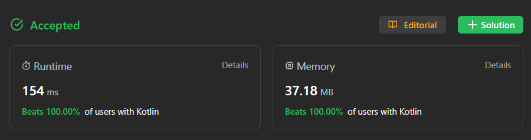

# Kotlin beats 100% 154 ms

**Author:** gotovk
**Votes:** 4
**Link:** [https://leetcode.com/problems/redistribute-characters-to-make-all-strings-equal/solutions/4477717/](https://leetcode.com/problems/redistribute-characters-to-make-all-strings-equal/solutions/4477717/)

---



# Complexity
- Time complexity: O(M*N)
<!-- Add your time complexity here, e.g. $$O(n)$$ -->

- Space complexity: O(1)
<!-- Add your space complexity here, e.g. $$O(n)$$ -->

# Code
```
class Solution {
    fun makeEqual(words: Array<String>): Boolean {
        val charCount = IntArray(26) // array a..z

    for (word in words) { // a loop for each word in words 
        for (char in word) { // loop for each character in word
            charCount[char - 'a']++ // add 1 to position of char in IntArray
        }
    }

    for (count in charCount) {
        if (count % words.size != 0) { // If count is not a multiple of the number of rows in the array -> false 
            return false
        }
    }
    return true
    }
}

```