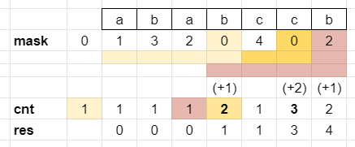

# Count bitmasks with picture

**Author:** votrubac
**Votes:** 203
**Link:** [https://leetcode.com/problems/number-of-wonderful-substrings/solutions/1299525/](https://leetcode.com/problems/number-of-wonderful-substrings/solutions/1299525/)

---

The idea is similar to:
- [1371. Find the Longest Substring Containing Vowels in Even Counts](https://leetcode.com/problems/find-the-longest-substring-containing-vowels-in-even-counts/discuss/534135/C%2B%2BJava-with-picture). 
- [1542. Find Longest Awesome Substring](https://leetcode.com/problems/find-longest-awesome-substring/discuss/779893/C%2B%2BJavaPython3-with-picture-(similar-to-1371))

We can track whether we have an odd (1) or even (0) number of characters using a bit mask. Every time we see a character - we just flip the corresponding bit. Unlike related problems listed above, where we track the minimum position for each bitmask, here we count how many times we arrived at that bitmask (`cnt[mask]`).



In the example above, we have four wonderful substrings: `abab`, `cc`, `ababcc` and `bccb`.

>For simplicity, we only show substrings with all even characters. We will look into counting substrings with one odd character below.

Say we arrive at bitmask `0000000001` at index `i`. That means that the count of all characters in `word[0..i]` is even except for `a`. What if we have seen this bitmask before at index `j`? Same, count for character `a` is odd in `word[0..j]`. Now, it tells us that the count for all characters in `word[j + 1, i]` is even... We have found a wonderful substring!

Final stretch - our substring can have up to one "odd" character. So we mutate our bitmask - one character at a time, and add the count for the mutated bitmask. The substring between the original and mutated mask will have a single "odd" character. In other words, XOR of these two masks will have one bit set.

> This is the same technique as we used in [1542. Find Longest Awesome Substring](https://leetcode.com/problems/find-longest-awesome-substring/discuss/779893/C%2B%2BJavaPython3-with-picture-(similar-to-1371)).

For example, for bitmask `0000000100` (or 4, which correspond to the first `c` in the example above), we will try:
1. `0000000101`
2. `0000000110`
3. `0000000000` -> this matches `ababc` substring in the example above.
4. `0000001100` 
	- and so on...

**C++**
Note that we run the count one more time for the original mask - the shift `1 << 11` is offset by `1023 &` operation.

```cpp
long long wonderfulSubstrings(string word) {
    long cnt[1024] = { 1 }, mask = 0, res = 0;
    for (auto ch : word) {
        mask ^= 1 << (ch - 'a');
        res += cnt[mask];
        for (auto n = 0; n < 10; ++n)
            res += cnt[mask ^ (1 << n)];
        ++cnt[mask];
    }
    return res;
}
```
**Java**
```java
public long wonderfulSubstrings(String word) {
    long cnt[] = new long[1024], res = 0;
    int mask = 0;
    cnt[0] = 1;
    for (var ch : word.toCharArray()) {
        mask ^= 1 << (ch - 'a');
        res += cnt[mask];
        for (var n = 0; n < 10; ++n)
            res += cnt[mask ^ (1 << n)];
        ++cnt[mask];
    }
    return res;
}
```
**Python 3**
```python
class Solution:
    def wonderfulSubstrings(self, word: str) -> int:
        cnt, res, mask = [1] + [0] * 1023, 0, 0
        for ch in word:
            mask ^= 1 << (ord(ch) - ord('a'))
            res += cnt[mask]
            for n in range(10):
                res += cnt[mask ^ 1 << n];
            cnt[mask] += 1
        return res
```