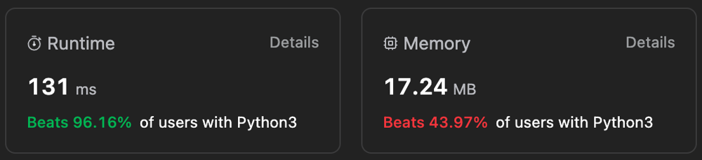

# ✅ Beats 96.16% 🔥 || Easiest Approach 🚀 || ⭐️ Beginner Friendly Explanation

**Author:** Gourav-2002
**Votes:** 15
**Link:** [https://leetcode.com/problems/unique-length-3-palindromic-subsequences/solutions/4285483/](https://leetcode.com/problems/unique-length-3-palindromic-subsequences/solutions/4285483/)

---



# Intuition:
**Here we have to find out the number of palindromic subsequences of length 3 in the given string. So we can iterate over all the characters and find the first and last occurrence of each character.  Then we can find the number of unique characters between the first and last occurrence of each character.  This will give us the number of palindromic subsequences of length 3 with the character as the middle character.  We can do this for all the characters and add the counts to get the final answer.**

# How does it work?
Let's take an example string "aabca".  We can see that the first occurrence of 'a' is at index 0 and the last occurrence is at index 3 which means that there are 2 unique characters between the first and last occurrence of 'a' which are 'b' and 'c'.  So there are 2 palindromic subsequences of length 3 with 'a' as the middle character.  How did we get this?  We can see that there are 2 palindromic subsequences of length 3 with 'a' as the middle character which are "aba" and "aca".  We have to take substing so we can skip the character that doesn't need to be included in the subsequence.  So we can skip the first occurrence of 'a' and the last occurrence of 'a' and take the substring between them which is "abc".  Now we can find the number of unique characters in this substring which are 'b' and 'c'.  So there are 2 palindromic subsequences of length 3 with 'a' as the middle character.
What if our string is "abshlfksna", here the first occurrence of a is at 0 index and last is at 8th idex, so it is very obvious that we can make palindrome with all the unique characters between these 2 indexes like: "aba", "asa", "aha" and for all the unique characters we can make palindrome with the middle character as 'a'. So we can say that the number of palindromic subsequences of length 3 with 'a' as the middle character is equal to the number of unique characters between the first and last occurrence of 'a'.  We can do this for all the characters and add the counts to get the final answer.

# Approach: Using two pointers
1. Here we initialize a count variable to 0 which will store the final answer.
2. We iterate over all the characters of the string and find the first and last occurrence of each character.
3. Then we find the number of unique characters between the first and last occurrence of each character.
4. We add the count to the final answer.
5. We return the final answer.

# Complexity Analysis:
- Time Complexity: **O(N)** where N is the length of the string
- Space Complexity: **O(1)** since we are using constant space
# Code
``` Python []
class Solution:
    def countPalindromicSubsequence(self, s: str) -> int:
        
        count = 0
        for i in range(26):
            l, r = s.find(chr(i + 97)), s.rfind(chr(i + 97))
            if l != -1 and r != -1:
                count += len(set(s[l + 1:r]))
        return count
```
``` C++ []
#include <iostream>
#include <string>
#include <unordered_set>

class Solution {
public:
    int countPalindromicSubsequence(std::string s) {
        int count = 0;
        for (int i = 0; i < 26; ++i) {
            char currentChar = static_cast<char>(i + 97);
            int l = s.find(currentChar);
            int r = s.rfind(currentChar);
            if (l != -1 && r != -1 && l < r) {
                count += std::unordered_set<char>(s.begin() + l + 1, s.begin() + r).size();
            }
        }
        return count;
    }
};
```
``` Java []
public class Solution {
    public int countPalindromicSubsequence(String s) {
        int count = 0;
        for (int i = 0; i < 26; ++i) {
            char currentChar = (char) (i + 97);
            int l = s.indexOf(currentChar);
            int r = s.lastIndexOf(currentChar);
            if (l != -1 && r != -1 && l < r) {
                count += new HashSet<>(s.substring(l + 1, r).chars().boxed().collect(Collectors.toList())).size();
            }
        }
        return count;
    }
}

```
``` C# []
public class Solution {
    public int CountPalindromicSubsequence(string s) {
        int count = 0;
        for (int i = 0; i < 26; ++i) {
            char currentChar = (char)(i + 97);
            int l = s.IndexOf(currentChar);
            int r = s.LastIndexOf(currentChar);
            if (l != -1 && r != -1 && l < r) {
                count += new HashSet<char>(s.Substring(l + 1, r - l - 1)).Count;
            }
        }
        return count;
    }
}
```
``` JavaScript []
/**
 * @param {string} s
 * @return {number}
 */
var countPalindromicSubsequence = function(s) {
    let count = 0;
    for (let i = 0; i < 26; ++i) {
        let currentChar = String.fromCharCode(i + 97);
        let l = s.indexOf(currentChar);
        let r = s.lastIndexOf(currentChar);
        if (l !== -1 && r !== -1 && l < r) {
            count += new Set(s.substring(l + 1, r)).size;
        }
    }
    return count;
};
```
``` TypeScript []
function countPalindromicSubsequence(s: string): number {
    let count = 0;
    for (let i = 0; i < 26; ++i) {
        let currentChar = String.fromCharCode(i + 97);
        let l = s.indexOf(currentChar);
        let r = s.lastIndexOf(currentChar);
        if (l !== -1 && r !== -1 && l < r) {
            count += new Set(s.substring(l + 1, r)).size;
        }
    }
    return count;
}
```
``` PHP []
class Solution {

    /**
     * @param String $s
     * @return Integer
     */
    function countPalindromicSubsequence($s) {
        $count = 0;
        for ($i = 0; $i < 26; ++$i) {
            $currentChar = chr($i + 97);
            $l = strpos($s, $currentChar);
            $r = strrpos($s, $currentChar);
            if ($l !== false && $r !== false && $l < $r) {
                $count += count(array_unique(str_split(substr($s, $l + 1, $r - $l - 1))));
            }
        }
        return $count;
    }
}
```
``` Ruby []
# @param {String} s
# @return {Integer}
def count_palindromic_subsequence(s)
    count = 0
    for i in 0...26
        current_char = (i + 97).chr
        l = s.index(current_char)
        r = s.rindex(current_char)
        if l && r && l < r
            count += s[l + 1...r].chars.uniq.size
        end
    end
    return count
end
```

## \uD83D\uDC47 Please UpVote\u2B06\uFE0F If this was beneficial for you:)