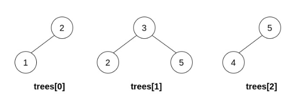
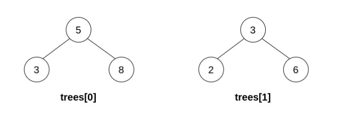

# Just do what is says | Explained the approach in detail | Time complexity : O(n) | ✅

**Author:** ayushab2002
**Votes:** 12
**Link:** [https://leetcode.com/problems/merge-bsts-to-create-single-bst/solutions/3537226/](https://leetcode.com/problems/merge-bsts-to-create-single-bst/solutions/3537226/)

---

# Approach : 
Time complexity : $$O(n)$$

So, first I have inserted all the leaf nodes to parent <key,value> pairs are stored. 



The the unordered map is stored to get the root of the tree having leaf value same as root2->val
Here in the image, 2 is root2 (tree[0]) and then I will find the root of the tree having a leaf node value as 2. So using unordered_map it becomes easy to find. So while searching I get the TreeNode* 3 (i.e. the root of leaf node value == 2)

### Joining Part   : 

So to join a bst 1 to another bst 2, i will check if I'm adding the bst1 to left of bst2, then I have to check if the right of bst1 if smaller than root value, if it is smaller then add the bst1 to bst2 or else return NULL.

##### So in the Above example : 
Taking (tree[0] and tree[1]) into consideration, tree[0] will be added to left of tree[1]. So I check if the right value of right of 2 is smaller than 3 (ie the root of tree[1]), here it does not exist so then add the tree[0] to tree[1].

##### Below example : 
Taking (tree[0] and tree[1]) into consideration, tree[1] will be added to left of tree[0].
So I check if the right value of right of 3 (tree[1]) is smaller than 5 (ie the root of tree[1]), here the value if 6>5, so return NULL




###### Similarly, do the checks while adding the bst to right, check if the value of bst1's left is greater than the root of bst2.

And then finally after connecting the trees, check if there is only 1 single connected tree or not. If there is only one connected tree, then just check if it is a valid bst.

# Code
```
// Here mp is the unordered_map where the leaf to parent is stored


class Solution {
public:
    bool isBSTHelper(TreeNode* root, long minVal, long maxVal) {
        if (root == NULL) return true;
        if(root->val <= minVal || root->val >= maxVal) return false;
        return isBSTHelper(root->left, minVal, root->val) && isBSTHelper(root->right, root->val, maxVal);
    }
    TreeNode* canMerge(vector<TreeNode*>& trees) {
        unordered_map<int, TreeNode*> mp;
//  trees -> parent
        unordered_map<TreeNode*,TreeNode*> par;
        // inserting values in parent
        for(auto t : trees){
            par[t] = t;
        }
        
        // inserting the values in mp
        for(int i =0; i< trees.size(); i++){
            TreeNode* tmp = trees[i];
            if(tmp->left){ 
                if(mp.find(tmp->left->val) == mp.end())
                    mp[tmp->left->val] = tmp;
                else return NULL;
            }
            if(tmp->right){ 
                if(mp.find(tmp->right->val) == mp.end())
                    mp[tmp->right->val] = tmp;
                else return NULL;
            }
        }
        for(int i = 0; i< trees.size(); i++){
            TreeNode* tmp = trees[i];
            if(mp.find(tmp->val) != mp.end()){
                TreeNode* root = mp[tmp->val];
                if(root->right && root->right->val == tmp->val){
                    int check = INT_MAX;
                    if(tmp->left){
                        check = tmp->left->val;
                    }
                    if(check > root->val){
                        root->right = tmp;
                        par[tmp] = par[root];
                        mp.erase(tmp->val);
                    }else{
                        return NULL;
                    }
                }
                else if(root->left && root->left->val == tmp->val){
                    int check = 0;
                    if(tmp->right){
                        check = tmp->right->val;
                    }
                    if(check< root->val){
                        root->left = tmp;
                        par[tmp] = par[root];
                        mp.erase(tmp->val);
                    }else{
                        return NULL;
                    }
                }
            }
        }
        vector<TreeNode*> ans;
        for(auto t : par){
            if(t.first == t.second){
                ans.push_back(t.first);
            }
        }
        if(ans.size() == 1){ 
            if(isBSTHelper(ans[0],LONG_MIN, LONG_MAX))
                return ans[0];
        }
        return NULL;
    }
};
```
###### Please upvote \uD83E\uDD79 !