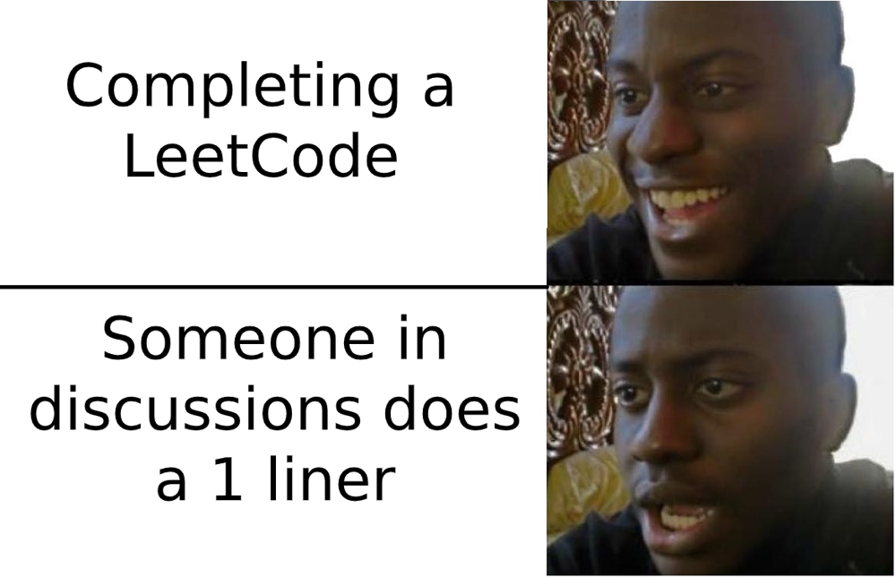

# one Liner

**Author:** Sajal_
**Votes:** 2
**Link:** [https://leetcode.com/problems/check-if-all-characters-have-equal-number-of-occurrences/solutions/5035005/](https://leetcode.com/problems/check-if-all-characters-have-equal-number-of-occurrences/solutions/5035005/)

---



# Code
```
class Solution:
    def areOccurrencesEqual(self, s: str) -> bool:
        return len(set(Counter(s).values()))==1
        
```

