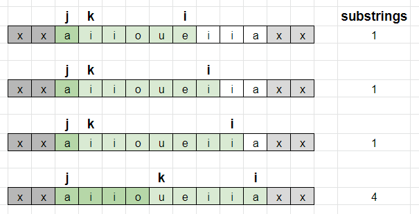

# Sliding Window

**Author:** votrubac
**Votes:** 214
**Link:** [https://leetcode.com/problems/count-vowel-substrings-of-a-string/solutions/1563737/](https://leetcode.com/problems/count-vowel-substrings-of-a-string/solutions/1563737/)

---

I spent more time on this problem than on medium/hard problems in the contest.

Brute-force would do for `100` characters (since it's an easy problem), but I wanted to solve it efficiently.

`j` marks the start of an "all-vowel" substring. We advance `j` every time we see a consonant.

`i` is the current position, and `k` indicates the smallest window with all 5 vowels. 

> Note that we use a trick to move `k` one step forward, so the smallest window is actually `[k - 1, j]`. 
> This is just to simplify the calculation, so that `k - j == 1` when we find the first vowel substring.

So, for each position `i`, we have `k - j` valid substrings. The picture below demonstrate it for `"xxaiioueiiaxx"` test case:



**C++**
```cpp
int countVowelSubstrings(string w) {
    int vow = 0, cnt = 0, m[123] = {};
    string vowels("aeiou");
    for (int i = 0, j = 0, k = 0; i < w.size(); ++i) {
        if (vowels.find(w[i]) != string::npos) {
            vow += ++m[w[i]] == 1;
            for (; vow == 5; ++k)
                vow -= --m[w[k]] == 0;
            cnt += k - j;
        }
        else {
            m['a'] = m['e'] = m['i'] = m['o'] = m['u'] = vow = 0;
            j = k = i + 1;
        }
    }
    return cnt;
}
```