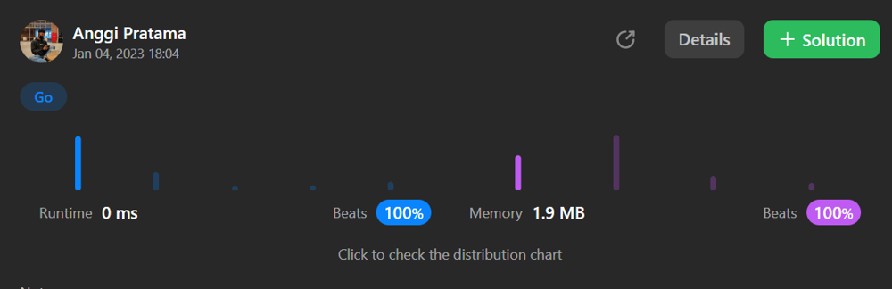

# Golang 0ms, and 100% memory 1,9 and easy you understand

**Author:** Orcaa
**Votes:** 2
**Link:** [https://leetcode.com/problems/rings-and-rods/solutions/2997555/](https://leetcode.com/problems/rings-and-rods/solutions/2997555/)

---

# Code

```
//example 1, 0ms 100% memory
func countPoints(rings string) int {
    rod := make(map[string]string)
    
    for i := 0; i < len(rings); i += 2{
        s1 := string(rings[i])
        s2 := string(rings[i+1])
        rod[s2] += s1
    }

    count := 0
    for _, v := range rod {
        if Unique(v) == "BGR" {
            count++
        }
    }

    return count;
}

func Unique(s string) string{
    arr := make([]int, 26)

    str := ""
    for _, n := range s { arr[n - 'A'] = 1}

    for i, n := range arr{
        if n != 0 {
            str += string(i + 'A')
        }
    }
    
    return str
}

//Simple solution exampel 2 versi update new : 

func countPoints(rings string) int {
    rod := make(map[string]map[string]int)
    sum := 0
    for i := 0; i < len(rings); i += 2{
        if rod[string(rings[i+1])] == nil {
            rod[string(rings[i+1])] = make(map[string]int)
        }
        rod[string(rings[i+1])][string(rings[i])]++
        if len(rod[string(rings[i+1])]) == 3 {
            if rod[string(rings[i+1])][string(rings[i])] <= 1 {
                sum++
            }
        }
    }
    
    return sum;
}

```