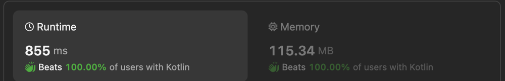

# Kotlin. TreeSet. Beats 100%

**Author:** anton-pogonets
**Votes:** 0
**Link:** [https://leetcode.com/problems/design-video-sharing-platform/solutions/5269788/](https://leetcode.com/problems/design-video-sharing-platform/solutions/5269788/)

---



# Complexity
- Time complexity: $$O(log(n))$$
- Space complexity: $$O(n)$$

# Code
```
class VideoSharingPlatform() {

    class Video(
        val payload: String,
        var likes: Int = 0,
        var dislikes: Int = 0,
        var views: Int = 0
    )

    val videos = ArrayList<Video?>()
    val removed = TreeSet<Int>()

    fun upload(video: String): Int {
        if (removed.isNotEmpty()) {
            val id = removed.pollFirst()!!
            videos[id] = Video(video)
            return id
        }
        
        videos += Video(video)
        return videos.lastIndex
    }

    fun remove(videoId: Int) {
        if (videoId in videos.indices) {
            videos[videoId] = null
            removed += videoId
        }
    }

    fun watch(videoId: Int, startMinute: Int, endMinute: Int): String {
        val video = videoById(videoId) ?: return "-1"
        video.views++
        val payload = video.payload
        return payload.substring(startMinute, minOf(endMinute + 1, payload.length))
    }

    fun like(videoId: Int) {
        val video = videoById(videoId) ?: return
        video.likes++
    }

    fun dislike(videoId: Int) {
        val video = videoById(videoId) ?: return
        video.dislikes++
    }

    fun getLikesAndDislikes(videoId: Int): IntArray {
        val video = videoById(videoId) ?: return intArrayOf(-1)
        return intArrayOf(video.likes, video.dislikes)
    }

    fun getViews(videoId: Int): Int {
        val video = videoById(videoId) ?: return -1
        return video.views
    }

    private fun videoById(videoId: Int): Video? {
        if (videoId in videos.indices) {
            return videos[videoId]
        }

        return null
    }

}