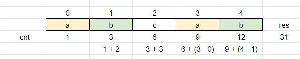

# DP

**Author:** votrubac
**Votes:** 287
**Link:** [https://leetcode.com/problems/total-appeal-of-a-string/solutions/1996203/](https://leetcode.com/problems/total-appeal-of-a-string/solutions/1996203/)

---

> Note: there is even a simpler [combinatorics solution](https://leetcode.com/problems/total-appeal-of-a-string/discuss/1999226/Combinatorics), proposed by [geekykant](https://leetcode.com/geekykant/).

What is the appeal of all substrings that end at `i`-th position?
- It is the same as the appeal of all substrings that end at `i - 1` position, plus: 
- number of substrings (ending at `i`-th position) that do not contain `s[i]` character.
	- to count those substrings, we just track the previous (`prev`) position of `s[i]` character.



**C++**
Since we initialize `last` with zero, we need to do `+ 1` 
```cpp
long long appealSum(string s) {
    long long res = 0, cur = 0, prev[26] = {};
    for (int i = 0; i < s.size(); ++i) {
        cur += i + 1 - prev[s[i] - 'a'];
        prev[s[i] - 'a'] = i + 1;
        res += cur;
    }
    return res;
}
```
**Python 3**
```python
class Solution:
    def appealSum(self, s: str) -> int:
        res, cur, prev = 0, 0, defaultdict(lambda: -1)
        for i, ch in enumerate(s):
            cur += i - prev[ch]
            prev[ch] = i
            res += cur
        return res  
```
**Java**
```java
public long appealSum(String s) {
    long res = 0, cur = 0, prev[] = new long[26];
    for (int i = 0; i < s.length(); ++i) {
        cur += i + 1 - prev[s.charAt(i) - 'a'];
        prev[s.charAt(i) - 'a'] = i + 1;
        res += cur;
    }    
    return res;
}
```