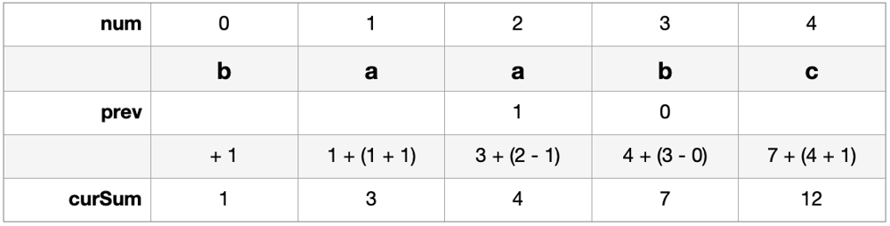

# Simple & Fast Solution [Swift]

**Author:** Anastasia1944
**Votes:** 0
**Link:** [https://leetcode.com/problems/total-appeal-of-a-string/solutions/4973175/](https://leetcode.com/problems/total-appeal-of-a-string/solutions/4973175/)

---

# Intuition
Each iteration we add all possible combinations with previous elements.

# Example 
Input `s = "baabc"`



Then `answer = 1 + 3 + 4 + 7 + 12 = 27`

If element has `prev` element we substract from num this `prev` and add to `curSum`.
If element has no `prev` element we add `num + 1` to `curSum`.


# Complexity
- Time complexity:
$$O(n)$$

- Space complexity:
$$O(1)$$

# Code
```
class Solution {
    func appealSum(_ s: String) -> Int {
        var prev: [Character: Int] = [:]
        var curSum = 0
        var answer = 0

        for (num, char) in s.enumerated() {
            curSum += num - (prev[char] ?? -1)
            prev[char] = num
            answer += curSum
        }

        return answer
    }
}
```