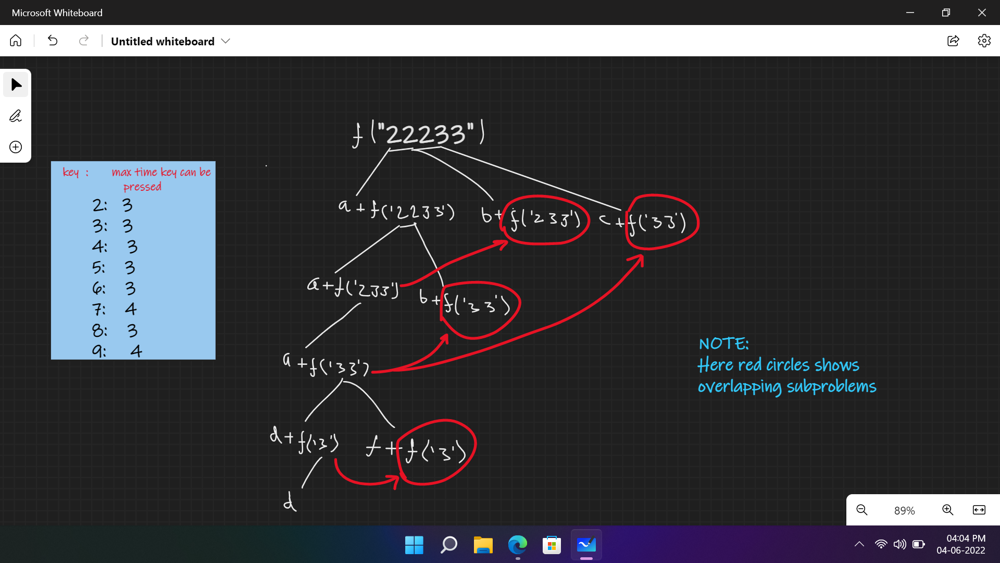

# Very detailed recursive tree diagram with decent intuition {C++ memorized code}

**Author:** yashrajyash
**Votes:** 46
**Link:** [https://leetcode.com/problems/count-number-of-texts/solutions/2109592/](https://leetcode.com/problems/count-number-of-texts/solutions/2109592/)

---

# Count Number of Texts

***Intuition***
* As we know in feature phones, numbers (2, 3, 4, 5, 6, 8) have maximum 3 characters while (7 and 9) have 4 characters.
* So if we encountered same key press again in input then we have 2 choices either we can take it as single key press (take 1st letter of that pressed number) and move on or we can say that  a previously pressed number tapped again (if a same key pressed again then we take the next letter which is embedded to that number key).
***Example***
	* Let's say we have input "22223"
       * if we consider every number was pressed once then the output word would be "aaaad".
       * if we consider that 2 was pressed twice at same time then the output word would be "baac".
       * if we say 2 pressed thrice then, we'll get "cab" as the output
       * (**note**) This time we can't take four 2s at same time because we know, we can only get a letter from number key 2 when it gets pressed once (a), twice(b) & thrice(c). Therefore the 4th keypress (2) considered as first tap & the keypress gives 'a'.
  * **Please refer to the below recursive tree diagram for better understanding.**
<br>


***Please Upvote if you like the post*** \u2B06\uFE0F

**Recursion [TLE]**

```
class Solution {
public:
    int mod = 1e9+7;
    int solve(string &str, int idx) {
        if(idx == str.length()) return 1;
        int maxKeyPress = (str[idx] == '7' || str[idx] == '9') ? 4 : 3;
        long long currIndex = idx, pressFrequency = 1, ans = 0;
        while(pressFrequency <= maxKeyPress && str[currIndex] == str[idx]) {
            ++currIndex;
            ++pressFrequency;
            ans += solve(str, currIndex) % mod;
        }
        return ans%mod;
    }
    int countTexts(string pressedKeys) {
        return solve(pressedKeys, 0) % mod;
    }
};
```

**Recursion + Memoization [#ACCEPTED]**
*TC : O(N) & SC: O(N), where N is input string length*

```
class Solution {
public:
    int dp[100005];
    int mod = 1e9+7;
    int solve(string &str, int idx) {
        if(idx == str.length()) return 1;
        if(dp[idx] != -1) return dp[idx];
        int maxKeyPress = (str[idx] == '7' || str[idx] == '9') ? 4 : 3;
        long long currIndex = idx, pressFrequency = 1, ans = 0;
        while(pressFrequency <= maxKeyPress && str[currIndex] == str[idx]) {
            ++currIndex;
            ++pressFrequency;
            ans += solve(str, currIndex) % mod;
        }
        return dp[idx] = ans%mod;
    }
    int countTexts(string pressedKeys) {
        memset(dp, -1, sizeof(dp));
        return solve(pressedKeys, 0) % mod;
    }
};
```

Thanks to [@aman-Raj](https://leetcode.com/aman-raj/) & [@anishakd](https://leetcode.com/anishakd/) for helping in recursive tree diagram \u2764\uFE0F.