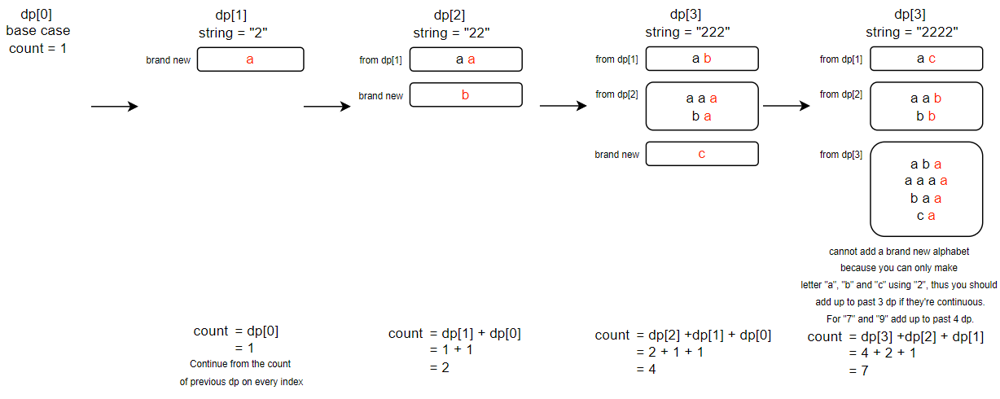
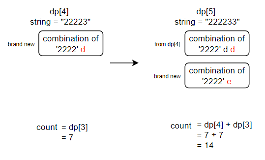

# Python | DP with diagrams for beginners

**Author:** owen1605
**Votes:** 24
**Link:** [https://leetcode.com/problems/count-number-of-texts/solutions/2018336/](https://leetcode.com/problems/count-number-of-texts/solutions/2018336/)

---

I have created some diagrams to help learners better understand how the dp works.
We create ```dp = [1] + [0] * len(pressedKeys)``` for dp[0] to become a "base case". 
At each continuous number, we append the appropriate letter to reach the "required length".
Take string "222233" as an example:



Same concept applies when moving to next different number:



```
class Solution(object):
    def countTexts(self, pressedKeys):
        """
        :type pressedKeys: str
        :rtype: int
        """
        dp = [1] + [0]*len(pressedKeys)
        mod = 10**9 + 7
        for i, n in enumerate(pressedKeys):
            dp[i+1] = dp[i]
            # check if is continous
            if i >= 1 and pressedKeys[i-1] == n:
                dp[i+1] += dp[i-1]
                dp[i+1] %= mod
                if i >= 2 and pressedKeys[i-2] == n:
                    dp[i+1] += dp[i-2]
                    dp[i+1] %= mod
                    # Special case for '7' and '9' that can have 4 characters combination
                    if i >= 3 and pressedKeys[i-3] == n and (n == "7" or n == "9"):
                        dp[i+1] += dp[i-3]
                        dp[i+1] %= mod
        return dp[-1]
```
Code can be further optimized.
Inspired from https://leetcode.com/problems/count-number-of-texts/discuss/2017760/JavaPython-3-Time-O(n)-space-O(1)-1-pass-DP-codes .


