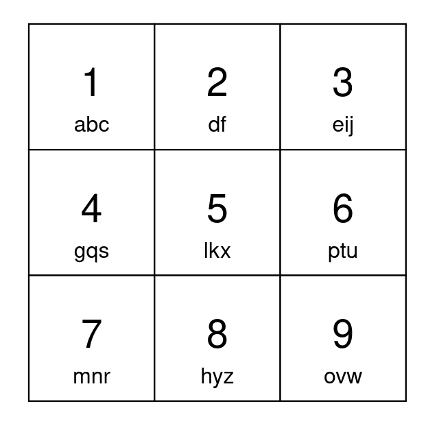
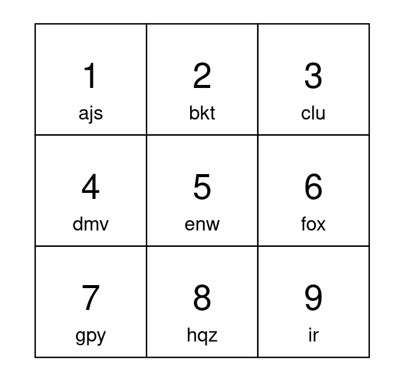

# [2268. Minimum Number of Keypresses](https://leetcode.com/problems/minimum-number-of-keypresses/)

| Category | Difficulty | Likes | Dislikes |
| :------: | :--------: | :---: | :------: |
| Algorithms | Medium | 250 | 39 |

**Tags:** [`hash-table`](https://leetcode.com/tag/hash-table), [`string`](https://leetcode.com/tag/string), [`greedy`](https://leetcode.com/tag/greedy), [`sorting`](https://leetcode.com/tag/sorting), [`counting`](https://leetcode.com/tag/counting)

**Companies:** `amazon`

## Description

You have a keypad with `9` buttons, numbered from `1` to `9`, each mapped to lowercase English letters. You can choose which characters each button is matched to as long as:

	- All 26 lowercase English letters are mapped to.

	- Each character is mapped to by **exactly** `1` button.

	- Each button maps to **at most** `3` characters.

To type the first character matched to a button, you press the button once. To type the second character, you press the button twice, and so on.

Given a string `s`, return *the **minimum** number of keypresses needed to type *`s`* using your keypad.*

**Note** that the characters mapped to by each button, and the order they are mapped in cannot be changed.

 

**Example 1:**


```

Input: s = &quot;apple&quot;
Output: 5
Explanation: One optimal way to setup your keypad is shown above.
Type &#39;a&#39; by pressing button 1 once.
Type &#39;p&#39; by pressing button 6 once.
Type &#39;p&#39; by pressing button 6 once.
Type &#39;l&#39; by pressing button 5 once.
Type &#39;e&#39; by pressing button 3 once.
A total of 5 button presses are needed, so return 5.

```

**Example 2:**


```

Input: s = &quot;abcdefghijkl&quot;
Output: 15
Explanation: One optimal way to setup your keypad is shown above.
The letters &#39;a&#39; to &#39;i&#39; can each be typed by pressing a button once.
Type &#39;j&#39; by pressing button 1 twice.
Type &#39;k&#39; by pressing button 2 twice.
Type &#39;l&#39; by pressing button 3 twice.
A total of 15 button presses are needed, so return 15.

```

 

**Constraints:**

	- `1 <= s.length <= 10^5`

	- `s` consists of lowercase English letters.

---

**Links:** [Submissions](https://leetcode.com/problems/minimum-number-of-keypresses/) | [Solutions](https://leetcode.com/problems/minimum-number-of-keypresses/)
