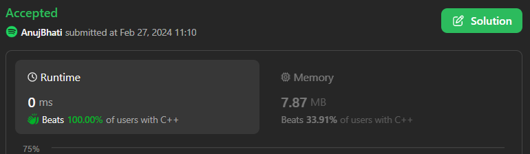
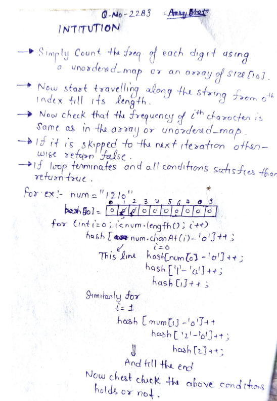

# ✨🔥💫Here it's my 9 Languages💯Faster ☠ Easy 🧠W/Explanation with Images Beats 100☠🎉🎊✅✅✅

**Author:** Edwards310
**Votes:** 4
**Link:** [https://leetcode.com/problems/check-if-number-has-equal-digit-count-and-digit-value/solutions/4788538/](https://leetcode.com/problems/check-if-number-has-equal-digit-count-and-digit-value/solutions/4788538/)

---

# Intuition





```javascript []
/**
 * @param {string} num
 * @return {boolean}
 */
var digitCount = function (num) {
    const arr = Array(num.length).fill(0)
    for (let elem of num) {
        arr[elem]++
    }
    return arr.join('') == num
};
```
```C []
bool digitCount(char* num) {
    int arr[10] = {};
    for (int i = 0; num[i] != '\\0'; i++)
        arr[num[i] - '0']++;
    for (int i = 0; i < strlen(num); ++i) {
        int x = num[i] - '0';
        if (arr[i] == x)
            continue;
        else
            return false;
    }
    return true;
}
```
```python3 []
class Solution:
    def digitCount(self, num: str) -> bool:
        for i in range(len(num)):
            if int(num[i]) != num.count(str(i)):
                return False
        return True
```
```C++ []
class Solution {
public:
    bool digitCount(string num) {
        unordered_map<int, int> mp;
        for (auto& x : num)
            mp[x - '0']++;
        for (int i = 0; i < num.length(); ++i) {
            if (mp[i] == num.at(i) - '0')
                continue;
            else
                return false;
        }
        return true;
    }
};
```
```Typescript []
function digitCount(num: string): boolean {
    const arr = Array(num.length).fill(0);
    for (const char of num)
        arr[Number(char)]++;
    
    return arr.join('') === num;
};
```
```python []
class Solution(object):
    def digitCount(self, num):
        """
        :type num: str
        :rtype: bool
        """
        list = [0] * 10
        for n in num:
            list[int(n)] += 1
        
        for i in range(0, len(num)):
            if list[i] == int(num[i]):
                continue
            else:
                return False
        return True


        
```
```Java []
class Solution {
    public boolean digitCount(String num) {
        int[] hash = new int[10];
        for (int i = 0; i < num.length(); i++)
            hash[num.charAt(i) - '0']++;
        for (int i = 0; i < num.length(); ++i) {
            if (hash[i] == num.charAt(i) - '0')
                continue;
            else
                return false;
        }
        return true;
    }
}
```
``` C# []
public class Solution {
    public bool DigitCount(string num) {
        int []arr = new int[10];
        for (int i = 0; i < num.Length; i++)
            arr[num[i] - '0']++;
        for (int i = 0; i < num.Length; ++i) {
            if (arr[i] == num[i] - '0')
                continue;
            else
                return false;
        }
        return true;
    }
}
```
<!-- Describe your first thoughts on how to solve this problem. -->

# Approach
<!-- Describe your approach to solving the problem. -->

# Complexity
- Time complexity:
<!-- Add your time complexity here, e.g. $$O(n)$$ -->
     O(n) --> n = string length
- Space complexity:
<!-- Add your space complexity here, e.g. $$O(n)$$ -->
     O(26) --> O(1)
# Code
```
/**
 * @param {string} num
 * @return {boolean}
 */
var digitCount = function (num) {
    const arr = Array(num.length).fill(0)
    for (let elem of num) {
        arr[elem]++
    }
    return arr.join('') == num
};
```
# It's very easy and usefl solution for all of you to understand .. so please upvote

