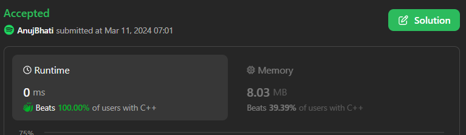

# Easy 6 different ways in 5 lang, beats 100%

**Author:** Edwards310
**Votes:** 3
**Link:** [https://leetcode.com/problems/rearrange-characters-to-make-target-string/solutions/4856882/](https://leetcode.com/problems/rearrange-characters-to-make-target-string/solutions/4856882/)

---

# Intuition


``` C++ []
class Solution {
public:
    int rearrangeCharacters(string s, string t) {
        unordered_map<char, int> mp_s, mp_t;
        int mini = INT_MAX;
        for (auto& x : s)
            mp_s[x]++;
        for (auto& x : t)
            mp_t[x]++;
        for (auto& y : t) {
            int how = mp_s[y] / mp_t[y];
            mini = min(mini, how);
        }
        return mini;
    }
};
```
```python3 []
class Solution:
    def rearrangeCharacters(self, s: str, target: str) -> int:
        counter_s = Counter(s)        
        return min(counter_s[c] // count for c,count in Counter(target).items())
```
```C []
int rearrangeCharacters(char* s, char* target) {
    int alphacnt[26] = {};
    for (int i = 0; s[i] != '\\0'; i++)
        alphacnt[s[i] - 'a']++;
    for (int cnt = 0; true; cnt++) {
        for (int k = 0; target[k] != '\\0'; k++) {
            alphacnt[target[k] - 'a']--;
            if (alphacnt[target[k] - 'a'] < 0)
                return cnt;
        }
    }
    return 1;
}
```
```java []
class Solution {
    public int rearrangeCharacters(String s, String target) {
        int[] freq = new int[26], freq2 = new int[26];
        for (char ch : s.toCharArray())
            freq[ch - 'a']++;
        for (char ch : target.toCharArray())
            freq2[ch - 'a']++;

        int min = Integer.MAX_VALUE;
        for (char ch : target.toCharArray())
            min = Math.min(min, freq[ch - 'a'] / freq2[ch - 'a']);

        return min;
    }
}
```
```python []
class Solution(object):
    def rearrangeCharacters(self, s, target):
        """
        :type s: str
        :type target: str
        :rtype: int
        """
        d_ch = Counter(s)
        d_target = Counter(target)
        counter = 0
        while True:
            d_ch.subtract(d_target)
            
            if min(d_ch.values()) >= 0:
                counter += 1
            else:
                return counter
```
```Python []
class Solution(object):
    def rearrangeCharacters(self, s, target):
        """
        :type s: str
        :type target: str
        :rtype: int
        """
        dict_s = {}
        dict_t = {}
        output = []
    
        for c in s:
            dict_s[c] = dict_s.get(c, 0) + 1

        for w in target:
            dict_t[w] = dict_t.get(w, 0) + 1

        for x in dict_t:
            if x in dict_s:
                a = dict_s[x] // dict_t[x]
                output.append(a)
            else:
                return 0

        return min(output)
```
<!-- Describe your first thoughts on how to solve this problem. -->

# Approach
<!-- Describe your approach to solving the problem. -->

# Complexity
- Time complexity:
<!-- Add your time complexity here, e.g. $$O(n)$$ -->
    O(n)
- Space complexity:
<!-- Add your space complexity here, e.g. $$O(n)$$ -->
     O(n)
# Code
```
class Solution {
    public int rearrangeCharacters(String s, String target) {
        int[] freq = new int[26], freq2 = new int[26];
        for (char ch : s.toCharArray())
            freq[ch - 'a']++;
        for (char ch : target.toCharArray())
            freq2[ch - 'a']++;

        int min = Integer.MAX_VALUE;
        for (char ch : target.toCharArray())
            min = Math.min(min, freq[ch - 'a'] / freq2[ch - 'a']);

        return min;
    }
}
```