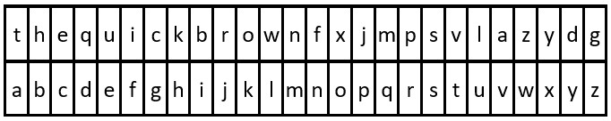

# [2325. Decode the Message](https://leetcode.com/problems/decode-the-message/)

| Category | Difficulty | Likes | Dislikes |
| :------: | :--------: | :---: | :------: |
| Algorithms | Easy | 1114 | 112 |

**Tags:** [`hash-table`](https://leetcode.com/tag/hash-table), [`string`](https://leetcode.com/tag/string)

**Companies:** `facebook`, `google`, `amazon`, `tesla`, `coinbase`

## Description

You are given the strings `key` and `message`, which represent a cipher key and a secret message, respectively. The steps to decode `message` are as follows:

	- Use the **first** appearance of all 26 lowercase English letters in `key` as the **order** of the substitution table.

	- Align the substitution table with the regular English alphabet.

	- Each letter in `message` is then **substituted** using the table.

	- Spaces `' '` are transformed to themselves.

	- For example, given `key = "happy boy"` (actual key would have **at least one** instance of each letter in the alphabet), we have the partial substitution table of (`'h' -> 'a'`, `'a' -> 'b'`, `'p' -> 'c'`, `'y' -> 'd'`, `'b' -> 'e'`, `'o' -> 'f'`).

Return *the decoded message*.

 

**Example 1:**


```

Input: key = &quot;the quick brown fox jumps over the lazy dog&quot;, message = &quot;vkbs bs t suepuv&quot;
Output: &quot;this is a secret&quot;
Explanation: The diagram above shows the substitution table.
It is obtained by taking the first appearance of each letter in &quot;the quick brown fox jumps over the lazy dog&quot;.

```

**Example 2:**


```

Input: key = &quot;eljuxhpwnyrdgtqkviszcfmabo&quot;, message = &quot;zwx hnfx lqantp mnoeius ycgk vcnjrdb&quot;
Output: &quot;the five boxing wizards jump quickly&quot;
Explanation: The diagram above shows the substitution table.
It is obtained by taking the first appearance of each letter in &quot;eljuxhpwnyrdgtqkviszcfmabo&quot;.

```

 

**Constraints:**

	- `26 <= key.length <= 2000`

	- `key` consists of lowercase English letters and `' '`.

	- `key` contains every letter in the English alphabet (`'a'` to `'z'`) **at least once**.

	- `1 <= message.length <= 2000`

	- `message` consists of lowercase English letters and `' '`.

---

**Links:** [Submissions](https://leetcode.com/problems/decode-the-message/) | [Solutions](https://leetcode.com/problems/decode-the-message/)
